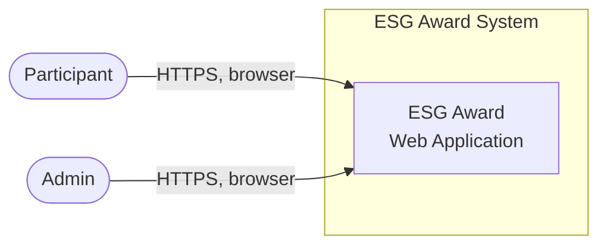
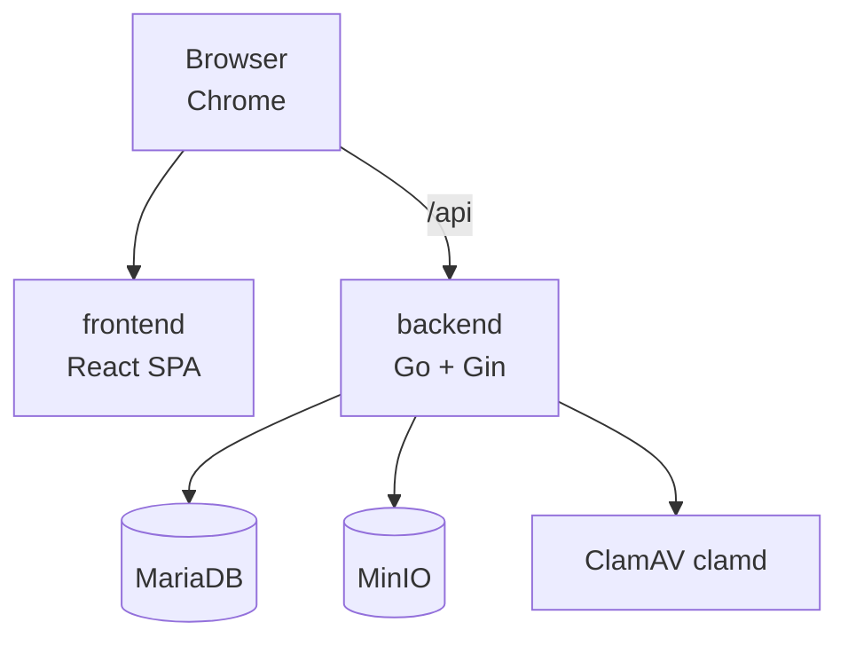
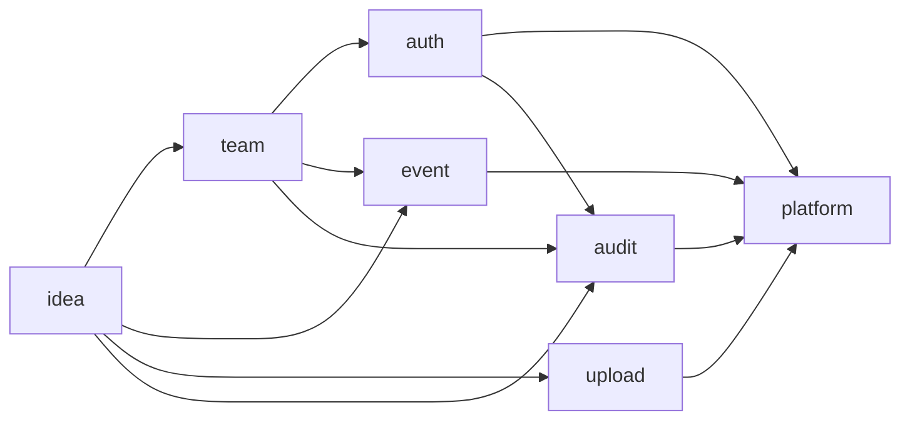
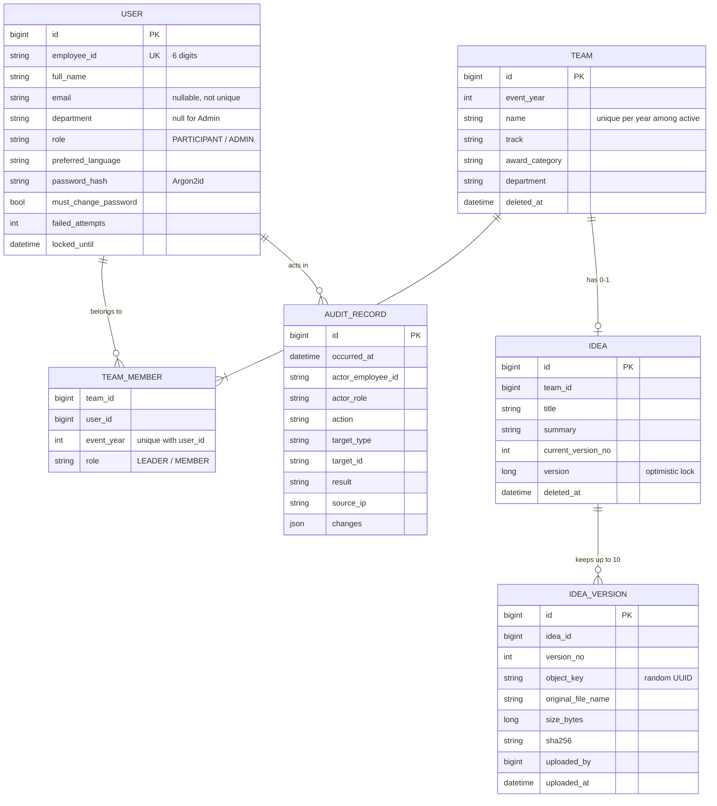
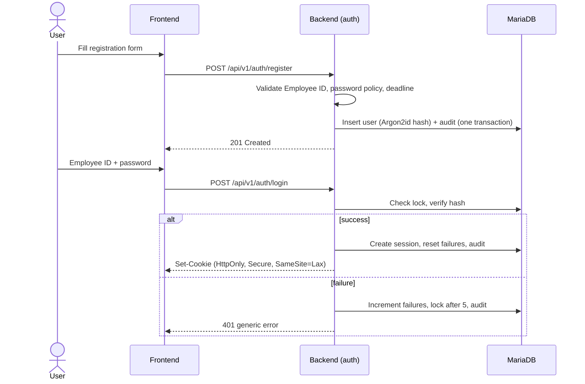
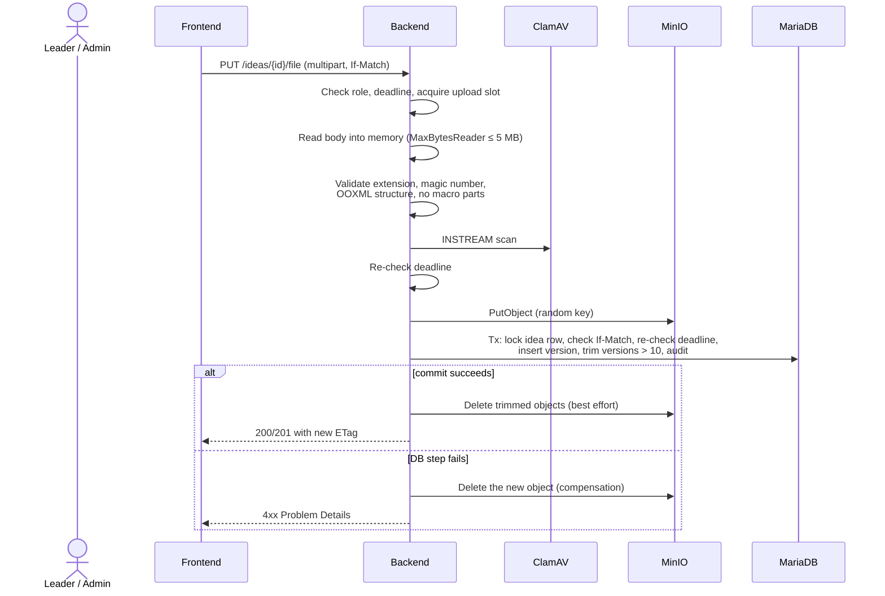

# ESG Award (Go edition) — Architecture

| Item | Value |
|---|---|
| Document | Architecture Overview |
| Version | 1.2 |
| Status | Accepted |
| Owner | Architect |
| Last updated | 2026-11-05 |
| Related | `docs/PRD.md`, `docs/adr/` (ADRs 0001, 0002, 0003, 0005, 0007, 0014 accepted), `backend/api/openapi.yaml` |

> **Purpose.** This document describes the stable structure of the **application** (frontend and backend). **What** the product does is in the PRD. **Why** a decision was made is recorded in an ADR (Section 12 lists the ADRs and their status).
>
> **Scope.** DevOps and operations (deployment, containers, orchestration, CI/CD, environments, monitoring, backup, TLS, secrets infrastructure) are deliberately **not** covered in this phase. See PRD Section 9.

---

## Table of Contents

1. [Architecture Drivers](#1-architecture-drivers)
2. [System Context](#2-system-context)
3. [Runtime Components](#3-runtime-components)
4. [Technology Stack](#4-technology-stack)
5. [Backend Structure](#5-backend-structure)
6. [Frontend Structure](#6-frontend-structure)
7. [Data Architecture](#7-data-architecture)
8. [Key Flows](#8-key-flows)
9. [Security Architecture](#9-security-architecture)
10. [Repository Layout and Local Development](#10-repository-layout-and-local-development)
11. [Quality Attribute Mapping](#11-quality-attribute-mapping)
12. [Decisions (ADRs to write)](#12-decisions-adrs-to-write)
13. [Risks and Technical Debt](#13-risks-and-technical-debt)
14. [Open Items](#14-open-items)

---

## 1. Architecture Drivers

### 1.1 Key quality attributes

| Driver | Target | PRD ref |
|---|---|---|
| Security | No plaintext secrets; strong password hashing; safe file handling | NFR-SEC-* |
| Data integrity | No lost or inconsistent Ideas; no silent overwrites | IDEA-006, IDEA-030 |
| Auditability | Audited operations recorded atomically with the change, append-only | AUD-* |
| Testability | Statement coverage ≥ 80% (backend and frontend) | NFR-QA-001 |
| Simplicity | Understandable by one person; few moving parts | — |

Load is small (~25,000 participants, ~5,000 teams), so there are no performance targets. The design avoids needless components instead.

### 1.2 Constraints

| Constraint | Source |
|---|---|
| Backend: Go, Gin | Product decision, accepted (PRD Q-01; ADR 0002). Go and Gin are also in common use in the company. |
| Frontend: Node.js 22 LTS, TypeScript, React 18, Material UI, Vite | Product decision |

### 1.3 Architectural style

- **Modular monolith, organized by feature.** One Go module, one binary. Each feature is one package (`auth`, `team`, `idea`, …). Dependencies are one-directional and checked by a linter. No framework enforces boundaries; the rules in Section 5 do.
- **Transaction-script services.** Business logic is thin. A service function opens a transaction, applies rules, writes the data and its audit record, and commits.
- **No message broker, no event bus, no cache server, no scheduler.** Everything happens in one transaction in one process.
- **Single-page application**, served from the same origin as the API (a dev proxy in development).

---

## 2. System Context



The application has no outbound integration: it sends no email and calls no external service. Its only dependencies are the database, the object store, and the malware scanner (Section 3).

---

## 3. Runtime Components



| Component | Responsibility |
|---|---|
| **frontend** | React SPA (static files in production, Vite dev server in development) |
| **backend** | All business logic, authentication, authorization, REST API. Stateless: sessions are in the database |
| **MariaDB** | System of record: users, teams, Ideas, versions, audit, sessions |
| **MinIO** | Object storage for Idea files (S3-compatible) |
| **ClamAV** | Malware scanning (clamd, `INSTREAM`) |

**The browser never talks to MinIO.** File uploads and downloads pass through the backend (streaming; files are at most 5 MB).

**Same origin for SPA and API.** The SPA and `/api` are served under one host, so there is no CORS and `SameSite` session cookies work. In development, the Vite dev server proxies `/api` to the backend.

---

## 4. Technology Stack

Exact versions are pinned in `go.mod` / `package-lock.json`. Major versions change only through an ADR.

| Layer | Technology |
|---|---|
| Language (backend) | Go (latest stable release when the project starts; pinned in `go.mod`) |
| HTTP framework | Gin |
| API contract | **Spec-first** (OpenAPI 3.0.x, ADR 0005): hand-written `openapi.yaml`; server interface and types generated with `oapi-codegen` (Gin server) |
| Request validation | `go-playground/validator` plus domain validators |
| Database | MariaDB, `database/sql` + `sqlx` + `go-sql-driver/mysql` |
| Migrations | `golang-migrate` |
| Sessions | `alexedwards/scs` with the MySQL store |
| Password hashing | Argon2id (`golang.org/x/crypto/argon2`) |
| CSRF | SameSite cookie plus a token header, Gin middleware |
| Rate limiting | In-process limiter (`golang.org/x/time/rate`) on auth endpoints |
| Object storage | MinIO, `minio-go` |
| Malware scanning | ClamAV (clamd), `INSTREAM` over TCP |
| Logging | `log/slog`, JSON to stdout |
| Backend testing | `testing`, `testify`, `testcontainers-go` (MariaDB, MinIO, ClamAV), `go test -cover` |
| Frontend | Node 22, TypeScript, React 18, Material UI, Vite, React Router, TanStack Query, react-i18next |
| API client | `openapi-typescript` (types) + `openapi-fetch` (client), generated from `openapi.yaml` (ADR 0005, OI-08) |
| Frontend testing | Vitest, React Testing Library, MSW, V8 coverage |
| End-to-end testing | Playwright |
| Static checks | `gofmt`, `golangci-lint` (including `depguard`), ESLint, `tsc` |

Not used: Redis, message brokers, ORMs, DI frameworks, background schedulers.

---

## 5. Backend Structure

### 5.1 Packages (one feature, one package)

One Go module under `backend/`. Application code lives in `backend/internal/` so nothing outside the module can import it.

| Package | Responsibility | PRD coverage |
|---|---|---|
| `platform` | Shared plumbing, **no business rules**: config, DB connection and `WithTx`, logger, clock, error model (RFC 9457), HTTP middleware (request ID, recover, CSRF, rate limit, security headers), value types (`EmployeeID`, `Department`, `Track`, `AwardCategory`) | — |
| `auth` | Registration, login, logout, session, lockout, password policy and change, roles, Admin provisioning, user preferences | REG-*, AUTH-*, R-*, ADM-004 |
| `event` | Event year and deadline from config; `Policy.Check(now)` ("is this participant action allowed now?") | EVT-*, DDL-* |
| `team` | Teams, roster validation, add/remove/leave, dissolve, soft delete | TEAM-*, ADM-001/002 (team part) |
| `idea` | Idea metadata, versions, 10-version retention, optimistic locking, download authorization, soft delete | IDEA-*, ADM-002/003 |
| `upload` | File validation (extension, magic number, OOXML structure), ClamAV scan, MinIO put/get/delete. **Knows nothing about teams or Ideas.** | IDEA-002…006 |
| `audit` | Append-only audit records: `Record(ctx, tx, entry)` | AUD-* |

Each feature package has the same internal layout:

```
team/
├── handler.go      # Gin handlers (implements the generated server interface)
├── service.go      # Business rules; owns the transaction
├── repo.go         # SQL via sqlx
├── model.go        # Types
├── errors.go       # Domain errors → problem codes
└── service_test.go
```

### 5.2 Dependency rules



1. **One direction, no cycles.** `platform` imports no feature package. `audit`, `upload`, and `event` import only `platform`.
2. **Use interfaces at the consumer.** If `idea` only needs to know whether a user is a member or leader of the Idea's team, `idea` defines `type TeamReader interface { MembershipOf(ctx, userID, ideaID) (...) }` and `team` satisfies it. `idea` does not import team internals.
3. **Handlers do not import other features' repos.** Cross-feature calls go through the other feature's service interface.
4. **Enforced by a linter.** `golangci-lint` with `depguard` lists the allowed imports per package; a violation fails the check.
5. **Wiring happens in `cmd/server/main.go`** (manual constructor injection). There is no DI framework.

### 5.3 Transactions and audit

- A service method calls `platform.WithTx(ctx, db, func(tx *sqlx.Tx) error {...})`. Inside it, the feature performs its change **and** calls `audit.Record(ctx, tx, entry)`. The audit row commits or rolls back together with the change, so a committed change always has its audit record.
- Failures with no business transaction (failed login, rejected upload, authorization denial) call `audit.RecordStandalone(ctx, entry)`, which uses its own short transaction.
- Cross-feature reactions are plain function calls inside the same transaction. Example: dissolving a team calls `idea.SoftDeleteByTeam(ctx, tx, teamID)`. `team` depends on `idea` only through the `IdeaCascade` interface defined in `team` and implemented by `idea`, wired in `main.go`, so the import arrow stays `idea → team`. This is the one sanctioned reverse call (ADR 0003).

### 5.4 No scheduled jobs

The application has no scheduler. Maintenance is done with manual command-line tools in `backend/cmd/`:

| Tool | Purpose |
|---|---|
| `cmd/migrate` | Applies database migrations (`golang-migrate`) |
| `cmd/hashpw` | Prints an Argon2id hash of a password read from stdin, for the Admin list and for engineer password resets |
| `cmd/purge` | Permanently deletes soft-deleted teams/Ideas older than 7 days and their objects; idempotent |

Soft-deleted rows are hidden from all queries immediately (`deleted_at IS NOT NULL`), so a purge that runs late changes nothing for users. The session library's expired-session cleanup is internal to the library and is not an application job.

### 5.5 API conventions

| Concern | Convention |
|---|---|
| Base path | `/api/v1`. Admin endpoints under `/api/v1/admin`. |
| Contract | `backend/api/openapi.yaml` is the single source of truth. `oapi-codegen` generates the Gin server interface and types into `internal/api/` (generated, never edited by hand). A check regenerates and fails on a diff. |
| Format | JSON; timestamps ISO-8601 with `+08:00` offset |
| Errors | RFC 9457 Problem Details; `title` and `detail` in English (I18N-003); stable `code` field for the frontend. Hand-written error middleware. |
| Concurrency | `ETag` on Ideas; updates require `If-Match`; mismatch → `412 Precondition Failed` |
| Uploads | `multipart/form-data`, single file part, hard limit via `http.MaxBytesReader` |
| Pagination | `page`, `size`, `sort`; response includes total |
| Authorization | Deny by default: every route belongs to a route group with an explicit role requirement; ownership checks live in services |

---

## 6. Frontend Structure

```
frontend/src/
├── app/                # Router, layout, providers, error boundary
├── features/
│   ├── auth/           # Register, login, change password
│   ├── team/           # Create (with member IDs), roster, leave, dissolve
│   ├── idea/           # Upload, versions, metadata
│   └── admin/          # Team list/search, Idea editing
├── shared/             # Reusable components, hooks, utilities
├── api/generated/      # Client and types generated from openapi.yaml
└── i18n/               # zh-TW and en resources
```

| Concern | Approach |
|---|---|
| Server state | TanStack Query; no global store for server data |
| API contract | Generated client; a backend contract change breaks the frontend build |
| Authentication | HttpOnly session cookie; the SPA never stores tokens |
| CSRF | Backend issues a CSRF cookie; the client echoes it in a header on every state-changing request |
| Language | Saved to the user profile via API; `localStorage` only before login |
| Upload | `multipart/form-data` to the backend with progress (XHR or equivalent) |
| Responsive | MUI breakpoints; minimum width 360 px |
| Coverage | Vitest V8 provider; `main.tsx` and `api/generated/` excluded |

---

## 7. Data Architecture

### 7.1 Logical data model



There is no `event_year` table: the event year and deadline come from configuration. `team.event_year` and `team_member.event_year` record which year a row belongs to. The session library manages its own `sessions` table; `golang-migrate` manages `schema_migrations`.

### 7.2 Integrity rules enforced by the database

| Rule | Mechanism |
|---|---|
| Employee ID unique | Unique index on `user.employee_id` |
| One team per person per event year | Unique index on `team_member (event_year, user_id)` |
| Exactly one leader per team | Unique index on a generated column that equals `team_id` when `role = 'LEADER'` and `NULL` otherwise |
| Team name unique per year among active teams | Unique index on `(event_year, name_ci_active)`, a generated column that is `NULL` when the team is soft-deleted |
| One active Idea per team | Unique index on a generated column `active_team_id` (= `team_id` when `deleted_at IS NULL`) |
| Version numbers unique within an Idea | Unique index on `idea_version (idea_id, version_no)` |
| Team size ≤ 5 | Team row locked (`SELECT … FOR UPDATE`) while adding members; creation inserts all rows in one transaction |
| No lost updates on Ideas | `UPDATE idea SET …, version = version + 1 WHERE id = ? AND version = ?`; zero affected rows → `412` |
| Audit append-only | The application DB user has only `INSERT` and `SELECT` on `audit_record` |

Unique-index violations are translated to domain errors (for example "already in a team"), so concurrent requests cannot break the rules.

### 7.3 Object storage layout

- One bucket (name from configuration, for example `esg-ideas`), private; only the backend credential can read and write.
- Object keys are random UUIDs. Original file names are stored only in the database.
- There is no quarantine bucket: nothing is written to storage until a file has been fully received, validated, and scanned in memory (Section 8.2).

### 7.4 Soft delete and purge

- Dissolved teams and deleted Ideas get `deleted_at`. All queries filter them out.
- On dissolution, `team_member` rows are deleted (members are released); the roster is stored in the audit record's `changes` so an engineer can restore manually within 7 days.
- `cmd/purge` permanently deletes rows and objects older than 7 days. Audit records are kept (AUD-007).

### 7.5 Schema migration

- `golang-migrate` SQL files in `backend/migrations/` named `NNNNNN_description.up.sql` / `.down.sql`. Immutable after merge.
- Migrations are applied with `cmd/migrate` before the backend starts; the backend itself never migrates at startup.
- Migrations should be backward compatible with the previous application version (expand-then-contract).
- No credentials or user data in migrations. Admin accounts are never created by migrations (see 8.6).

---

## 8. Key Flows

### 8.1 Registration and login



Password hashing is done under a semaphore so a burst of logins cannot exhaust memory.

### 8.2 Idea upload (streamed through the backend)



Guarantees:

- **Interrupted upload (IDEA-006):** if the connection drops before the request body is fully read, nothing has been written to MinIO or the database.
- **Deadline at completion (DDL-005):** checked before storing and again inside the committing transaction; the deadline passing mid-upload rejects the upload.
- **Orphans:** the only way to leave an object without a row is a crash between `PutObject` and the commit, or a failed compensation delete. This is accepted for now (Section 13).
- **Memory bound:** at most `N` uploads are processed at once per instance (a semaphore; requests wait briefly, then receive `503` with `Retry-After`). Each holds ≤ 5 MB.
- **PPTX validation:** ZIP container with the expected Office Open XML parts and no `vbaProject.bin`. PDF validation: `%PDF-` header.

### 8.3 Download

1. `GET /api/v1/ideas/{id}/versions/{n}/file`.
2. The backend checks team membership or the Admin role and writes an audit record.
3. It streams the object from MinIO to the client with `Content-Disposition: attachment`, `X-Content-Type-Options: nosniff`, and `Cache-Control: no-store`.

### 8.4 Team creation

1. `POST /api/v1/teams` with name, track, award category, and a list of member Employee IDs.
2. In one transaction: check the deadline, check the caller is a Participant not in a team, lock the member user rows, validate every ID (TEAM-007), insert team, leader row, and member rows, write the audit record.
3. If any ID is invalid, roll back and return the list of `{employeeId, reason}`.
4. Concurrent attempts to claim the same person are resolved by the unique index on `team_member (event_year, user_id)`.

### 8.5 Team dissolution

One transaction: set `team.deleted_at`, store the roster in the audit `changes`, delete `team_member` rows, soft-delete the Idea (`idea.SoftDeleteByTeam`), write the audit record. `cmd/purge` removes everything after 7 days.

### 8.6 Admin provisioning

At startup, `auth.SeedAdmins` reads a JSON file whose path is configured (`ADMINS_FILE`). In production the file is supplied by the secure configuration store (Vault); in development it is a local, untracked file.

```json
[
  { "employeeId": "000001", "fullName": "…", "email": "…", "passwordHash": "$argon2id$…" }
]
```

- For each entry, the insert is a no-op if the Employee ID already exists as an Admin; it is idempotent, so several instances starting together are safe.
- If the Employee ID exists as a Participant, startup **fails** with a clear error (ADM-004).
- Seeded Admins have `must_change_password = true`. Each created account writes an audit record.
- Hashes are produced offline with `cmd/hashpw`. No plaintext password is ever stored or logged.

---

## 9. Security Architecture

### 9.1 Authentication and session

| Control | Implementation |
|---|---|
| Password hashing | Argon2id via `x/crypto/argon2`; PHC-format encoded hash (parameters and salt embedded) so parameters can be raised later and hashes upgraded at next login. Starting parameters: memory 19 MiB, 2 iterations, parallelism 1 (OWASP minimum), tuned later. Hash computations are limited by a semaphore. |
| Password policy | Validator in `auth` (PRD REG-005), used by registration and password change |
| Session | `scs` with the MySQL store; cookie `HttpOnly`, `Secure`, `SameSite=Lax`; idle 30 min, absolute 8 h; token renewed at login |
| Invalidate other sessions | The user id is stored in the session data; on password change the service destroys the user's other sessions |
| Account lockout | 5 failures → 5 min lock, per account (columns on `user`) |
| Network-source rate limit | In-process limiter keyed by client IP on `/api/v1/auth/*` (AUTH-004). It is per instance; a shared limiter can be added later. Gin `TrustedProxies` is configured when a reverse proxy is used. |
| Generic errors | Login never discloses account existence or lock state |
| CSRF | SameSite cookie plus a per-session token in a header for all state-changing requests |
| First login of Admin | `must_change_password` blocks all routes except change-password until updated |

### 9.2 Authorization

- Roles: `PARTICIPANT`, `ADMIN`. Resource checks (leader of this team, member of this team) are done in each feature's service.
- Every route is denied by default; route groups declare the required role.
- `event.Policy` is part of authorization for participant write operations. Admins bypass it (DDL-006).
- Admin routes are under `/api/v1/admin` and require the Admin role at the router and in the service.

### 9.3 Configuration and secrets

- All configuration (database, MinIO, ClamAV, `ADMINS_FILE`, event year and deadline) is read at startup from environment variables or a config file. Secrets are never committed to source control (NFR-SEC-001); `.env*` and local config files are git-ignored.
- Event year and deadline are not secrets. The deadline is given with an explicit `+08:00` offset.
- How secrets are delivered in shared environments is an operations topic and out of scope for now.

### 9.4 HTTP security headers

The backend sets `Content-Security-Policy`, `X-Content-Type-Options`, `Referrer-Policy`, and frame denial on every response. `Strict-Transport-Security` is added when HTTPS is terminated in front of the application.

### 9.5 File security

Extension, declared type, and content signature must match; PPTX macro parts are rejected; every file is scanned by ClamAV before it is stored; files are served only as attachments through authenticated endpoints; object keys are random.

---

## 10. Repository Layout and Local Development

```
esg-award-site-golang/
├── backend/
│   ├── cmd/
│   │   ├── server/main.go         # Wiring and HTTP server
│   │   ├── migrate/main.go        # Applies golang-migrate migrations
│   │   ├── hashpw/main.go         # Argon2id hash helper
│   │   └── purge/main.go          # Permanent removal of soft-deleted data
│   ├── api/openapi.yaml           # Contract (source of truth)
│   ├── migrations/                # golang-migrate SQL files
│   ├── internal/
│   │   ├── api/                   # Generated by oapi-codegen (do not edit)
│   │   ├── platform/
│   │   ├── auth/
│   │   ├── event/
│   │   ├── team/
│   │   ├── idea/
│   │   ├── upload/
│   │   └── audit/
│   ├── go.mod
│   └── .golangci.yml              # includes depguard rules
├── frontend/                      # React + Vite
├── e2e/                           # Playwright
└── docs/
    ├── PRD.md
    ├── Architecture.md
    └── adr/
```

**Local development.** The backend needs MariaDB, MinIO, and ClamAV to be reachable. How a developer starts them (for example a local container setup) is a personal convenience and is not part of the product architecture. The Vite dev server proxies `/api` to the backend.

---

## 11. Quality Attribute Mapping

| PRD requirement | Architectural response |
|---|---|
| IDEA-006 interrupted uploads | Whole file received and validated in memory before anything is written (8.2) |
| IDEA-030 no silent overwrite | `version` column + `ETag` / `If-Match` (5.5, 7.2) |
| TEAM-006, TEAM-007 under concurrency | Unique indexes and row locking (7.2) |
| DDL-005 deadline at completion | `event.Policy` checked before storing and inside the committing transaction (8.2) |
| AUD-001, AUD-003 | Audit row in the same transaction; insert-only DB grant (5.3, 7.2) |
| AUTH-004 network rate limit | In-process limiter on auth routes (9.1) |
| AUTH-005 sessions | `scs` with MySQL store (9.1) |
| R-03, ADM-004 Admin only via Vault | Seeding from a configured file, no creation API (8.6) |
| NFR-SEC-001 | Configuration from environment/files, git-ignored (9.3) |
| NFR-QA-001 | `go test -coverprofile` and Vitest coverage, ≥ 80% statement |
| NFR-QA-003 | Requirement IDs in test names, e.g. `TEAM_007_rejects_department_mismatch` |

---

## 12. Decisions (ADRs)

ADRs go in `docs/adr/`, numbered sequentially, and are never edited after acceptance.

**Status:** accepted on 2026-11-05: 0001, 0002, 0003, 0005, 0007, 0014. Not yet written: 0004, 0006, 0008, 0009, 0010, 0011, 0012, 0013, 0015. They are outside Phase 0 and are scheduled with their features.

| ADR | Title |
|---|---|
| 0001 | Record architecture decisions |
| 0002 | Go and Gin for the backend (exception to the Java standard) |
| 0003 | Feature packages with one-directional dependencies, enforced by `depguard` |
| 0004 | `sqlx` and hand-written SQL; optimistic locking by version column |
| 0005 | Spec-first API with `oapi-codegen` |
| 0006 | `golang-migrate`, applied by a separate command |
| 0007 | Sessions in MariaDB with `scs`; no Redis for now |
| 0008 | Argon2id password hashing and parameters |
| 0009 | Upload and download streamed through the backend; no presigned URLs, no quarantine bucket |
| 0010 | ClamAV scanning with `INSTREAM` |
| 0011 | Audit written in the business transaction; no event bus |
| 0012 | Soft delete with manual purge; no scheduler |
| 0013 | Admin accounts provisioned from a configured file (Vault in production) only |
| 0014 | Event year and deadline from configuration |
| 0015 | Statement coverage gate |

---

## 13. Risks and Technical Debt

| Risk | Impact | Mitigation |
|---|---|---|
| Employee ID squatting without verification (PRD A-03) | Wrong person holds an ID; no in-app remedy | Engineer fixes the database; email verification is a later phase |
| Forgotten passwords need an engineer (PRD A-04) | Support load near the deadline | `cmd/hashpw` + direct update; consider a reset flow later |
| No framework-enforced module boundaries | Coupling can creep in | `depguard`; consumer-side interfaces; code review |
| Uploads buffered in memory | Memory pressure on bursts | 5 MB limit, concurrency semaphore, 503 + `Retry-After` |
| Crash between `PutObject` and commit leaves an orphan object | Wasted storage only | Compensating delete; a reconciliation tool can be added later |
| Purge is manual | Soft-deleted data stays longer than 7 days if forgotten | Hidden from users anyway; wrap `cmd/purge` in a scheduler later |
| In-process rate limiter is per instance | Weaker limit with several instances | Acceptable at this scale; shared limiter later |
| Deadline change needs a restart | Slower reaction to extension requests | Accepted (PRD A-06) |

---

## 14. Open Items

| ID | Item | Owner |
|---|---|---|
| OI-01 | Acceptance of Go/Gin as the backend technology (PRD Q-01) | **Closed:** accepted (ADR 0002) |
| OI-08 | Frontend API client generator choice | **Closed:** `openapi-typescript` + `openapi-fetch` (ADR 0005) |
| OI-03 | Retention of audit records beyond 1 year (PRD Q-02) | **Closed:** 1 year (PRD AUD-004) |
| OI-04 | All DevOps / operations topics (deployment, CI/CD, environments, monitoring, backup, TLS, secrets delivery) | **Deferred.** Scope frozen for this phase; later phase |
