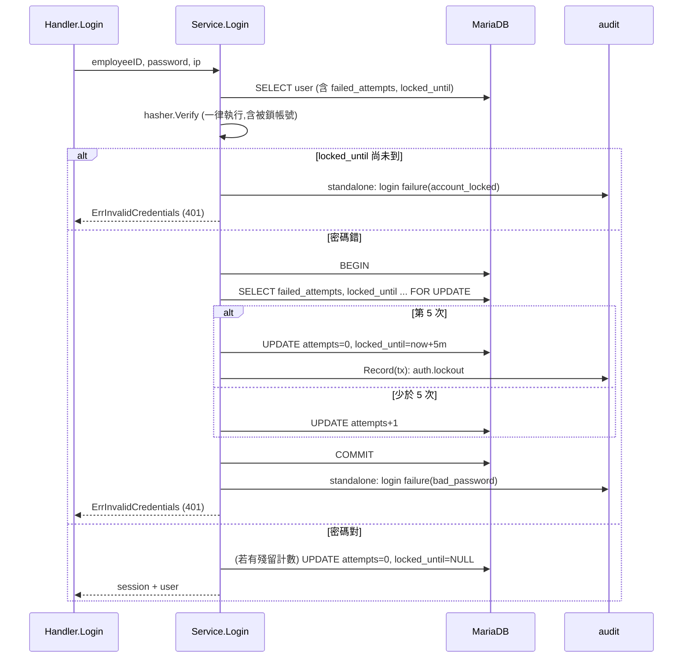

# 帳號鎖定與通用錯誤訊息 (AUTH-002/003)

## 一句話摘要
同一帳號連續 5 次密碼錯誤就鎖 5 分鐘,且所有登入失敗(含鎖定中)對外都是同一個回應。

## 背景與目標
對應 PRD AUTH-002(5 次失敗鎖 5 分鐘,每帳號)與 AUTH-003(失敗訊息一律泛用,不洩漏帳號存在或鎖定狀態)。成功的定義:攻擊者從 response body、status、header、cookie 看不出「帳號不存在 / 密碼錯 / 被鎖」的差別;鎖定在並行猜密碼下也不會被繞過。**不含**:來源 IP rate limit(AUTH-004)、管理員解鎖(PRD ADM-005 明確不做)。

## 架構與資料流

## 程式碼導覽
| 檔案 | 職責 |
|---|---|
| `backend/internal/auth/service.go:27` | `maxFailedAttempts = 5`、`lockDuration = 5m`,PRD 固定值,所以是常數不是 config |
| `backend/internal/auth/service.go:185` | `Login`:驗證、判斷鎖定、分流三種結果 |
| `backend/internal/auth/service.go:208` | 無論是否被鎖都先 `Verify`,再算 `locked` |
| `backend/internal/auth/service.go:238` | 成功後只在有殘留狀態時才清零 |
| `backend/internal/auth/service.go:271` | `recordFailedAttempt`:transaction 內計數、鎖定、寫 lockout audit |
| `backend/internal/auth/repo.go:92` | `lockStateForUpdate`:`SELECT … FOR UPDATE` |
| `backend/internal/auth/repo.go:102` | `saveLockState`:零值 time 存成 `NULL` |
| `backend/internal/auth/errors.go` | `ErrInvalidCredentials` 是唯一對外的登入失敗 |
| `backend/internal/auth/lockout_test.go:45` | 鎖定、過期、並行、byte-identical 回應等測試 |

## 設計決策與取捨
- **決策**:鎖定狀態放在 `user` 表(`failed_attempts`、`locked_until`),計數在 transaction 內用 `FOR UPDATE` 序列化。
  - **替代方案**:單一 `UPDATE … SET failed_attempts = failed_attempts + 1` 不開 tx;in-memory counter;Redis。
  - **理由**:migration `000002` 的註解寫明狀態要能撐過 session 過期;`backend` 是 stateless(Architecture 3),in-memory 在多 instance 下會失效;且鎖定與 lockout audit 要同一個 tx(Architecture 5.3)。單句 UPDATE 在 MySQL 是由左到右取值,「用新值判斷要不要鎖」依賴賦值順序,可讀性差。
  - **代價**:每次密碼錯多 1 個 tx(BEGIN、SELECT、UPDATE、COMMIT);同一帳號的並行失敗會互相等 row lock。
- **決策**:鎖定時回應與其他失敗完全相同(401 `invalid_credentials`),不給 423、不給 `Retry-After`。
  - **替代方案**:回 423/429 加剩餘秒數,UX 較好。
  - **理由**:AUTH-003 明文禁止洩漏鎖定狀態。
  - **代價**:被鎖的使用者不知道要等多久,前端無法提示。
- **決策**:鎖定時計數歸零,而不是留 5 然後靠 `locked_until` 判斷。
  - **理由**:鎖定過期後不需要額外的 reset 流程,下一次失敗自然從 1 開始(`TestAUTH_002_FailureAfterExpiredLockStartsACleanCount`)。
  - **代價**:`failed_attempts` 不再代表「歷史上失敗幾次」;靠 audit 補足。
- **決策**:被鎖期間的嘗試不計數、不延長鎖定。
  - **理由**:否則攻擊者持續送請求就能讓受害者永遠鎖著。
  - **代價**:仍無法阻止攻擊者每 5 分鐘一輪重新鎖人。
- **決策**:被鎖的帳號仍執行一次 Argon2id `Verify`。
  - **理由**:與不存在帳號用 `dummyHash`(`service.go:197`)是同一個防 timing oracle 的思路。
  - **代價**:鎖定中的請求仍花 CPU;成本由 `Hasher` 的 semaphore 限制(Architecture 8.1)。

## 邊界情況與失敗處理
- **不存在的 Employee ID**:不寫任何鎖定資料,只跑 `dummyHash` 並寫 audit(`TestAUTH_002_UnknownIDIsNeverLocked`)。
- **被鎖時輸入正確密碼**:一樣 401,不發 session,audit reason 為 `account_locked`。
- **並行**:兩個請求都讀到 4 次失敗,第一個鎖定,第二個在 tx 內重讀發現已鎖,直接 return,不重複寫 lockout audit(`TestAUTH_002_ConcurrentRequestAlreadyLockedTheAccount`)。
- **DB 失敗**:`BEGIN` 或 UPDATE 失敗回 500,且錯誤訊息不外洩(`TestAUTH_002_FailureWriteErrorIsAServerErrorWithoutLeak`)。
- **audit 寫入失敗**:登入失敗的 standalone audit 失敗只記 log,不改回應;lockout audit 在 tx 內,失敗會讓鎖定一起 rollback。
- **context 取消**:被鎖路徑會回傳 `ctx.Err()`,而不是當成「帳號鎖定」的回應。

## 已知落差
- AUTH-004(來源 IP rate limit)尚未實作,所以目前沒有任何東西擋住「對大量 Employee ID 各猜 5 次」。
- 鎖定中的請求少一次 DB 寫入,和「密碼錯」的請求有幾毫秒的 timing 差,未處理。
- 成功登入與並行失敗之間的 race 未處理(見 Q7)。
- 本次沒有新 ADR;若要記錄「鎖定狀態放 DB、不回 423」建議補一份(待確認是否需要)。

## 面試考題

### 基礎

::: details Q1. 一次登入失敗,從進入 `Login` 到回應,資料怎麼流動?
**出處**:`backend/internal/auth/service.go:185`

**參考答案**
先 `ParseEmployeeID`,再 `findUserByEmployeeID` 讀出 `failed_attempts` 與 `locked_until`。接著一律 `Verify`,再用 `clock.Now()` 判斷是否仍在鎖定期。密碼錯就進 `recordFailedAttempt`:開 tx、`FOR UPDATE` 重讀、計數或鎖定、必要時寫 lockout audit、commit。最後寫 standalone 的 login failure audit,回 `ErrInvalidCredentials`。

**可能的追問**
- 為什麼 tx 裡要重讀一次,而不是直接用最前面讀到的 `row`?

**考察點**:能完整講出一條 request 路徑與 tx 邊界。
:::

::: details Q2. 為什麼鎖定中輸入正確密碼也要回 401 且訊息一樣?
**出處**:`backend/internal/auth/service.go:214`、`backend/internal/auth/errors.go`

**參考答案**
AUTH-003 要求不洩漏鎖定狀態。若鎖定時回不同訊息或狀態碼,攻擊者可用它判斷帳號存在、且已被猜過。`TestAUTH_003_LockedAndUnlockedResponsesAreByteIdentical` 驗證鎖定、密碼錯、不存在三種回應 body 完全相同,且沒有 `Retry-After`。

**可能的追問**
- 這對真實使用者的 UX 有什麼代價?怎麼補?

**考察點**:authN 安全與 user enumeration。
:::

::: details Q3. `failed_attempts` 在哪些時機被改?
**出處**:`backend/internal/auth/service.go:238`、`:283`、`:287`

**參考答案**
三個時機:少於 5 次時 +1;第 5 次時設為 0 並寫 `locked_until`;登入成功且有殘留狀態時清為 0 並把 `locked_until` 設 `NULL`。鎖定期間的嘗試不改它。

**可能的追問**
- 為什麼成功登入沒有殘留狀態時不寫 DB?

**考察點**:讀得懂狀態機。
:::

### 進階

::: details 🔥 Q4. 為什麼用 `SELECT … FOR UPDATE` 加 tx,而不是 `UPDATE … SET failed_attempts = failed_attempts + 1`?
**出處**:`backend/internal/auth/repo.go:92`、`backend/internal/auth/service.go:271`

**參考答案**
需求有三個動作要原子:計數、第 5 次時鎖定、寫 lockout audit。單句 UPDATE 要在同一句裡用新值判斷是否鎖定,MySQL 的 SET 是由左到右使用已更新的值,結果依賴欄位順序,而且拿不到「這次有沒有鎖」給 audit。`FOR UPDATE` 讓同帳號的並行失敗排隊,每個 tx 看到前一個的結果,所以 10 個並行錯誤請求不會全都讀到 `attempts = 0`。lockout audit 也在同個 tx 內,鎖定與記錄一起 commit 或 rollback。

**可能的追問**
- 預設 isolation 是 REPEATABLE READ,`FOR UPDATE` 讀到的是快照還是最新值?(locking read 讀最新 committed 值。)
- 同一帳號被大量並行打,會發生什麼?(排隊等 row lock,延遲上升。)

**考察點**:transaction、lock、isolation。
:::

::: details 🔥 Q5. 為什麼被鎖的帳號還要跑一次 Argon2id `Verify`?
**出處**:`backend/internal/auth/service.go:208`、`:197`

**參考答案**
Argon2id 是這條路徑上最慢的步驟。若被鎖就提早 return,回應會明顯比「密碼錯」快,攻擊者用時間差就能判斷鎖定。所以和不存在帳號用 `dummyHash` 一樣,先跑 `Verify` 再回答。限制:`Verify` 之後的 DB 寫入只在「密碼錯」那條路徑發生,仍有毫秒級差異,這是已知落差。

**可能的追問**
- 這樣被鎖的帳號反而成為 CPU 放大目標,怎麼緩解?(`Hasher` 的 semaphore、之後的 IP rate limit。)

**考察點**:timing side channel、取捨。
:::

::: details Q6. 鎖定過期後為什麼不需要額外的 unlock 流程?
**出處**:`backend/internal/auth/service.go:286`、`backend/internal/auth/lockout_test.go:118`

**參考答案**
鎖定當下就把 `failed_attempts` 設為 0,`locked_until` 到期後只是一個過去的時間戳,判斷式 `now.Before(locked_until)` 自然為 false。之後第一次失敗是 `0 → 1`。成功登入時若 `locked_until` 還有值會一併清掉(`service.go:238`)。不依賴排程,符合「沒有 scheduler」的架構限制(Architecture 1.3)。

**可能的追問**
- 時鐘為什麼走 `platform.Clock` 而不是 `time.Now()`?(測試可以用 `ManualClock` 控制,不需 sleep。)

**考察點**:設計簡化、可測試性。
:::

### 設計/情境

::: details Q7. 流量放大 10 倍,或後端變成多 instance,這個設計要改哪裡?
**出處**:`backend/internal/auth/service.go:271`

**參考答案**
鎖定狀態在 DB,不是 process memory,所以多 instance 本身是正確的,這是選 DB 的原因。要擔心的是同一帳號的 row lock 競爭,但這只會發生在被暴力猜的帳號上,其他帳號互不影響。真正的瓶頸會是 Argon2id 的 CPU / memory;可以調整 semaphore、在前面加 IP rate limit(AUTH-004)擋掉大量請求。驗證方式:用同一帳號並行打錯誤密碼,確認鎖定剛好發生在第 5 次、且 lockout audit 只有一筆。

**可能的追問**
- 若要改成 10 次鎖 15 分鐘,要改哪裡?(兩個常數;若要可設定再搬到 config。)
- 若 PRD 要求鎖定要通知使用者,哪一層放?

**考察點**:擴充性、瓶頸判斷、驗證方法。
:::

::: details Q8. 若產品想在被鎖時顯示「請 5 分鐘後再試」,怎麼在不違反 AUTH-003 下做?
**出處**:`backend/internal/auth/errors.go`、`backend/api/openapi.yaml`

**參考答案**
直接回鎖定狀態就違反 AUTH-003。可行方向:前端對所有登入失敗都顯示固定提示,例如「若連續失敗多次,帳號會暫時鎖定 5 分鐘」,不依賴回應內容。要回傳精準狀態,就要改 PRD(待確認),並評估帳號探測風險。

**考察點**:需求與安全的取捨,不盲目改規格。
:::

### 找問題

::: details 🔥 Q9. 這段程式碼有什麼潛在問題?
**出處**:`backend/internal/auth/service.go:238`、`:208`

**問題**:(1) 整個系統沒有 IP rate limit(AUTH-004 未做),Employee ID 是 6 位數字、容易枚舉,攻擊者可以對大量帳號各打 5 次,讓整批帳號被鎖 5 分鐘,是低成本的 DoS。(2) 成功登入的清零 `saveLockState` 用的是最前面讀到的 `row`,與並行的失敗請求之間沒有鎖:正確密碼的請求可能把剛被並行請求累加的計數蓋掉,或在別的請求剛鎖定之後仍然登入成功。只有知道正確密碼的人能觸發,影響小,但不是嚴格正確。(3) 鎖定中的請求沒有 DB 寫入,與「密碼錯」有毫秒級 timing 差。

**如何修**:(1) 實作 AUTH-004,在 auth 路由前加 IP limiter。(2) 成功路徑也開 tx,`FOR UPDATE` 重讀後再判斷是否被鎖、再清零。(3) 若要完全抹平,對被鎖路徑做等量的假寫入,但成本與收益需評估(待確認)。

**如何驗證**:(1) 壓測腳本對 1000 個 ID 各打 5 次,確認被 limiter 擋下。(2) 用 sqlmock 或真 MariaDB(testcontainers)寫並行測試,檢查最終狀態。(3) 量測兩種路徑回應時間分佈。
:::

::: details Q10. 這些測試能證明什麼、證明不了什麼?
**出處**:`backend/internal/auth/lockout_test.go:150`

**參考答案**
使用 `sqlmock`,能證明 SQL 順序、參數(例如 `locked_until = t0 + 5m`)、audit 內容與回應一致。證明不了真的 row lock 行為:`TestAUTH_002_ConcurrentRequestAlreadyLockedTheAccount` 只是模擬 tx 內重讀到已鎖的狀態,並沒有真的並行。要證明並行正確,需要 `testcontainers-go` 的 MariaDB 整合測試(Architecture 4 已列為測試工具,待補)。

**考察點**:認清測試邊界、不誇大驗證結果。
:::

## 三分鐘口頭說明稿
AUTH-002 要求同一帳號連續 5 次登入失敗就鎖 5 分鐘,AUTH-003 要求所有失敗訊息一樣、不能洩漏帳號存在或鎖定狀態。

我把狀態放在 `user` 表的 `failed_attempts` 和 `locked_until`,因為後端是 stateless,而且鎖定要能撐過 session 過期。密碼錯時開一個 transaction,用 `SELECT … FOR UPDATE` 重讀計數,少於 5 次就加 1,第 5 次就把計數歸零、設定 `locked_until = now + 5m`,並在同一個 transaction 寫 lockout audit。這樣並行猜密碼會被 row lock 排隊,不會繞過上限,也不會重複寫 audit。

對外只有一種失敗:401「Invalid Employee ID or password」。被鎖時連正確密碼也一樣拒絕,而且不計數、不延長鎖定,避免有人用持續請求把別人永遠鎖住。為了不讓回應時間洩漏狀態,被鎖的帳號和不存在的帳號一樣,都會先跑一次 Argon2id 驗證。

取捨是使用者被鎖時看不到剩餘時間。已知問題有三個:AUTH-004 的 IP rate limit 還沒做,所以可以低成本把大量帳號鎖住;成功登入的清零沒有和並行失敗做同步;測試是 sqlmock,沒有真正驗證 row lock。我會優先補 IP limiter 和 MariaDB 整合測試。
