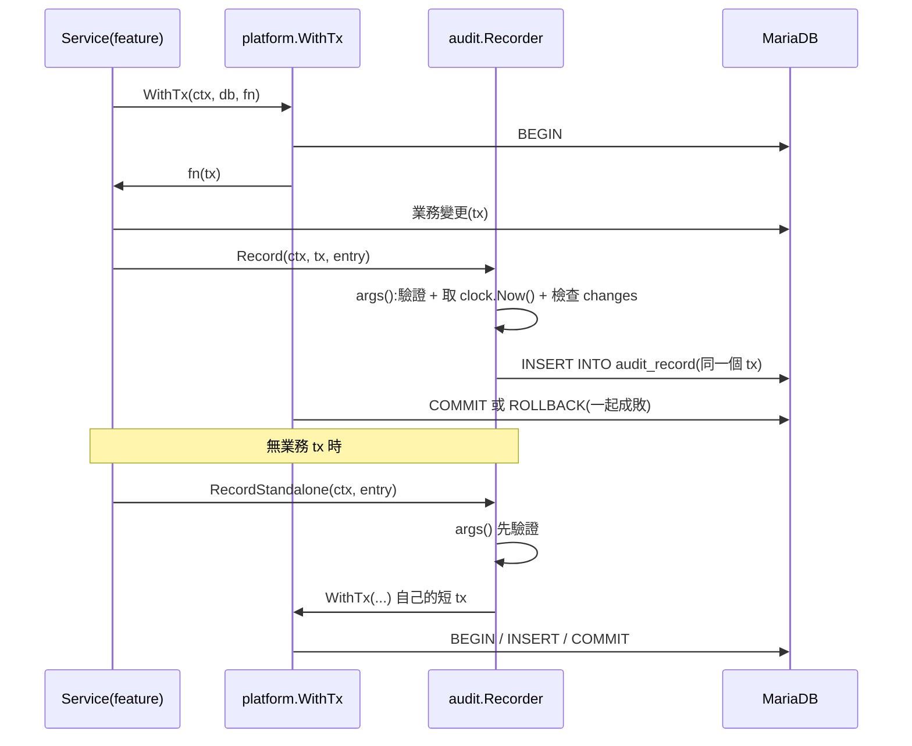

# Audit 套件與 audit_record 權限(Record / RecordStandalone)

## 一句話摘要
稽核紀錄與業務變更同一個 transaction 提交,且應用程式帳號在 DB 層只能 INSERT / SELECT。

## 背景與目標
- 對應 PRD AUD-001(哪些事件要記)、AUD-002(欄位)、AUD-003(append-only)、AUD-006(不得含密碼、session id、檔案內容);Architecture 5.3(`Record` 與 `RecordStandalone`)、7.2(application DB user 只有 `INSERT`、`SELECT`)。
- 使用者是之後的 `auth`、`team`、`idea` service;`audit` 只能 import `platform`(ADR 0003,由 `.golangci.yml` 的 depguard 檢查)。
- 成功定義:已 commit 的變更一定有對應 audit row;沒有業務 transaction 的事件(登入失敗等)也能記;應用程式即使被攻破或有 bug,也無法改寫或刪除 audit。

## 架構與資料流

註:目前沒有任何 service 呼叫它,`main.go` 也尚未建立 `Recorder`,圖中的 Service 是尚未存在的呼叫端。

## 程式碼導覽
| 檔案 | 職責 |
|---|---|
| `backend/internal/audit/audit.go:29` | `Entry`:一筆紀錄;時間戳不在 Entry 內,由 Recorder 蓋 |
| `backend/internal/audit/audit.go:43` | `Recorder{db, clock}`;`NewRecorder`(48) |
| `backend/internal/audit/audit.go:59` | `Record`:在呼叫端 tx 內 INSERT,不 commit |
| `backend/internal/audit/audit.go:72` | `RecordStandalone`:先驗證,再開自己的 `WithTx` |
| `backend/internal/audit/audit.go:86` | `args`:驗證 action / result、編碼 changes、`""` 轉 NULL |
| `backend/internal/audit/audit.go:116` | `encodeChanges` / `findSensitiveKey`(134):AUD-006 的敏感鍵檢查 |
| `backend/migrations/000001_create_audit_record.up.sql:4` | 建表、`result` CHECK、三個索引 |
| `backend/scripts/restrict-audit-grants.sh:1` | 撤掉 DB 層級權限,只對 `audit_record` 授權 INSERT, SELECT |
| `backend/internal/audit/audit_test.go:37` | sqlmock 測試:tx 歸屬、NULL、rollback、非法 entry |

## 設計決策與取捨
- **決策**:`Record` 的參數型別是 `sqlx.ExecerContext`,不是 `*sqlx.Tx`。
  - **替代方案**:要求 `*sqlx.Tx`;自訂 `Execer` 介面。
  - **理由**:`*sqlx.Tx` 直接符合,測試與未來其他實作都能傳入,audit 不需 import 更多東西(ADR 0003)。
  - **代價**:型別上擋不住有人傳 `*sqlx.DB`(它也符合),那就不在同一個 tx 內了(見「找問題」)。
- **決策**:`Recorder` 持有 `db` 與 `platform.Clock`,時間由 Recorder 蓋,存 UTC。
  - **替代方案**:用 DB 的 `NOW()`;讓呼叫端傳時間。
  - **理由**:ADR 0014 要求所有「現在」來自注入的 Clock,測試可固定時間;顯示才轉 Asia/Taipei。
  - **代價**:時間是應用程式機器的時間,不是 DB 的。
- **決策**:append-only 靠 DB 權限,不靠程式碼自律。
  - **替代方案**:trigger 擋 UPDATE/DELETE;只靠 repo 層不提供 update 方法。
  - **理由**:Architecture 7.2 的明文設計;權限在 DB 層,應用程式 bug 或 SQL injection 也改不了。
  - **代價**:見下一項。
- **決策**:授權腳本撤掉資料庫層級權限,改成逐表授權。
  - **替代方案**:只對 `audit_record` 做 `REVOKE UPDATE, DELETE`。
  - **理由**:MariaDB 權限是累加的,docker-compose 給 `MARIADB_USER` 的是整個資料庫 ALL,表層級的 REVOKE 無法扣掉資料庫層級的權限(實測用一次性容器驗證過 UPDATE、DELETE、TRUNCATE、DROP 都被拒)。
  - **代價**:之後每張表都要加進 `APP_TABLES`,漏了應用程式就沒有權限。
- **決策**:`RecordStandalone` 先 `args()` 驗證,再開 transaction。
  - **理由**:壞的 entry 不會白開一個 tx。
  - **代價**:`args()` 被跑兩次(第二次在 `Record` 內)。
- **決策**:`changes` 用 JSON 鍵名的子字串黑名單擋敏感資料。
  - **替代方案**:每個 action 一個 typed 結構;白名單鍵。
  - **理由**:簡單、能在單元測試中直接驗證。
  - **代價**:只是防呆,不是保證(見「找問題」)。

## 邊界情況與失敗處理
- `action` 為空白、`result` 不是 `success` / `failure`:回傳包著 `ErrInvalidEntry` 的錯誤,不碰 DB(`audit_test.go:88`)。
- `Changes` 無法 JSON 編碼(例如 channel)或含敏感鍵:同樣回 `ErrInvalidEntry`。
- INSERT 失敗:`Record` 回 `insert audit record: ...`;在業務 tx 內,呼叫端的 `WithTx` 會 rollback 整個變更;`RecordStandalone` 則 rollback 自己的 tx 並回傳錯誤(`audit_test.go:76`)。
- 可選欄位為空字串:存成 NULL,不存空字串(`audit_test.go:53`)。
- 欄位長度超過 schema(例如 `actor_role` 超過 16):沒有程式碼層檢查,取決於 MariaDB 的 strict mode 是否報錯(待確認)。
- `RecordStandalone` 失敗時不會自己重試或吞掉,由呼叫端決定要不要影響使用者回應。

## 已知落差
- `main.go` 尚未建立 `Recorder`,沒有 service 呼叫它。
- 只有 sqlmock 單元測試,沒有對真實 MariaDB 的整合測試;權限限制只做過一次手動驗證,CI 不會擋回歸。
- `cmd/migrate` 尚未存在,migration 目前沒有程式在套用;誰用什麼帳號跑 DDL 也還沒定義(應用程式帳號沒有 DDL 權限)。
- `APP_TABLES` 目前是空的:執行腳本後,應用程式帳號只剩 `audit_record` 的權限,連 session 表(ADR 0007)也沒有,必須等各功能把表加進去。
- 腳本假設帳號 host 是 `'%'`,與 compose 建的帳號一致;其他環境待確認。

## 面試考題

### 基礎

::: details Q1. `Record` 與 `RecordStandalone` 各自什麼時候用?差在哪?
**出處**:`backend/internal/audit/audit.go:59`、`:72`

**參考答案**
`Record` 在呼叫端傳入的 tx 內執行 INSERT,自己不 commit 也不 rollback,所以 audit row 與業務變更一起成功或失敗(`audit_test.go:37` 用 `ExpectRollback` 驗證 Record 不會自己 commit)。`RecordStandalone` 用 `platform.WithTx` 開一個短 tx,給沒有業務 tx 的事件,例如登入失敗、被拒絕的上傳、授權被拒。

**可能的追問**
- 業務 tx 已經 rollback 了,但「失敗」本身也想留紀錄,該用哪個?
- 為什麼 `RecordStandalone` 不直接 `db.ExecContext`?

**考察點**:transaction 邊界與 atomicity
:::

::: details Q2. 為什麼時間戳不放在 `Entry`,而由 `Recorder` 蓋?
**出處**:`backend/internal/audit/audit.go:29`、`:98`

**參考答案**
`args()` 用注入的 `platform.Clock` 取 `Now().UTC()`。這符合 ADR 0014(所有時間來自 Clock、內部用 UTC),測試用 `ManualClock` 固定時間,斷言 `WithArgs(fixedNow, ...)` 不用 sleep。同時呼叫端無法偽造時間。

**可能的追問**
- 為什麼存 UTC、顯示才轉 Asia/Taipei?
- 多台 app server 時鐘不同步會怎樣?

**考察點**:可測試性、時間處理
:::

::: details Q3. 空字串的 `ActorEmployeeID` 為什麼要存成 NULL?
**出處**:`backend/internal/audit/audit.go:109`、`audit_test.go:53`

**參考答案**
`nullable("")` 回 nil。「沒有 actor」(未知帳號的登入失敗、系統動作)與「actor 是空字串」是不同語意;存 NULL 查詢時用 `IS NULL` 就能乾淨區分。

**可能的追問**
- NULL 在複合索引與唯一性上有什麼行為?

**考察點**:資料建模
:::

### 進階

::: details 🔥 Q4. 為什麼只對 `audit_record` 做 `REVOKE UPDATE, DELETE` 不夠?腳本怎麼解?
**出處**:`backend/scripts/restrict-audit-grants.sh:1`、`:20`

**參考答案**
MariaDB 的權限是累加的:有效權限是全域、資料庫、表、欄位各層級授權的聯集。docker-compose 的 `MARIADB_USER` 拿到的是 `esg_award.*` 的 ALL,表層級的 REVOKE 不會從資料庫層級授權裡扣掉東西。腳本改成先 `REVOKE ALL PRIVILEGES, GRANT OPTION`,再 `GRANT USAGE ON *.*`,只對 `audit_record` 授權 `INSERT, SELECT`,其他表由 `APP_TABLES` 逐表授權。撤掉再授權也讓腳本可重複執行(我跑了兩次結果一致)。

**可能的追問**
- 為什麼腳本用 `MYSQL_PWD` 環境變數而不是 `-p`?
- 有沒有比逐表授權更好的做法?(例如 role、獨立的 migrator 帳號)
- `TRUNCATE`、`DROP` 為什麼也被擋?(需要 DROP 權限)

**考察點**:DB 權限模型、least privilege
:::

::: details Q5. 為什麼 `RecordStandalone` 要在開 transaction 之前先驗證?
**出處**:`backend/internal/audit/audit.go:72`

**參考答案**
非法的 entry 不需要連線、不需要 BEGIN。`TestInvalidEntries_NeverReachDB`(`audit_test.go:88`)的 sqlmock 沒有任何 `ExpectBegin`,若有 DB 呼叫就會失敗,所以能證明沒碰 DB。代價是 `args()` 跑兩次。

**可能的追問**
- 兩次呼叫 `clock.Now()` 有什麼影響?(最終寫入的是第二次的時間)
- 怎麼避免重複計算?

**考察點**:fail fast、成本與清晰度的取捨
:::

::: details Q6. 為什麼 `changes` 要先 marshal 再 unmarshal 成 `any` 才檢查敏感鍵?
**出處**:`backend/internal/audit/audit.go:116`

**參考答案**
`Changes` 可以是 struct、map、slice 等任何東西。先 `json.Marshal` 得到「真正會寫進 DB 的 JSON」,再 unmarshal 成通用樹遞迴檢查鍵名,這樣 struct 的 json tag 也會被考慮,檢查的對象與儲存內容一致。

**可能的追問**
- 這樣檢查的盲點是什麼?(值本身、子字串誤判)
- 效能影響?(每筆多一次編解碼,本專案量小可接受)

**考察點**:輸入驗證、與儲存內容一致的檢查
:::

### 設計/情境

::: details Q7. 流量放大 10 倍,audit 的寫入會變成瓶頸嗎?要改哪裡?
**出處**:`backend/internal/audit/audit.go:52`、`migrations/000001_create_audit_record.up.sql:19`

**參考答案**
audit 是 INSERT 且與業務變更同一個 tx,不會增加額外 round trip 以外的鎖競爭,但每筆寫入多了三個二級索引的維護成本。可以:先量測;若索引成本明顯,評估移除少用的索引(AUD-005 說只有工程師查 DB);再大則考慮 partition by `occurred_at`。改成非同步寫入(queue)會打破「已 commit 的變更一定有 audit」的保證,需要 ADR。PRD 的規模(約 25,000 人)沒有效能目標,我沒有量測數據,所以以上是方向而非結論。

**可能的追問**
- 保留 1 年(AUD-004)之後資料量怎麼估?
- 如果允許 audit 延遲,可以怎麼設計又不丟資料?(outbox)

**考察點**:取捨、可靠性與效能
:::

::: details Q8. 如果要新增一個 action,例如 `idea.download`,要改哪裡?怎麼證明它有被記錄?
**出處**:`backend/internal/audit/audit.go:29`

**參考答案**
不用改 audit 套件:呼叫端在對應 service 的 `WithTx` 裡呼叫 `Record`。`action` 目前是自由字串,沒有集中定義。驗證方式是該 service 的測試斷言 audit INSERT 被執行;最好有對真實 DB 的整合測試。若 action 數量增加,可以考慮在 audit 套件定義常數,避免拼字不一致(待討論,現況未做)。

**可能的追問**
- 下載是讀取操作,沒有業務 tx,該用哪個 API?
- AUD-001 的清單如何確保沒有遺漏?

**考察點**:擴充性、需求可追溯
:::

::: details Q9. 怎麼讓「application 帳號真的不能改 audit」不會在日後被悄悄打破?
**出處**:`backend/scripts/restrict-audit-grants.sh:1`

**參考答案**
目前只有一次手動驗證。做法:加整合測試(CI 起 MariaDB,跑 migration 與腳本,再用應用程式帳號嘗試 UPDATE / DELETE / TRUNCATE 並斷言權限錯誤 1142);另外查 `SHOW GRANTS` 確認沒有資料庫層級權限。這是已知落差,尚未實作。

**可能的追問**
- 誰有權限在生產環境修改授權?
- 如果 DBA 手動加了權限,怎麼偵測?

**考察點**:把安全性質變成可測的不變量
:::

### 找問題

::: details 🔥 Q10. 這段程式碼有什麼潛在問題?
**出處**:`backend/internal/audit/audit.go:59`、`:84`、`:134`;`scripts/restrict-audit-grants.sh:22`

**問題**(都是我在程式碼裡實際看到的):
1. `Record` 的參數是 `sqlx.ExecerContext`,`*sqlx.DB` 也符合。呼叫端誤傳 `db` 編譯會過,audit 會在自己的隱含 tx 立即 commit,業務 tx 之後 rollback 時 audit 還留著(或相反),破壞 atomicity,而且沒有任何錯誤。
2. 敏感資料檢查只看鍵名,而且是子字串:`{"note": "password is 123"}` 通過,`{"tokenizer": "x"}`、`{"sessions_count": 3}` 被誤擋。它是防呆,不是 AUD-006 的保證。
3. `RecordStandalone` 先 `args()` 再於 `Record` 內又算一次,時間戳取自第二次呼叫,同時重複做 JSON 編解碼。
4. 沒有欄位長度與 `SourceIP` 格式驗證,超長值的行為取決於 MariaDB 是否 strict mode(待確認)。
5. 授權腳本在 `APP_TABLES` 為空時,會把應用程式帳號對其他所有表的權限都撤掉;順序上若在其他表建立之後、`APP_TABLES` 補齊之前執行,應用程式立即失去存取。

**如何修**:
1. 把參數改成只有 tx 能滿足的窄介面(例如多一個 tx 專屬的標記方法),或 `Record` 接 `*sqlx.Tx`;
2. 改用 typed 的 changes 結構或白名單鍵,並在 review 規範禁止塞原始 request body;
3. 把驗證與編碼拆成 `prepare(e)`,回傳 args 後直接傳給 insert,只算一次;
4. 在 `args()` 加長度檢查,`net.ParseIP` 檢查 `SourceIP`;
5. 腳本在執行前列出現有表,對尚未列在 `APP_TABLES` 的表報錯,或改用 role。

**如何驗證**:
1. 單元測試傳 `*sqlx.DB`,應該無法編譯或回錯;2. 表格測試涵蓋值含敏感字串與鍵名誤判;3. 測試 `clock.Now()` 只被呼叫一次;4. 超長欄位的測試;5. 整合測試:執行腳本後,應用程式帳號對 `SHOW GRANTS` 的結果符合預期。
:::

## 三分鐘口頭說明稿
這個功能要滿足兩個稽核需求:一是每個已提交的變更都要有對應的稽核紀錄,二是紀錄不能被應用程式改掉或刪掉。

第一個需求我用同一個 transaction 解決。`Recorder.Record(ctx, tx, entry)` 在呼叫端的 `WithTx` 裡做 INSERT,不自己 commit,所以業務變更和稽核紀錄一起成功或一起 rollback。沒有業務 transaction 的事件,像登入失敗或被拒絕的上傳,用 `RecordStandalone`,它先驗證 entry,再用自己的短 transaction 寫入。時間由注入的 Clock 提供並存 UTC,測試可以固定時間。寫入前還會檢查 action 與 result,並檢查 changes 的鍵名,避免把密碼、session 之類的東西寫進去。

第二個需求我放在資料庫層,而不是靠程式自律。一開始想只對 `audit_record` 撤銷 UPDATE 和 DELETE,但 MariaDB 的權限是累加的,compose 給應用程式帳號的是整個資料庫的 ALL,表層級撤銷沒有用。所以腳本改成撤掉資料庫層級權限,再逐表授權,`audit_record` 只給 INSERT 和 SELECT。我用一次性的 MariaDB 容器驗證過,UPDATE、DELETE、TRUNCATE、DROP 都被拒絕。

取捨與未完成的地方:逐表授權代表之後每張新表都要登記;敏感資料檢查只是防呆;`Record` 的參數型別擋不住有人傳入 `*sqlx.DB`;而且目前只有 sqlmock 測試,沒有 CI 的整合測試去守住權限這個性質。下一步是補整合測試並收窄那個參數型別。
