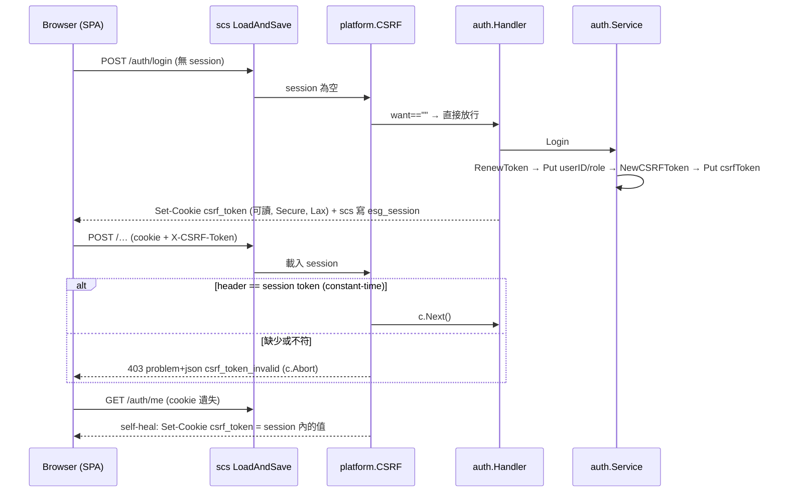

# CSRF 防護 (AUTH-009)

## 一句話摘要
登入後每個 session 有一個隨機 token,所有狀態變更請求必須用 `X-CSRF-Token` header 帶回,伺服器拿它跟 session 內的值比對。

## 背景與目標
對應 PRD AUTH-009(每個狀態變更動作都要防 CSRF)。Session 是 cookie(ADR 0007),所以跨站偽造的請求會自動帶上 session cookie。成功的定義:登入狀態下,沒有正確 token 的 POST/PUT/PATCH/DELETE 一律在 handler 之前被擋下(`403 csrf_token_invalid`)。**不含**:沒有 session 的請求(register、login、無 session 的 logout),這是刻意縮小範圍,見「設計決策」與「已知落差」。

## 架構與資料流

## 程式碼導覽
| 檔案 | 職責 |
|---|---|
| `backend/internal/platform/csrf.go:15` | 契約常數:cookie 名稱 `csrf_token`、header `X-CSRF-Token`、session key、problem code |
| `backend/internal/platform/csrf.go:27` | `SessionReader`:消費端定義的最小介面,`*scs.SessionManager` 滿足(ADR 0003) |
| `backend/internal/platform/csrf.go:32` | `NewCSRFToken`:`crypto/rand` 32 bytes,base64url |
| `backend/internal/platform/csrf.go:47` | `CSRF` middleware:讀 session token、self-heal cookie、安全方法放行、constant-time 比對、失敗 403 + `Abort` |
| `backend/internal/platform/csrf.go:79` | `SetCSRFCookie`:刻意不是 HttpOnly(SPA 要讀) |
| `backend/internal/platform/csrf.go:89` | `ClearCSRFCookie`:先移除本回應已排隊的 `csrf_token` Set-Cookie 再清除 |
| `backend/internal/auth/service.go:252` | `Login` 在 `RenewToken` 之後建立並 `Put` token,每次登入都換新 |
| `backend/internal/auth/service.go:311` | `CSRFToken(ctx)`:讓 handler 能取得要發的 cookie 值 |
| `backend/internal/auth/handler.go:74` | `Login` 成功後發 cookie;`handler.go:87` `Logout` 清 cookie |
| `backend/internal/auth/session.go:20` | `keyCSRF = platform.CSRFSessionKey`:auth 與 middleware 共用同一個 key |
| `backend/cmd/server/main.go:87` | `router.Use(platform.CSRF(...))`,在路由註冊之前;`:93` `LoadAndSave` 包在整個 router 外 |
| `frontend/src/api/client.ts` | 前端早就完成的另一半:非安全方法從 `csrf_token` cookie 讀值放進 header |

## 設計決策與取捨
- **決策**:token 存在 server 端 session,header 與「session 內的值」比對,不與 cookie 比。
  - **替代方案**:純 double-submit cookie(header == cookie)。
  - **理由**:攻擊者若能種 cookie(例如同網域的子網域),純 double-submit 就被繞過;與 session 比對則不受影響。已經有 session store,沒必要接受較弱的版本。ADR 0018。
  - **代價**:每個請求都要有 session 讀取(但 `LoadAndSave` 本來就讀了,沒有額外 DB 查詢)。
- **決策**:cookie 不設 HttpOnly。
  - **替代方案**:HttpOnly + 另開 `GET /auth/csrf` 回傳 token。
  - **理由**:前端 client 已經照「讀 cookie」寫好;SPA 與 API 同 origin。
  - **代價**:XSS 可以讀到 token,所以 CSRF 防護的前提是 CSP 擋住 XSS(Architecture 9.4)。
- **決策**:沒有 session(`want == ""`)就整個略過檢查。
  - **替代方案**:登入前發匿名 token。
  - **理由**:使用者明確要求簡化;沒有 session 就沒有可被冒用的身分,且 `SameSite=Lax` 已擋跨站 POST。
  - **代價**:接受 login CSRF(把受害者登入成攻擊者帳號);而且是 fail-open(見「找問題」)。
- **決策**:middleware 放在 `platform`,只認 `SessionReader` 介面;token 建立與 cookie 生命週期放在 `auth`。
  - **理由**:`platform` 不能 import 任何 feature(depguard,ADR 0003)。
  - **代價**:session key 要靠共用常數 `CSRFSessionKey` 對齊,不是型別層級保證。
- **決策**:拒絕只寫 `slog`,不寫 audit。
  - **理由**:`platform` 不能 import `audit`;AUD-001 沒列 CSRF 拒絕。
  - **代價**:攻擊嘗試在資料庫查不到,只在 log。

## 邊界情況與失敗處理
- **缺 header / 錯 header / 只有前綴**:`ConstantTimeCompare` 長度不同直接回 0 → 403;handler 不執行(`csrf_test.go:76`)。
- **攻擊者種 cookie 並在 header 回傳同值**:session 內的才算數 → 403(`csrf_test.go:93`)。
- **cookie 被瀏覽器丟掉**:任何帶 session 的請求都會被 self-heal 補發;SPA 載入時 `useSession` 會打 `GET /auth/me`(`auth/csrf_test.go:78`)。
- **Logout**:self-heal 與 handler 的清除會在同一個回應產生兩個 `csrf_token` Set-Cookie;`ClearCSRFCookie` 先移除前者,確保只剩清除那一個(`platform/csrf.go:89`)。Logout 本身受保護:偽造的 logout 被 403,session 保留(`auth/csrf_test.go:26`)。
- **無 session 的 logout**:沒有 token,不檢查,維持冪等 204。
- **產生 token 失敗**(`rand.Read` 錯誤):`Login` 回傳錯誤,但此時 session 已 `RenewToken` 且 `userID/employeeID/role` 已寫入、尚無 `csrfToken`;audit 失敗時的 `Destroy` 補償路徑不涵蓋這一步(見「找問題」Q9)。
- **多次登入**:每次 `RenewToken` 後換新 token,A session 的 token 對 B session 無效(`auth/csrf_test.go:51`)。

## 已知落差
- **ADR 0018 與程式碼不一致**:ADR 寫「registered after the rate limiter」,但這個 branch 的 `main.go` 沒有 rate limiter(AUTH-004 是主工作樹未提交的另一張票)。實際順序只有 `Recovery → CSRF → routes`。AUTH-004 合併後才會成立,合併前 ADR 這句話不準確。**待處理**。
- **Login CSRF 未防**:設計上接受(ADR 0018)。
- **CSRF 拒絕未進 audit**:設計上接受。
- **AUTH-007 改密碼**:CUR-62 已實作,改密碼成功時會輪替 CSRF token(不輪替 session token,原因見 ADR 0019),並有測試守住。
- **自動化 E2E 尚未涵蓋**:NFR-QA-002 要求;目前只有 unit/integration(`httptest`),沒有真瀏覽器流程。
- **測試名稱略超出內容**:`TestAUTH_009_LoginAndLogoutWithoutASessionNeedNoToken`(`auth/csrf_test.go:71`)實際只測了 logout;login 只是被其他測試隱含涵蓋。

## 面試考題

### 基礎

::: details Q1. 這個功能的 CSRF token 從產生到驗證經過哪些步驟?
**出處**:`backend/internal/auth/service.go:252`、`backend/internal/platform/csrf.go:47`

**參考答案**
`Login` 成功並 `RenewToken` 後,呼叫 `platform.NewCSRFToken()`(32 bytes `crypto/rand`,base64url)存進 session 的 `csrfToken`。Handler 在回應裡再發一個同值的 `csrf_token` cookie(非 HttpOnly)。之後 SPA 的 `client.ts` 在非安全方法上把 cookie 值放進 `X-CSRF-Token`。每個請求先經 `LoadAndSave` 載入 session,再進 `platform.CSRF`:讀出 session token,若 method 不是 GET/HEAD/OPTIONS,就用 `subtle.ConstantTimeCompare` 比對 header,不符回 403 並 `c.Abort()`。

**可能的追問**
- 為什麼 token 要在 `RenewToken` 之後才建立?
- SPA 怎麼拿到 token?為什麼不是 HttpOnly?

**考察點**:能否完整說出資料流,而不是只講「有一個 CSRF middleware」。
:::

::: details Q2. 為什麼要比對 header 與 session 內的值,而不是 header 與 cookie?
**出處**:`backend/internal/platform/csrf.go:40`、`backend/internal/platform/csrf_test.go:93`

**參考答案**
純 double-submit 只證明「header 與 cookie 一致」,攻擊者只要能種 cookie(子網域、某些 cookie injection)就能自己產生一組一致的值。這裡比對的是 server 端 session 裡只有登入者的瀏覽器才知道的 token。`TestAUTH_009_CookieAloneIsNotEnoughTheSessionDecides` 用 header=cookie=`forged` 對上 session `real`,驗證會 403。

**可能的追問**
- 這樣還需要 cookie 嗎?(需要:只是讓 SPA 有地方讀,驗證不依賴它。)
- 子網域能種 cookie 為什麼會影響?

**考察點**:對 CSRF 防禦模型的理解深度。
:::

### 進階

::: details 🔥 Q3. 為什麼用 `subtle.ConstantTimeCompare`?換成 `==` 會怎樣?實際風險有多大?
**出處**:`backend/internal/platform/csrf.go:64`

**參考答案**
`==` 在第一個不同位元組就返回,理論上可以用回應時間逐字猜 token。`ConstantTimeCompare` 對等長輸入花固定時間;長度不同時直接回 0(長度本身不是祕密,因為 token 固定 43 字元)。實際上網路抖動讓這種攻擊在遠端很難,而且 token 每個 session 都換,攻擊窗口小;但成本是零,所以照做。注意它不能保護「長度」資訊。

**可能的追問**
- 同樣的考量還有哪裡用到?(密碼雜湊驗證、session token 比對由函式庫處理。)
- 攻擊者要怎麼才能拿到足夠精確的計時?

**考察點**:是否知道這個細節的真實威脅等級,而不是背「要用 constant-time」。
:::

::: details Q4. `RenewToken` 與 CSRF token 的產生順序為什麼重要?
**出處**:`backend/internal/auth/service.go:245`(RenewToken)、`:252`、`backend/internal/auth/session_test.go`(`TestAUTH_005_LoginRenewsTheTokenBeforeStoringIdentity`)

**參考答案**
`RenewToken` 讓登入前的 session 識別碼作廢,防 session fixation。若先放 token 再 renew,token 雖會跟著資料搬到新 session(scs 保留資料),但語意上應該只有「已驗證的 session」才擁有 CSRF token。測試斷言呼叫順序為 `renew → put:userID → put:employeeID → put:role → put:csrfToken`,把這個順序固定下來。

**可能的追問**
- scs `RenewToken` 會保留 session 資料嗎?(待確認:實際行為以 scs 文件為準。)
- 登入前若攻擊者已經在受害者瀏覽器種下 session,會發生什麼?

**考察點**:session fixation 與 CSRF 的交互。
:::

::: details Q5. 為什麼 self-heal 放在「檢查之前」?拒絕的請求也會補發 cookie,這樣安全嗎?
**出處**:`backend/internal/platform/csrf.go:54`

**參考答案**
放前面是為了讓 `GET /auth/me`(安全方法)也能補 cookie,SPA 載入時就恢復。對被拒絕的請求補發 cookie 不洩漏東西:cookie 值就是這個 session 擁有者本來就該有的 token,而且是回到「發出這個請求的瀏覽器」(跨站偽造請求的回應攻擊者讀不到)。不過 Set-Cookie 在跨站請求回應上能否被接受取決於瀏覽器的 SameSite 處理,這裡依賴的是「攻擊者看不到回應」,不是「瀏覽器會擋」。

**可能的追問**
- 這段邏輯對 `Secure` 與本機 http 開發有影響嗎?(Chrome 對 localhost 視為安全來源,待確認其他瀏覽器。)

**考察點**:對「這個副作用在對抗情境下會怎樣」的推理。
:::

### 設計/情境

::: details Q6. 現在要連登入前的 register/login 也防 CSRF(含 login CSRF),要改哪裡?怎麼驗證?
**出處**:`backend/internal/platform/csrf.go:49`(`want == ""` 的分支)

**參考答案**
需要登入前就有 token:新增 `GET /auth/csrf`(或在任何回應發匿名 token),token 存在無身分的 session 或簽章 cookie。Middleware 的 `want == ""` 分支改成「必須有 token」,但 login/register 要用匿名 token 驗證。登入時 `RenewToken` 後輪替成登入者的 token。驗證:新增測試「無 session 的 POST /auth/login 沒 header → 403」「有匿名 token → 成功」「登入後匿名 token 失效」;OpenAPI 同步更新,前端在 login 前先取 token。代價是多一個端點與一條程式碼路徑,所以 ADR 0018 先選擇不做。

**可能的追問**
- 匿名 token 要怎麼綁定?(簽章 cookie 與 session 存放的取捨。)
- 這會不會影響第一次進站的請求數?

**考察點**:需求變動時能否定位改動點並評估成本。
:::

::: details Q7. 以後有人加 `PUT /auth/password`(AUTH-007)與 `POST /ideas`,各自要做什麼才不會漏掉 CSRF?
**出處**:`backend/cmd/server/main.go:87`、`backend/internal/auth/service.go:252`

**參考答案**
新路由不需要做任何事:middleware 是全域的,在 `RegisterHandlersWithOptions` 之前,任何帶 session 的非安全請求都會被檢查,這是「預設保護」。要手動處理的只有 token 生命週期:改密碼時 session 要輪替,token 也要一起換,而且 AUTH-007 還要銷毀同一使用者的其他 session。目前沒有測試守住這點,所以實作該票時要先寫「改密碼後舊 token 失效」的測試。

**可能的追問**
- 如果有人新增一條不該被檢查的路由(例如 webhook),怎麼豁免?(目前沒有豁免機制,待設計。)

**考察點**:預設安全的設計,以及哪些責任仍在 feature 端。
:::

### 找問題

::: details 🔥 Q8. 這段程式碼有什麼潛在問題?
**出處**:`backend/internal/platform/csrf.go:49`

**問題**:這個 middleware 是 **fail-open**:只要 session 內沒有 `csrfToken` 就整個略過。任何已登入但沒有 token 的 session 都不受保護,例如:(1) 部署此功能之前建立的舊 session,直到它過期或重新登入;(2) 未來有人新增另一條建立登入 session 的路徑(例如管理員強制改密碼流程)卻忘了放 token。Middleware 只知道「有沒有 token」,不知道「是否已登入」(它看不到 `userID`)。

**如何修**:讓 middleware 同時知道登入狀態,例如傳入 `isAuthenticated` 判斷(消費端介面再加一個方法,或由 auth 提供 `func(ctx) bool`),「已登入但沒 token」直接 403 或補發 token;或把建立登入 session 的邏輯集中到單一函式,保證一定放 token。

**如何驗證**:新測試:session 有 `userID` 但沒有 `csrfToken` 的 POST 應該被拒絕;並驗證登入流程仍通過。
:::

::: details Q9. 還有哪些你在程式碼裡看到的次要問題?
**出處**:`backend/internal/auth/service.go:252`、`backend/internal/auth/csrf_test.go:71`、`backend/internal/platform/csrf.go:93`

**問題**:
1. `Login` 在 `RenewToken` 與 `Put` 之後才產生 token;`rand.Read` 失敗時直接 return,session 已被 renew 並寫入 `userID/role`,卻沒有 `Destroy`(audit 失敗那條路徑有補償,這條沒有)。這個 session 因為沒有 `csrfToken`,會落入 Q8 的 fail-open。實務上 `crypto/rand` 幾乎不會失敗,但順序上更安全的做法是**在 `RenewToken` 之前先產生 token**,失敗就根本不動 session。
2. `ClearCSRFCookie` 靠 `strings.HasPrefix(v, "csrf_token=")` 過濾 header,是字串匹配,對格式改動脆弱。
3. 測試名稱 `LoginAndLogoutWithoutASessionNeedNoToken` 只測 logout。

**如何修**:先產生 token 再 renew;過濾改用 `http.ParseSetCookie`(待確認所用 Go 版本是否提供);名稱與內容對齊或補一個 login 的無 header 測試。

**如何驗證**:注入會失敗的 token 產生器(目前直接呼叫 `platform.NewCSRFToken`,不可注入;要先改成可替換)再斷言不留下半成品 session。
:::

## 三分鐘口頭說明稿
AUTH-009 要求所有狀態變更請求都要防 CSRF。我們的 session 是 cookie,所以跨站請求會自動帶上它,必須再加一個攻擊者拿不到的東西。

我的做法是「綁在 session 的 token」:登入時,在 session 更新完 token 之後,產生一個 32 bytes 的隨機值存進 server 端 session,同時用一個非 HttpOnly 的 `csrf_token` cookie 交給 SPA。SPA 的 client 在所有非 GET 請求把它放到 `X-CSRF-Token` header。後端是一個 Gin middleware,放在 session 載入之後、路由之前,把 header 和 session 裡的值用 constant-time 比對,不符就回 403 problem+json,handler 完全不執行。因為比的是 session 裡的值而不是 cookie,攻擊者就算能種 cookie 也沒用。新增的任何路由自動受保護。

幾個取捨:cookie 必須可讀,所以安全性依賴 CSP 擋 XSS;沒有 session 的請求(register/login)不檢查,因為沒有身分可冒用,我們接受 login CSRF 這個低風險,寫進 ADR 0018;拒絕只寫 log 不寫 audit,因為 platform 不能依賴 audit。我也補了 cookie 遺失時的自我修復,以及 logout 時避免同一回應出現兩個 Set-Cookie。

做完回頭審視,我發現兩個可以改進的點:middleware 是 fail-open,舊 session 或未來漏放 token 的登入路徑都不受保護;以及 token 產生應該在 `RenewToken` 之前。這兩點我已經記錄在文件的「找問題」。測試涵蓋了缺 header、錯 header、cookie 偽造、換 session、logout 與 cookie 補發,platform 覆蓋率 88%、auth 94%。
