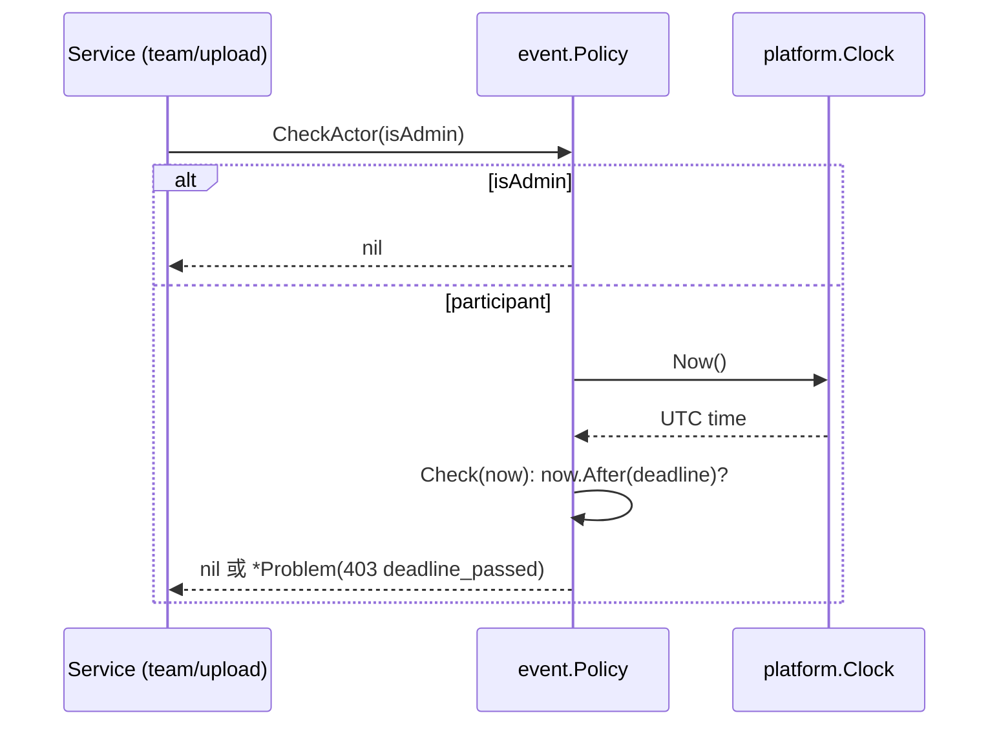

# 活動年度與截止時間政策 (event.Policy)

## 一句話摘要
在單一位置判斷「參賽者現在能不能寫入」,依設定的截止時間(Asia/Taipei)放行或拒絕,Admin 免檢。

## 背景與目標
對應 PRD DDL-001(單一全域截止、Asia/Taipei、來自設定)、DDL-003(截止後禁止寫入)、DDL-005(以動作完成當下的系統時間為準)、DDL-006(Admin 不受限)、DDL-007(改截止 = 改設定 + 重啟)。使用者是 team / upload / idea 等 service:每個 participant 寫入操作都呼叫它。成功的定義:規則只有一份實作、時間可注入測試、錯誤能被 error middleware 轉成 RFC 9457 回應。見 [ADR 0014](../../docs/adr/0014-event-year-and-deadline-from-configuration.md)。

## 架構與資料流

目前尚無 caller(main.go 未接線),上圖是設計中的呼叫順序,非已運行的流程。

## 程式碼導覽
| 檔案 | 職責 |
|---|---|
| `backend/internal/event/policy.go:17` | `Taipei` 固定 +08:00 zone,僅用於顯示 |
| `backend/internal/event/policy.go:20` | `ErrDeadlinePassed()` 建立 403 / `deadline_passed` 的 Problem |
| `backend/internal/event/policy.go:28` | `Policy` 不可變 struct:year、deadline(UTC)、clock |
| `backend/internal/event/policy.go:40` | `NewPolicyFromConfig` 由啟動時已驗證的 `platform.Config` 建立 |
| `backend/internal/event/policy.go:53` | `Check(now)` 純函式式判斷,`now.After(deadline)` 才拒絕 |
| `backend/internal/event/policy.go:63` | `CheckActor(isAdmin)` Admin 短路,否則用 clock 呼叫 `Check` |
| `backend/internal/event/policy_test.go` | 邊界表驅動測試、`ManualClock` 模擬截止中途經過、Admin bypass |

## 設計決策與取捨
- **決策**:`Check(now)` 接收時間參數,另提供 `CheckActor` 包 clock 與 Admin 判斷。
  - **替代方案**:只提供 `Check()` 內部取時間;或讓 Policy 依賴 auth 的 Role 型別。
  - **理由**:`Check(now)` 對應 Architecture 5.1 的簽名且易於表驅動測試;`isAdmin bool` 避免 `event` import `auth`,維持 ADR 0003 的依賴方向。
  - **代價**:呼叫端必須自己判斷 isAdmin,可能忘記傳或傳錯。
- **決策**:deadline 內部存 UTC,顯示用固定 offset zone。
  - **替代方案**:`time.LoadLocation("Asia/Taipei")`。
  - **理由**:不依賴 image 內的 tzdata;台灣無 DST。
  - **代價**:zone 名稱只是標籤,若日後需要其他時區的規則就得改。
- **決策**:設定只在啟動讀一次,Policy 不可變(ADR 0014)。
  - **代價**:延長截止需重啟;多實例設定不一致時各自執行不同截止。

## 邊界情況與失敗處理
- `now == deadline`:允許(`After` 為嚴格大於)。晚 1 ns 即拒絕。
- 傳入不同時區的 `now`:`After` 比較的是時間點,與 zone 無關(測試 `same instant in Taipei zone` 覆蓋)。
- 截止在流程中途經過:每次呼叫都重新讀 clock,所以 `CheckActor` 在流程後段再呼叫一次會得到拒絕(`ManualClock.Advance` 測試覆蓋)。
- 回傳的是 `*platform.Problem`,`AsProblem` 可直接轉成 403 回應,不會洩漏內部訊息。
- 截止已過去的啟動設定是允許的(ADR 0014),此時所有 participant 寫入都被拒絕。

## 已知落差
- **邊界語意**:DDL-005 寫「未在截止前完成就拒絕」,字面上 `now == deadline` 也算未在截止「前」完成;實作採「等於截止仍允許」。PRD 沒有明說,待 Product Owner 確認。
- **尚未接線**:`main.go` 未建立 Policy,也沒有 API 欄位把 year / deadline 唯讀暴露給前端(DDL-002)。
- **upload 雙重檢查**(Architecture 8.2)要等 upload / idea 實作後才會真正使用 `CheckActor`。

## 面試考題

### 基礎

::: details Q1. `Check` 在什麼條件下回傳錯誤?截止時間剛好等於 now 時呢?
**出處**:`backend/internal/event/policy.go:53`

**參考答案**
只有 `now.After(p.deadline)` 為真才回傳 `ErrDeadlinePassed()`。`now == deadline` 回傳 nil,即允許。比較的是 instant,不受 `now` 的 Location 影響,所以 Taipei 與 UTC 表示同一時刻結果相同。

**可能的追問**
- 若 PO 說「23:59:59 整就算過期」,要改哪裡?(改成 `!now.Before(deadline)` 並更新邊界測試)

**考察點**:邊界條件與 `time.Time` 比較語意。
:::

::: details Q2. 為什麼 `Policy` 要接收 `platform.Clock`,而不是直接呼叫 `time.Now()`?
**出處**:`backend/internal/event/policy.go:35`, `backend/internal/event/policy_test.go`(`TestCheckActor_AdminBypassAndClock`)

**參考答案**
時間是外部相依,注入後測試可用 `ManualClock` 精準控制,例如先在截止前 1 分鐘通過、`Advance(2 * time.Minute)` 後被拒,完全不需要 sleep,也不會 flaky。這也是 ADR 0014「Injected clock」的要求。

**可能的追問**
- `ManualClock` 為什麼要用 mutex?(測試中可能與被測 goroutine 並行讀寫)

**考察點**:可測試性、dependency injection。
:::

### 進階

::: details 🔥 Q3. DDL-005 要求「以動作完成當下的時間為準」。這個 Policy 能保證嗎?哪裡還有縫隙?
**出處**:`backend/internal/event/policy.go:63`

**參考答案**
Policy 本身只回答「此刻是否允許」,不保證之後的動作也在截止前完成。做法是 upload 在存 object 前與 DB transaction 內各檢查一次(Architecture 8.2),把縫隙縮到 commit 前的毫秒級,但 `Check` 與 `COMMIT` 之間仍有極小視窗,若要絕對嚴格需把時間判斷放進 DB(例如 `UPDATE ... WHERE NOW() <= ?`),但那樣用的是 DB clock,與應用 clock 又可能有偏差。另外多實例之間的 clock skew 也會造成誤差,需靠 NTP。

**可能的追問**
- 這個視窗在業務上可接受嗎?為什麼?
- 檢查在 tx 內 vs tx 外,有什麼差別?

**考察點**:race condition / TOCTOU 意識、分散式環境的時間。
:::

::: details Q4. 為什麼 `CheckActor` 用 `isAdmin bool`,而不是傳入使用者或 Role?
**出處**:`backend/internal/event/policy.go:63`

**參考答案**
`event` 不應 import `auth`(ADR 0003 的依賴方向)。傳 bool 讓 Policy 只關心「是否豁免」,把角色判斷留在 service 層。代價是每個 caller 都要自己算 isAdmin;好處是 Policy 好測、沒有循環依賴。

**可能的追問**
- 若日後出現第三種角色(例如 judge)有不同截止,怎麼擴充?

**考察點**:package 邊界、依賴方向。
:::

::: details Q5. 為什麼回傳 `*platform.Problem` 當作 `error`?`errors.Is(err, ErrDeadlinePassed())` 會成立嗎?
**出處**:`backend/internal/event/policy.go:20`

**參考答案**
`Problem` 實作了 `error`,讓 error middleware 用 `AsProblem` 直接渲染 403 與穩定的 `code`。但 `ErrDeadlinePassed` 是工廠函式,每次回傳新指標,`errors.Is` 比較指標所以不成立;要判斷請用 `errors.As` 取出 `*Problem` 後比對 `Code == CodeDeadlinePassed`(測試就是這樣做)。

**可能的追問**
- 為什麼不用 sentinel `var`?(共享可變指標,有人改 `Instance` 會影響全域;`WriteProblem` 雖有複製,但工廠更安全)

**考察點**:Go error 慣例、`errors.Is` / `errors.As`。
:::

### 設計/情境

::: details Q6. 現在要支援「截止前不重啟就能延長」,你會怎麼改?怎麼驗證?
**出處**:`backend/internal/event/policy.go:28`

**參考答案**
目前 Policy 不可變且啟動讀一次(ADR 0014 刻意如此)。要動態化有兩條路:DB 存 deadline 並加 Admin UI(ADR 否決的方案,需 authZ 與 audit),或用 `atomic.Pointer` 持有設定並在收到 SIGHUP 時重載。多實例時要有共享來源,否則不同實例執行不同截止。驗證:`-race` 測試並行 `Check` 與 reload;表驅動測試延長前後的行為;整合測試多實例一致性。

**可能的追問**
- 為什麼 ADR 選擇不做?(沒有 Admin UI 範圍、無 scheduler、避免第二個設定來源)

**考察點**:需求變更下的設計取捨、concurrency。
:::

::: details Q7. 流量放大 10 倍,`Check` 會成為瓶頸嗎?
**出處**:`backend/internal/event/policy.go:53`

**參考答案**
不會。`Check` 只做一次時間比較,沒有鎖、沒有 I/O、Policy 不可變所以天然 goroutine-safe。唯一的鎖在 `ManualClock`,只用於測試;`SystemClock` 無狀態。真正的瓶頸會在 upload 與 DB。

**考察點**:效能判斷、不可變物件的並行安全。
:::

### 找問題

::: details Q8. 這段程式碼有什麼潛在問題?
**出處**:`backend/internal/event/policy.go:63`

**問題**:
1. `NewPolicy` 若傳入 `nil` clock,`CheckActor(false)` 會在執行時 nil pointer panic,而不是在啟動時失敗。
2. `CheckActor` 傳 `isAdmin=true` 即完全跳過檢查,安全性全靠 caller 正確判斷身分;沒有型別層級的保護。
3. `Taipei` 是可變的套件層級變數(`*time.Location`),雖然實務上沒人改,但不是常數。
4. 邊界語意與 DDL-005 字面可能不一致(見「已知落差」)。

**如何修**:`NewPolicy` 對 nil clock 回傳錯誤或 panic 於啟動期;考慮讓 caller 傳入已驗證的 principal 型別而非 bool;邊界語意向 PO 確認後調整。

**如何驗證**:加測試 `NewPolicy(…, nil)` 的行為;在 service 層的測試中確認 Admin / Participant 兩條路徑都被覆蓋。
:::

## 三分鐘口頭說明稿
這個功能要解決的是「截止後參賽者不能再改東西,但 Admin 可以」。需求來自 PRD 的 DDL-001 到 DDL-007。我把規則集中在 `event` 套件的 `Policy`:啟動時從設定讀入年度和截止時間(要求帶 +08:00 offset,內部轉 UTC),對外提供 `Check(now)`,截止後回傳 403 的 `deadline_passed` Problem,前端用穩定的 code 翻譯成訊息。Admin 豁免用 `CheckActor(isAdmin)` 處理,我刻意傳 bool 而不是 Role,避免 `event` 依賴 `auth`。時間透過 `platform.Clock` 注入,測試用 `ManualClock` 可以模擬「截止在流程中途經過」,完全不用 sleep。取捨方面:設定只在啟動讀一次,所以延長截止要重啟,這是 ADR 0014 接受的代價,換來沒有 scheduler、沒有第二個設定來源。已知風險是 Check 與 commit 之間有極小的 TOCTOU 視窗,所以 upload 會在 transaction 內再檢查一次;另外邊界「剛好等於截止」目前算允許,待 PO 確認。測試以表驅動涵蓋前後一秒、剛好、一奈秒之後與跨時區等案例。
