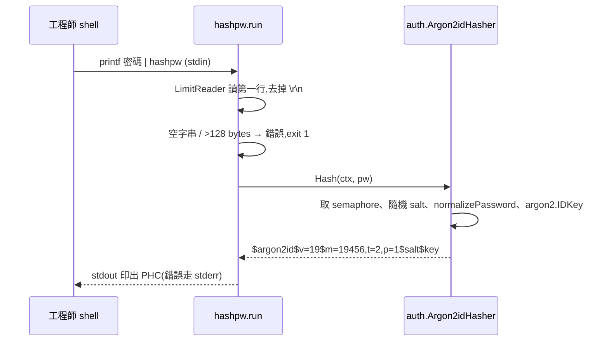

# cmd/hashpw Argon2id 雜湊工具 (NFR-SEC-003)

## 一句話摘要
從 stdin 讀一個密碼,輸出 Argon2id PHC 雜湊,供 Vault `admins.json` 與工程師重設密碼使用。

## 背景與目標
對應 NFR-SEC-003(密碼只以 Argon2id 儲存)、ADM-004(Admin 由 Vault 檔案 seed,檔案只收雜湊)、AUTH-010(忘記密碼由工程師直接改 DB)。使用者是維運工程師,不是終端使用者。成功的定義:

- 輸出的雜湊能被 `auth` 的 `Verify` 驗過,且能通過 `SeedAdmins` 的 `checkPHC`。
- 密碼不出現在命令列參數、log 或錯誤訊息。
- 起始參數為 19 MiB、2 iterations、parallelism 1(Architecture 9.1)。

**不含**:互動式輸入(關閉 echo)、批次處理多筆、密碼政策檢查(見「已知落差」)。

## 架構與資料流

## 程式碼導覽
| 檔案 | 職責 |
|---|---|
| `backend/cmd/hashpw/main.go:25` | `main`:呼叫 `run`,錯誤印到 stderr 並 `exit 1` |
| `backend/cmd/hashpw/main.go:32` | `run(in, out)`:讀入、檢查、雜湊、輸出;I/O 用參數注入以便測試 |
| `backend/cmd/hashpw/main.go:34` | 用 `io.LimitReader` 限制讀取量,只讀第一行 |
| `backend/cmd/hashpw/main.go:39` | 只去除行尾 `\r\n`,保留密碼中的空白 |
| `backend/cmd/hashpw/main.go:43` | 超過 128 bytes 就拒絕,與 `auth` 的上限一致 |
| `backend/cmd/hashpw/main.go:46` | 重用 `auth.NewArgon2idHasher().Hash` |
| `backend/internal/auth/password.go:72` | 真正的 Argon2id 實作與 PHC 格式(單一來源) |
| `backend/internal/auth/seed.go:154` | `checkPHC` 驗證檔案內的雜湊;錯誤訊息指向 `cmd/hashpw` |
| `backend/cmd/hashpw/main_test.go:15` | 輸出可被 `Verify` 驗過、參數前綴正確 |

## 設計決策與取捨
- **決策**:密碼只從 stdin 讀,不接受參數或環境變數。
  - **替代方案**:`hashpw 'password'`、`--password` flag、互動 prompt。
  - **理由**:命令列參數會進 shell history 與 `ps`(全域規則禁止把祕密放在命令列)。
  - **代價**:互動執行時終端機會 echo 密碼(見「找問題」)。
- **決策**:重用 `auth.Argon2idHasher.Hash`,不複製一份 Argon2 程式碼。
  - **替代方案**:在 `cmd/hashpw` 自己呼叫 `argon2.IDKey`。
  - **理由**:PHC 格式、參數、`normalizePassword`(NFKC)只有一個擁有者;否則工具產生的雜湊可能和登入驗證的正規化不一致。`cmd/` 可以 import `internal/auth`(depguard 只限制 feature 套件之間)。
  - **代價**:工具連帶引入 `auth` 套件的依賴;`Hash` 會多用一個 semaphore(對單次執行無影響)。
- **決策**:上限 128 bytes,與 `maxPasswordBytes` 重複定義。
  - **理由**:`Verify` 對超長密碼直接回 false;若工具替它產生雜湊,帳號會永遠登不進去。
  - **代價**:常數在兩處,可能漂移(見「找問題」)。
- **決策**:只取第一行,`run(io.Reader, io.Writer)` 注入 I/O。
  - **理由**:`main` 無法在單元測試中呼叫;拆出 `run` 後可測錯誤路徑。PRD NFR-QA-001 允許排除 entry point,所以 `main()` 本身不計入。

## 邊界情況與失敗處理
- 空輸入或只有換行:`empty password on stdin`,exit 1,stdout 不輸出任何內容。
- 超過 128 bytes:報錯,訊息只含上限,不回顯密碼。
- 沒有結尾換行(`printf 'x'`)或 CRLF:都能正確處理。
- 密碼前後有空白:保留(只去 `\r\n`)。
- stdin 讀取失敗:`read password: ...`,exit 1。
- 每次執行 salt 都不同,同一密碼的兩次輸出不相等。
- 多行輸入:只用第一行,其餘靜默忽略(見「找問題」)。

## 已知落差
- 沒有套用 REG-005 密碼政策:`passwordViolations` 在 `auth` 內未匯出。這適合工程師重設,但 Vault 的 Admin 密碼可能因此過弱(待確認是否要加警告)。
- Ticket 要求「參數起始值 19 MiB、2、1」;參數是 `auth` 的未匯出常數,`hashpw` 沒有自己的測試鎖住 `m=19456,t=2,p=1` 以外的值(目前只測前綴)。
- 沒有說明文件或 README 描述 Vault 流程(DevOps 屬 PRD 第 9 節範圍外)。

## 面試考題

### 基礎

::: details Q1. `hashpw` 的資料怎麼流動?輸出的字串每一段代表什麼?
**出處**:`backend/cmd/hashpw/main.go:32`、`backend/internal/auth/password.go:84`

**參考答案**
stdin 讀第一行 → 去掉 `\r\n` → 檢查空與長度 → `Hash` 產生 16 bytes 隨機 salt,對 NFKC 正規化後的密碼跑 `argon2.IDKey(t=2, m=19456 KiB, p=1, keyLen=32)` → 以 `$argon2id$v=19$m=19456,t=2,p=1$<salt>$<key>` 輸出,salt 與 key 為 base64 無 padding。參數與 salt 都在字串內,所以日後調高參數,舊雜湊仍可驗證。

**可能的追問**
- 為什麼 PHC 要把參數放進字串?(升級參數時舊雜湊不失效,下次登入可重新雜湊。)
- 為什麼是 Argon2id 而不是 bcrypt?

**考察點**:對密碼雜湊格式的理解
:::

::: details Q2. 為什麼從 stdin 讀密碼,而不是 `hashpw <password>`?
**出處**:`backend/cmd/hashpw/main.go:34`

**參考答案**
命令列參數會留在 shell history,並在執行期間出現在 `ps` / `/proc/<pid>/cmdline`,任何同機使用者都看得到。stdin 不會。專案全域規則也禁止把祕密放在命令列參數。工程師用 `printf '%s\n' "$PW" | hashpw` 或 `hashpw < file`。

**可能的追問**
- `printf` 是 shell builtin,`echo` 呢?(bash/zsh 的 `echo` 也是 builtin,不進 `ps`,但仍會進 history,所以要避免把明文寫在命令列。)

**考察點**:secrets 處理的實務
:::

### 進階

::: details 🔥 Q3. 為什麼重用 `auth.Argon2idHasher`,而不是在工具裡直接呼叫 `argon2.IDKey`?
**出處**:`backend/cmd/hashpw/main.go:46`、`backend/internal/auth/password.go:82`、`backend/internal/auth/password.go:152`

**參考答案**
`Hash` 在雜湊前會呼叫 `normalizePassword`(NFKC),`verifyPassword` 驗證時也一樣。如果工具自己雜湊而漏掉正規化,含全形字元或組合字元的密碼雜湊出來的值,在登入時會對不起來,而且錯誤不會被發現直到有人登入。重用同一個函式讓「產生」與「驗證」只有一個定義。代價是工具依賴 `internal/auth`;因為 `cmd/hashpw` 在同一個 module,可以 import `internal`。

**可能的追問**
- 若 `auth` 之後調高參數,舊的 Vault 雜湊怎麼辦?(仍可驗證,因參數在 PHC 內。)
- depguard 允許 `cmd/*` 引用 `auth` 嗎?(規則針對 `internal/<feature>/**` 之間,`cmd` 不受限;待用 `golangci-lint` 確認——本次已跑過,0 issues。)

**考察點**:單一來源、避免實作漂移
:::

::: details Q4. 為什麼要拒絕超過 128 bytes 的密碼?
**出處**:`backend/cmd/hashpw/main.go:43`、`backend/internal/auth/password.go:61`

**參考答案**
`Verify` 一開始就 `len(password) > maxPasswordBytes → return false`,目的是不讓未登入者要求做大量運算。所以如果 `hashpw` 對 200 bytes 的密碼產生了雜湊,該帳號的密碼永遠驗證失敗,等於鎖死帳號,而且沒有任何錯誤提示。工具在產生階段就擋掉,比在登入時才發現好。

**可能的追問**
- 長度用 bytes 還是字元?(bytes,與 `Verify` 一致;NFKC 之後的長度不被檢查。)

**考察點**:跨元件不變量
:::

### 設計/情境

::: details Q5. 要把工具改成可以在終端機安全地輸入密碼(不 echo),要改哪裡?
**出處**:`backend/cmd/hashpw/main.go:25`、`backend/cmd/hashpw/main.go:32`

**參考答案**
在 `main` 判斷 `term.IsTerminal(int(os.Stdin.Fd()))`(`golang.org/x/term`):是 TTY 就用 `term.ReadPassword` 取得 bytes 並提示輸入兩次比對;否則維持原本的 pipe 行為。`run` 的簽名可改為接收已讀好的密碼,或保留 `io.Reader` 並在 `main` 把 `ReadPassword` 的結果包成 `strings.NewReader`。測試仍測 `run`,TTY 分支很薄、不計入覆蓋率目標。要新增 `golang.org/x/term` 依賴(ADR 規定主要版本變更需 ADR,新增小依賴則待確認)。

**可能的追問**
- 為什麼要輸入兩次?(打錯字會產生永遠登不進去的帳號。)

**考察點**:需求變更、可測試性
:::

::: details Q6. 若要一次替 50 個 Admin 產生雜湊,怎麼設計?
**出處**:`backend/cmd/hashpw/main.go:32`、`backend/internal/auth/seed.go:53`

**參考答案**
不建議把明文密碼批次放進檔案。較安全的作法是讓每位 Admin 自行產生:各自跑 `hashpw`,把雜湊交給負責維護 Vault 的人。如果一定要批次,可以讓工具讀多行(每行一個密碼)並輸出多行雜湊,但要注意 `Hash` 會用 semaphore(最多 4 個並行)與每次約 19 MiB 的記憶體,50 筆序列處理即可,不需要並行。另外 `SeedAdmins` 本來就強制首次登入改密碼(AUTH-008),所以初始密碼不是長期祕密。

**考察點**:最小權限、風險取捨
:::

### 找問題

::: details 🔥 Q7. 這段程式碼有什麼潛在問題?
**出處**:`backend/cmd/hashpw/main.go:34`、`backend/cmd/hashpw/main.go:23`、`backend/cmd/hashpw/main.go:39`

**問題**:
1. **互動執行會 echo 密碼**:不用 pipe 直接執行 `hashpw` 時,終端機會顯示輸入內容(也可能被螢幕錄影或 scrollback 保留)。
2. **多行輸入被靜默截斷**:`printf 'abc\ndef\n' | hashpw` 只會雜湊 `abc`。若密碼本身含換行(不常見)會被悄悄改變。
3. **常數重複**:`maxPasswordBytes` 在 `cmd/hashpw` 與 `auth` 各定義一次;其中一邊調整後會漂移。
4. **沒有密碼政策警告**:可以替 `a` 這種弱密碼產生合法雜湊。
5. **記憶體中的明文沒有清除**:Go 的 `string` 不可變,無法 zero;對一次性 CLI 風險很低,但值得知道。

**如何修**:(1) 用 `golang.org/x/term` 偵測 TTY 並關閉 echo;(2) 讀完第一行後檢查是否還有資料,有的話報錯;(3) 從 `auth` 匯出 `MaxPasswordBytes` 供工具使用;(4) 匯出 `auth` 的政策檢查,工具在違反時往 stderr 印警告(不阻擋);(5) 接受。

**如何驗證**:(2) 在 `main_test.go` 增加多行輸入應回錯誤的案例;(3) 用一個測試斷言兩處值相等,或直接共用常數後刪除測試;(1)(4) 需要 TTY 或匯出介面後以單元測試覆蓋。
:::

## 三分鐘口頭說明稿
Admin 帳號只能由 Vault 提供,而且檔案裡只允許放密碼雜湊,不允許明文。所以需要一個工具讓工程師產生符合格式的 Argon2id 雜湊,也用在忘記密碼時工程師直接改資料庫的流程(AUTH-010)。

我做了 `cmd/hashpw`:從 stdin 讀一行密碼,輸出 PHC 格式的雜湊,參數是 OWASP 最低建議的 19 MiB、2 iterations、parallelism 1。幾個重點:第一,密碼只能走 stdin,不走命令列參數,避免進 shell history 與 `ps`。第二,我直接重用 `auth.Argon2idHasher`,而不是複製 Argon2 程式碼,因為雜湊前還有 NFKC 正規化,產生和驗證必須用同一份定義,否則含特殊字元的密碼會登不進去。第三,超過 128 bytes 直接拒絕,因為 `Verify` 對超長密碼一律回 false,如果工具照做,帳號會被鎖死。第四,把 I/O 注入到 `run(in, out)`,所以錯誤路徑可以單元測試。

取捨與已知限制:互動執行時終端機會 echo、多行輸入只取第一行、沒有套用密碼政策、128 的上限在兩處定義。這些我都記在文件裡,下一步是用 `x/term` 關閉 echo 並共用常數。結果是 `run` 的所有分支都有測試,輸出的雜湊也驗證過可以被 `auth.Verify` 驗過,`golangci-lint` 無問題。
