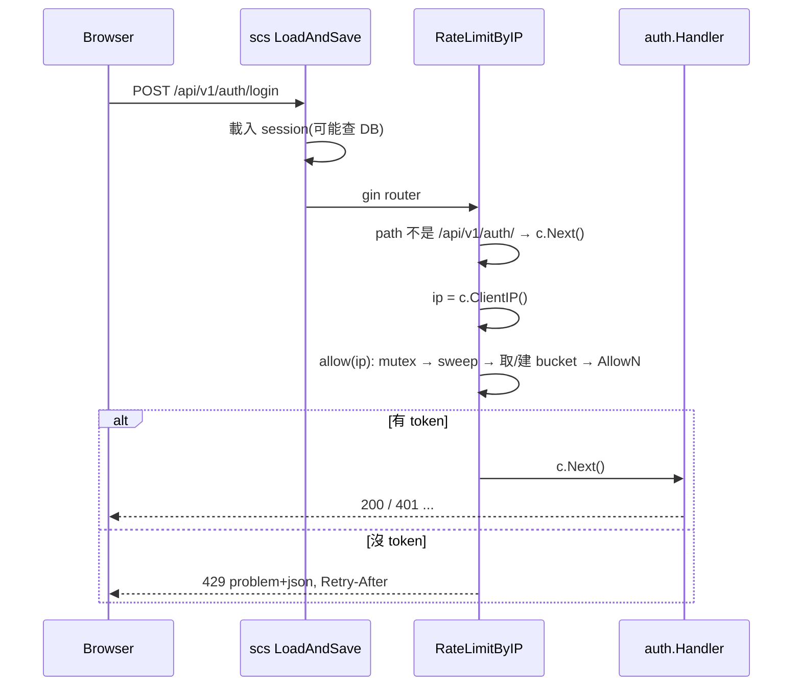

# 登入 IP 限流 Middleware (AUTH-004)

## 一句話摘要
在 Gin 內以 per-IP token bucket 限制 `/api/v1/auth/*`,補足帳號鎖定擋不住的「一個 IP 試很多帳號」。

## 背景與目標
- PRD **AUTH-004**:同一網路來源的重複登入嘗試要限流,**獨立於** AUTH-002 的 per-account lockout。
- 為什麼 lockout 不夠:攻擊者用同一個密碼輪流試 1000 個帳號,每個帳號只失敗一次,永遠不會被鎖。
- 原本由 reverse proxy(Traefik)做,但 DevOps 暫緩(PRD §9、Architecture OI-04),所以改在應用程式內實作。Architecture §9.1 本來就寫了「in-process limiter」,ADR 0017 補上具體設計。
- 成功定義:同一 IP 超過額度回 `429`;偽造 `X-Forwarded-For` 不能換到新額度;記憶體不會無限成長。

## 架構與資料流

注意順序:`sessions.LoadAndSave` 包在整個 router 外面(`main.go:94`),limiter 在 router 裡面,所以被擋的請求**仍會先做一次 session 載入**。

## 程式碼導覽
| 檔案 | 職責 |
|---|---|
| `backend/internal/platform/ratelimit.go:48` | `RateLimitByIP`:Gin middleware,依 path prefix 決定是否限流 |
| `backend/internal/platform/ratelimit.go:68` | `allow`:持鎖、順便 sweep、取得或建立該 IP 的 bucket |
| `backend/internal/platform/ratelimit.go:84` | `sweep`:每分鐘最多一次,刪除已完全回補的閒置 bucket |
| `backend/internal/platform/config.go:149` | `TRUSTED_PROXIES`、`AUTH_RATE_LIMIT_BURST/REFILL` 解析與驗證 |
| `backend/cmd/server/main.go:84` | `SetTrustedProxies(cfg.TrustedProxies)` 後再 `router.Use(RateLimitByIP…)` |
| `backend/api/openapi.yaml:137` | 共用的 `RateLimited` response(含 `Retry-After`) |
| `backend/internal/platform/ratelimit_test.go:42` | 以 `ManualClock` 測 burst、refill、per-IP、偽造 XFF、sweep |

## 設計決策與取捨
- **決策**:token bucket(`x/time/rate`),預設 burst 10、每 6 秒補 1 個。
  - **替代方案**:fixed window 計數;DB 表紀錄失敗次數;第三方 Gin 套件。
  - **理由**:token bucket 允許短暫突發(一群同事同時登入)又限制長期速率;約 60 行,不增加 DB 寫入。
  - **代價**:per-process 狀態,多 instance 時有效額度 ×N;重啟即歸零(ADR 0017)。
- **決策**:放在 `platform`,用 path prefix 篩選,而不是對每個 route 掛。
  - **替代方案**:`GinServerOptions.HandlerMiddlewares`(會套到 `/health`);自己建 `router.Group`。
  - **理由**:新增 auth route 自動受保護;`platform` 不引入新的 import 邊(ADR 0003)。
  - **代價**:靠字串 prefix,路徑寫錯就靜默失效(見「找問題」)。
- **決策**:`TRUSTED_PROXIES` 預設為空,key 用 `c.ClientIP()`。
  - **替代方案**:直接讀 `X-Forwarded-For`。
  - **理由**:該 header 由 client 控制,不設限等於讓人每次請求換一個「IP」。
  - **代價**:日後加 proxy 若忘了設,所有人看起來同一個 IP、共用一個 bucket。
- **決策**:沒有背景 goroutine,sweep 在 request path 裡 lazy 執行。
  - **理由**:Architecture §1.3、§5.4 明訂沒有 scheduler。
  - **代價**:sweep 在持鎖下 O(n) 掃描整個 map,偶爾造成一次延遲尖峰。
- **決策**:被限流的請求只記 `warn` log,不寫 audit。
  - **理由**:AUD-001 沒列;攻擊流量會灌爆 append-only 的 audit 表。

## 邊界情況與失敗處理
- **偽造 `X-Forwarded-For`**(untrusted peer):被忽略,仍以 TCP peer 為 key(`ratelimit_test.go:78`)。
- **來自 trusted proxy**:取 XFF 中的 client IP,不同 client 各自一個 bucket(`ratelimit_test.go:87`)。
- **同 IP 不同 port**:同一 bucket,key 不含 port(`ratelimit_test.go:66`)。
- **非 auth 路徑**:直接 `c.Next()`,不計數。
- **`TRUSTED_PROXIES` 填錯**:`Load` 啟動即失敗;burst ≤ 0 或 refill ≤ 0 同樣失敗。
- **被擋時回應**:`429`、`code=rate_limited`、`Retry-After` = refill 秒數進位;內容不含任何帳號資訊(AUTH-003)。
- **服務重啟**:所有 bucket 消失,額度重置。

## 已知落差
- ADR 0017 狀態是 **Proposed**,尚待 Architect 確認;Architecture §12 的 ADR 清單還沒列入 0017。
- `cmd/server` 沒有測試(coverage 0%),「先 `SetTrustedProxies` 再 `Use`」的接線順序只被 `ratelimit_test.go` 的測試 router 模仿,**沒有被實際 `main.go` 驗證**。
- 工單與 PRD 提到的 Traefik,Architecture 內並無對應文字(只有 §9.1 的 in-process limiter);已視為工單背景,不是文件落差。
- 前端尚未處理 `rate_limited` 與 `Retry-After`。
- 多 instance 共享 limiter 尚未實作(Architecture §13 已列風險)。

## 面試考題

### 基礎

::: details Q1. 為什麼有了 account lockout 還需要 IP 限流?
**出處**:`backend/internal/platform/ratelimit.go:44`

**參考答案**
Lockout 是 per-account:5 次失敗鎖 5 分鐘。攻擊者用 password spraying——一個常見密碼試遍所有帳號,每個帳號只失敗 1 次,永遠不觸發 lockout。IP 限流以來源為單位,擋的是「單一來源的嘗試速率」。兩者互補,PRD AUTH-004 也明寫兩者獨立。

**可能的追問**
- 攻擊者換很多 IP(botnet)怎麼辦?
- 兩者誰先執行?為什麼 429 不洩漏帳號資訊?

**考察點**:威脅模型與縱深防禦。
:::

::: details Q2. 一個請求進來,資料怎麼流動?
**出處**:`backend/internal/platform/ratelimit.go:48`

**參考答案**
先判斷 `URL.Path` 是否以 `/api/v1/auth/` 開頭,不是就放行。是的話取 `c.ClientIP()`,呼叫 `allow(ip)`:持有 mutex,必要時 sweep,取或建該 IP 的 `rate.Limiter`,用 `clock.Now()` 呼叫 `AllowN`。有 token 就 `c.Next()`;沒有就寫 `Retry-After`、回 429 problem+json、`c.Abort()`。

**可能的追問**
- 為什麼 `WriteProblem` 後要 `c.Abort()`?
- 為什麼時間要從 `Clock` 來而不是 `time.Now()`?

**考察點**:能把 middleware 流程講清楚。
:::

### 進階

::: details 🔥 Q3. `TRUSTED_PROXIES` 為什麼預設是空?設錯會怎樣?
**出處**:`backend/cmd/server/main.go:84`、`backend/internal/platform/config.go:149`

**參考答案**
`ClientIP()` 只在 peer 屬於 trusted proxies 時才採信 `X-Forwarded-For`。預設空表示用 TCP peer 位址,client 無法偽造。若反過來信任所有來源,攻擊者每次送不同 XFF 就拿到新的 bucket,限流形同虛設,audit 的 `source_ip` 也會被污染。設太窄(加了 proxy 卻沒設)則所有人都是 proxy 的 IP,共用一個 bucket,正常使用者互相擠掉。`Load` 會驗證每個 entry 是 IP 或 CIDR,錯就啟動失敗。測試 `ratelimit_test.go:78`、`:87` 分別覆蓋兩種情況。

**可能的追問**
- 多層 proxy(CDN + LB)時 XFF 怎麼解析?
- 為什麼這件事在 ADR 要特別記錄?

**考察點**:對 trust boundary 的理解——限流的正確性依賴 IP 的真實性。
:::

::: details Q4. 為什麼選 token bucket,而不是 fixed window?
**出處**:`backend/internal/platform/ratelimit.go:75`

**參考答案**
Fixed window 在視窗邊界可在短時間內放行兩倍額度(視窗尾 + 下一個視窗頭)。Token bucket 的 burst 與長期速率是分開的兩個參數:burst 10 讓公司內同一 NAT 的人能一起登入,refill 每 6 秒 1 個把持續速率壓在每分鐘 10 次。`rate.NewLimiter(rate.Every(Refill), Burst)` 就是這兩個參數。

**可能的追問**
- sliding window log 的記憶體成本?
- `Retry-After` 為什麼用 refill 秒數?(因為一個 token 最多等一個 refill 週期。)

**考察點**:演算法取捨。
:::

### 設計/情境

::: details 🔥 Q5. 流量放大、改成 3 個 instance,要怎麼改?如何驗證?
**出處**:`backend/internal/platform/ratelimit.go:68`

**參考答案**
目前 state 在 process 記憶體,3 個 instance 有效額度最多 ×3;LB 若做 sticky 就不明顯。要共享需要外部儲存(Redis 或 DB)。由於 `allow(ip)` 是唯一觸碰狀態的函式,可換成介面實作;ADR 0017 說明了這一點。但 ADR 0007 刻意不引入 Redis,所以第一步應是量化:以 25,000 人的規模,per-instance 的鬆動是否可接受(Architecture §13 判斷可以)。驗證:壓測腳本從單一 IP 打 N 次,計算放行數是否 ≈ burst × instance 數;換成共享實作後應 ≈ burst。

**可能的追問**
- 共享儲存掛掉時 fail-open 還是 fail-closed?
- DB 計數每個請求多一次寫入,攻擊流量會不會反而拖垮 DB?

**考察點**:知道目前設計的邊界,能提出漸進式演進而不是直接上 Redis。
:::

::: details Q6. 部署在公司辦公室 NAT 後面,截止日當天大家同時登入被擋,怎麼辦?
**出處**:`backend/internal/platform/config.go:151`

**參考答案**
同一出口 IP 的人共用 bucket。第一步調 `AUTH_RATE_LIMIT_BURST`,這是設定不需改程式。進一步可以對已通過認證的請求不計數,或 key 改成 (IP, employeeId)——但後者需要在 body 解析之後,而且攻擊者可以換 employeeId,等於退回 lockout 的弱點。我會先看 `warn` log 裡被擋的 IP 與頻率,確認是 NAT 造成再決定。

**可能的追問**
- 如何監控被擋的比率?(目前只有 log,沒有 metrics。)

**考察點**:能把安全與可用性放在一起權衡。
:::

### 找問題

::: details 🔥 Q7. 這段程式碼有什麼潛在問題?
**出處**:`backend/internal/platform/ratelimit.go:48`、`:84`、`backend/cmd/server/main.go:94`

**問題**(我在程式碼裡實際看到的):
1. **`/auth/me` 與 `/auth/logout` 也被計入同一個 bucket。** 前端每次載入頁面可能呼叫 `/auth/me`,同一 NAT 下很多人刷新頁面,會把登入額度吃掉。ADR 寫「涵蓋所有 auth route」是刻意的,但沒有評估這個副作用。
2. **sweep 持有全域 mutex 做 O(n) 掃描。** 每分鐘一次,n 是活躍 IP 數;攻擊者大量換 IP(IPv6 /64)時,map 先膨脹,sweep 也變慢,拖慢所有 auth 請求。
3. **記憶體上限沒有硬性界線。** 閒置 60 秒(burst×refill)才會被刪,期間 map 可無限增長。
4. **被擋的請求仍先經過 `LoadAndSave`**(`main.go:94`):帶 cookie 的請求會先查一次 session store,所以限流沒有保護 DB 的 session 讀取。
5. **路徑比對是字串 prefix。** 若 `apiBase` 與 spec 的 `servers` 不同步,限流會靜默失效,且 `cmd/server` 沒有測試能抓到。

**如何修**:(1) 只對 `register`/`login` 計數,或給 `/me` 較寬的額度;(2) 改用分片 map 或 `sync.Map` + 每個 bucket 自己的鎖;(3) 設 map 大小上限,超過時 fail-closed 或用 IPv6 /64 prefix 作 key;(4) 把 limiter 移到 `LoadAndSave` 外層;(5) 為 `main.go` 的接線寫一個啟動 router 的整合測試。

**如何驗證**:(1) 測試連打 `/auth/me` 不影響 `/auth/login` 額度;(2) benchmark 100k 個 key 下 `allow` 的 p99;(3) 測試 map 大小不超過上限;(4) 測試被擋的請求不觸發 store 讀取;(5) 對真實 router 送 11 次 login 請求,第 11 次得 429。
:::

::: details Q8. 為什麼 `ratelimit_test.go` 不用 `time.Sleep`?
**出處**:`backend/internal/platform/ratelimit_test.go:56`

**參考答案**
limiter 透過 `Clock` 介面取得時間,並把 `now` 傳給 `AllowN(now, 1)`,而不是 `Allow()`(它內部用 `time.Now()`)。測試用 `ManualClock.Advance(6 * time.Second)` 就能「經過」時間,快、穩定、不 flaky。這延續 ADR 0014 的做法。

**可能的追問**
- `ManualClock` 內為什麼要有 mutex?

**考察點**:可測試性設計。
:::

## 三分鐘口頭說明稿
PRD 的 AUTH-004 要求同一網路來源的登入嘗試要限流,而且獨立於帳號鎖定。原因是 password spraying:攻擊者用一個密碼試很多帳號,每個帳號只失敗一次,lockout 永遠不會觸發。

原本計畫由 Traefik 處理,但 DevOps 這階段暫緩,所以我在 Gin 裡寫了一個 middleware。它放在 `platform`,不增加套件之間的依賴;用 `x/time/rate` 的 token bucket,每個 client IP 一個,預設 burst 10、每 6 秒補一個。超過就回 429 加 `Retry-After`,內容是通用的 problem,不洩漏帳號資訊。路徑只比對 `/api/v1/auth/` 的 prefix,所以之後新增 auth route 會自動被保護。

最關鍵的是 IP 的真實性。Gin 預設會相信 `X-Forwarded-For`,client 可以每次送不同值來換 bucket。所以我把 `TRUSTED_PROXIES` 做成設定,預設空,啟動時驗證格式。沒有 scheduler,所以閒置 bucket 在 request path 裡每分鐘最多清一次。時間從 `Clock` 來,測試不用 sleep。

取捨是狀態在記憶體:多 instance 時額度會放大、重啟會歸零,辦公室 NAT 也可能共用一個 bucket。以 25,000 人的規模我認為可接受,並寫進 ADR 0017。我也看到幾個可改進的地方:`/auth/me` 與登入共用額度、sweep 持有全域鎖、被擋的請求仍會先載入 session,以及 `main.go` 的接線沒有整合測試。
