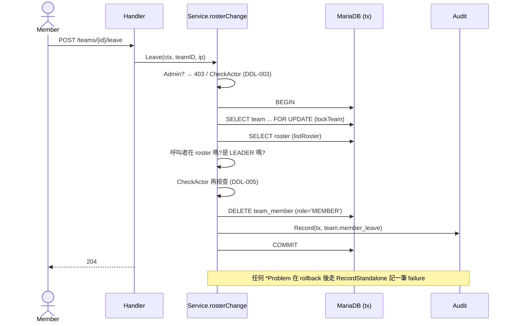

# 成員離隊與組長不得離隊 (TEAM-012、013)

## 一句話摘要
隊員在活動開放期間可以自己離隊(`POST /teams/{teamId}/leave`),組長一律被拒絕,只能解散團隊。

## 背景與目標
- PRD:**TEAM-012** 隊員可在開放期間離隊(UI 二次確認,NFR-UX-003)、**TEAM-013** 組長不能離隊、**DDL-003/005** 截止後不可改、**AUD-001** 每個 team action 都要稽核、**R-02** Admin 不屬於任何 team。
- 成功的定義:離隊後這個人立刻可以加入或建立別的隊(一人一隊的限制是看 `team_member` 有沒有列);每次成功的離隊都有同一 transaction 的 audit record。
- 二次確認屬於前端,API 不收 confirm 欄位(`openapi.yaml` 的 description 有寫明);前端 dialog 尚未實作。

## 架構與資料流

和 CUR-67 的 add/remove 共用 `rosterChange`(Admin 擋、deadline、錯誤翻譯、failure audit)。

## 程式碼導覽
| 檔案 | 職責 |
|---|---|
| `backend/internal/team/members.go:72` | `Leave`:取得呼叫者、交給 `rosterChange` |
| `backend/internal/team/members.go:84` | `leaveInTx`:鎖 team、找出自己、拒絕組長、刪除、audit |
| `backend/internal/team/members.go:136` | `rosterChange`:新增 `adminErr` 參數,讓 Admin 的 403 訊息可依操作而異 |
| `backend/internal/team/errors.go:51` / `:57` | `ErrLeaderCannotLeave`(409)、`ErrAdminCannotLeave`(403) |
| `backend/internal/team/handler.go:79` | `LeaveTeam` handler,成功回 204,沒有 request body |
| `backend/internal/team/leave_test.go` | 所有 TEAM-012/013 測試(需求 ID 在測試名稱,NFR-QA-003) |

## 設計決策與取捨
- **決策**:用 `POST /teams/{teamId}/leave`,而不是 `DELETE /teams/{teamId}/members/me`。
  - **替代方案**:重用 remove 的路徑,把自己的 Employee ID 填進去。
  - **理由**:remove 是組長專用,授權語意完全不同;共用路徑會讓一個 endpoint 有兩套權限規則。`leave` 是動作,POST 合理,也不會與 `{employeeId}` 路徑參數衝突。
  - **代價**:多一個 endpoint。
- **決策**:不接收 body、不接收「要離開的人」,離開的永遠是 session 的使用者。
  - **理由**:沒有 IDOR 的空間,隊員無法讓別人離隊。
- **決策**:找人用 roster 比對呼叫者的 Employee ID,而不是先判斷 role。
  - **理由**:同一次讀取同時得出「不在隊內(404)」與「是組長(409)」,陌生人拿到 404,不洩漏 team id 是否存在(與 CUR-67 一致)。
- **決策**:組長被拒絕是 **409** `leader_cannot_leave`,不是 403。
  - **理由**:呼叫者有權操作自己的隊伍,是狀態不允許(要先解散),與 `leader_cannot_be_removed` 一致,前端可據此顯示「請改用解散」。
- **決策**:Admin 的 403 用獨立訊息(`ErrAdminCannotLeave`)。
  - **理由**:原本共用的訊息是「只有組長能改名單」,對離隊來說會誤導。為此 `rosterChange` 多一個參數。
- **決策**:鎖順序仍是 team → (沒有 user 鎖)。離隊只刪自己那一列,不需要鎖 user。

## 邊界情況與失敗處理
- **組長呼叫**:409 `leader_cannot_leave`,rollback,寫一筆 failure audit。DB 沒有被修改。
- **不在這隊的 Participant / 不存在或已解散的 team / 往年的 team**:404 `team_not_found`。
- **Admin**:403 `forbidden`,在碰 DB 之前。
- **截止後**:403 `deadline_passed`,不碰 DB;若截止發生在 tx 進行中,第二次 `CheckActor` 擋下並 rollback(DDL-005)。
- **刪除時 row 已不在**(理論上被鎖住就不會發生):`deleteMember` 影響 0 列 → 404,不寫成功 audit。
- **重複呼叫**:第二次呼叫者已不在 roster → 404(不是 204),呼叫端需視為已離隊。
- **未預期的 DB 錯誤**:不是 `*Problem`,不寫 failure audit,handler 回 500 並隱藏細節。

## 已知落差
- **前端未實作**:離隊按鈕與 NFR-UX-003 的二次確認 dialog 還沒有。
- **沒有真實 DB 的測試**:同 CUR-67,全部是 `sqlmock`,沒驗證 `FOR UPDATE` 的實際鎖行為。
- **failure audit 可被灌入**:與 CUR-67 相同,任何登入者對任意 team id 呼叫都會留下一筆 404 的 failure audit(`rosterChange` 對所有 `*Problem` 都記錄),沒有針對性的限流。這次沿用既有行為,沒有改動。
- **舊文章行號**:`team-members.md` 引用的 `members.go` 行號因為新增 `Leave` 而位移,內容仍正確。
- `scripts/api-check.sh` 在變更尚未 commit 時會顯示 out of date;commit 後應該通過。

## 面試考題

### 基礎

::: details Q1. 組長想離隊時會發生什麼?為什麼是 409 而不是 403?
**出處**:`backend/internal/team/members.go:84`、`backend/internal/team/errors.go:51`

**參考答案**
`leaveInTx` 鎖 team、讀 roster,找到呼叫者是 `LEADER`,回 `ErrLeaderCannotLeave`(409 `leader_cannot_leave`),tx rollback,另外寫一筆 failure audit。用 409 是因為呼叫者有權管理這隊,只是「目前狀態」不允許這個操作,必須先解散;403 表示沒有權限,語意不對。

**可能的追問**
- 前端怎麼利用這個 code?(顯示「請改用解散團隊」。)

**考察點**:HTTP 狀態碼語意、需求 TEAM-013。
:::

::: details Q2. 為什麼離隊 API 不需要帶 Employee ID?
**出處**:`backend/internal/team/handler.go:79`

**參考答案**
離開的人永遠是 session 使用者,由 `CurrentUser` 決定。如果讓客戶端傳 ID,就要額外檢查「是不是本人」,多一個漏洞面(IDOR)。

**可能的追問**
- 組長要請人離開該用哪個 API?(remove,CUR-67。)

**考察點**:授權設計、減少攻擊面。
:::

### 進階

::: details 🔥 Q3. 兩個隊員同時離隊、或隊員離隊的同時組長加人,會有問題嗎?
**出處**:`backend/internal/team/members.go:84`、`backend/internal/team/repo.go`(`lockTeam`)

**參考答案**
所有名單變更都先 `SELECT ... FOR UPDATE` 鎖同一個 team 列,所以同一隊的變更序列化。加人時看到的 roster 一定是離隊 commit 之後的結果,人數檢查精確。離隊本身不需要鎖 user,因為只刪自己的那一列,而且一人一隊由 unique index 保證。

**可能的追問**
- 不鎖 team 會怎樣?(加人的 count 可能讀到舊的人數。)
- 同一人連點兩次離隊?(第二次在 roster 找不到自己 → 404。)

**考察點**:locking read、序列化粒度。
:::

::: details Q4. 為什麼要再檢查一次 deadline?
**出處**:`backend/internal/team/members.go:84`

**參考答案**
DDL-005 要求以「動作完成」的時間為準。進 tx 前檢查一次可以省掉無謂的 DB 工作,在刪除之前再檢查一次,可以擋下 tx 進行中跨過截止時間的請求(rollback)。

**考察點**:時間相關的競態。
:::

### 設計/情境

::: details Q5. 需求變成「離隊後 24 小時內不能加入別隊」,要改哪裡?
**出處**:`backend/internal/team/members.go:84`

**參考答案**
需要記錄離隊時間,但 `team_member` 列被刪掉了,所以要新增資料(新欄位在 `user`,或新表)並在建立/加入時檢查;這會與一人一隊的 unique index 無關,是新的規則。audit 雖有紀錄,但它是給工程師查詢用,不該當成業務資料來源。要先改 PRD,再寫 ADR。

**考察點**:需求變更的影響面,資料從哪來。
:::

### 找問題

::: details 🔥 Q6. 這個功能有哪些潛在問題?
**出處**:`backend/internal/team/members.go:136`

**問題**:
1. 任何登入者對任意 team id 呼叫 leave 都會產生一筆 failure audit(append-only、保留一年),沒有限流(AUTH-004 只掛在 `/auth/*`)。
2. 重複呼叫第二次得到 404 而不是 204,不是冪等;前端需要處理。
3. 只有 sqlmock 測試。

**如何修**:對未授權類失敗限制 audit 寫入或加限流;前端把 404 視為已離隊;補 testcontainers 整合測試。
:::

## 三分鐘口頭說明稿
這個功能對應 TEAM-012 和 TEAM-013:隊員可以在開放期間自己離隊,組長不行,只能解散。我新增了 `POST /teams/{teamId}/leave`,沒有 body,離開的人一定是 session 使用者,所以沒有 IDOR 的問題。實作重用 CUR-67 的 `rosterChange`,Admin、截止時間、錯誤翻譯與失敗稽核都只寫一次;為了讓 Admin 的 403 訊息正確,多加了一個參數。

交易內先鎖 team 列,和加人、移除用同一把鎖,所以同一隊的變更序列化;接著讀 roster,用呼叫者的 Employee ID 比對:不在名單裡回 404,是組長回 409 `leader_cannot_leave`,否則再檢查一次截止時間,刪掉自己那一列,並在同一個 transaction 寫入含 before/after 名單的 audit。失敗的情況在 rollback 後另外記一筆 failure audit。

取捨是:測試只有 sqlmock,沒有真實 DB;而且沿用既有行為,任何登入者都能對不存在的 team 灌出 failure audit,我把它列為已知落差。二次確認屬於前端,尚未實作。
