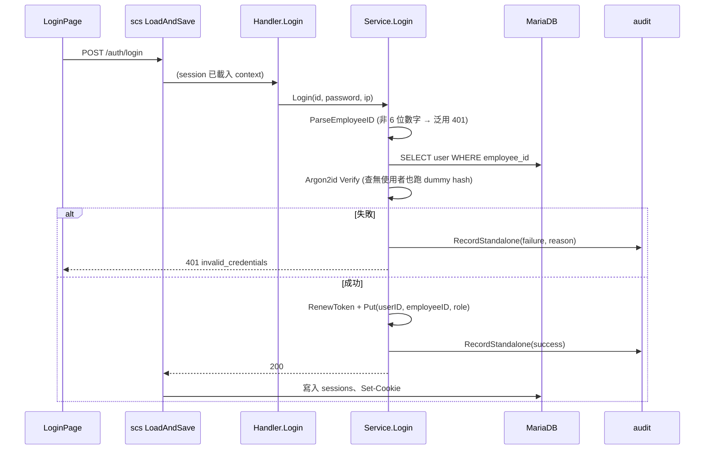

# 登入、登出與 Session 逾時 (AUTH-001/005/006)

## 一句話摘要
以員工編號 + 密碼登入,伺服器端 session(MariaDB + `scs`)閒置 30 分鐘、絕對 8 小時失效,登出即時刪除。

## 背景與目標
對應 PRD AUTH-001(僅 Employee ID 登入,Email 不可)、AUTH-005(30 分閒置 / 8 小時絕對)、AUTH-006(登出立即失效),並順帶遵守 AUTH-003(失敗訊息一律泛用)與 DDL-004(截止後仍可登入)。Cookie 為 `HttpOnly`、`Secure`、`SameSite=Lax`。**不含**:帳號鎖定(AUTH-002)、來源 IP rate limit(AUTH-004)、改密碼後踢掉其他 session(AUTH-007)、Admin 首次改密碼(AUTH-008)、CSRF 後端(AUTH-009)。

## 架構與資料流

## 程式碼導覽
| 檔案 | 職責 |
|---|---|
| `backend/internal/auth/session.go` | `NewSessionManager`:cookie 屬性、IdleTimeout / Lifetime |
| `backend/internal/auth/service.go` `Login` | 驗證、建立 session、稽核 |
| `backend/internal/auth/service.go` `Logout` | `Destroy` 後再稽核;無 session 時冪等 |
| `backend/internal/auth/service.go` `CurrentUser` | `/auth/me`:由 session 取 user id,再回 DB 讀最新資料 |
| `backend/internal/auth/password.go` `Verify` | 與 `Hash` 共用 semaphore |
| `backend/internal/platform/config.go` | `SESSION_IDLE_TIMEOUT`(30m)、`SESSION_LIFETIME`(8h) |
| `frontend/src/features/auth/useSession.ts` | 401 視為「訪客」而非錯誤 |

## 設計決策與取捨
- **決策**:所有憑證失敗(格式錯、查無帳號、密碼錯)回同一個 401 `invalid_credentials`,真正原因只寫進 audit 的 `changes.reason`。
  - **理由**:AUTH-003,不得讓回應洩漏帳號是否存在。Email 因不是 6 位數字,落在「格式錯」同一條路徑,AUTH-001 因此不需額外分支。
  - **代價**:除錯要看 audit,看不到 client 回應。
- **決策**:查無使用者時仍對預先算好的 `dummyHash` 做一次 Argon2id 驗證。
  - **理由**:否則「查無帳號」比「密碼錯」快上數十毫秒,形成 timing oracle。
  - **代價**:啟動時多算一次 hash;若失敗只記 log 並退回快速路徑。
- **決策**:session 由 `scs` 的 `IdleTimeout` + `Lifetime` 控制。
  - **細節**:`IdleTimeout > 0` 時,每個載入 session 的請求都會重新 commit,到期時間 = `min(絕對期限, now + 閒置)`;絕對期限在建立 / `RenewToken` 時固定,活動不會延長它。因此「一直有操作」的使用者仍在 8 小時整被登出。
  - **代價**:每個請求都寫一次 `sessions`(25,000 人規模可接受,見 ADR 0007)。
- **決策**:登入時 `RenewToken`,防 session fixation。
- **決策**:登入的稽核寫入失敗 → 銷毀 session 並回 500(fail closed);登出的稽核失敗 → 只記 log。
  - **理由**:AUD-001 要求登入必有紀錄,但登出的首要責任是「立刻失效」,不能因 log 表故障讓使用者仍保持登入。
- **決策**:登出冪等,無 session 也回 204。已過期的使用者按登出不會看到錯誤。
- **決策**:`Service` 依賴的 `Sessions` 是自己定義的窄介面(`*scs.SessionManager` 滿足),store 由 `main.go` 注入;測試用 `memstore`。

## 邊界情況與失敗處理
- 密碼 > 128 bytes:`Verify` 直接回不符,不進 Argon2(避免未驗證呼叫端要求大量運算)。
- 資料庫儲存的 hash 格式壞掉 → 500(是我們的 bug,不是使用者的錯),錯誤內容不回給 client。
- 使用者在登入期間被刪除 → `/auth/me` 銷毀該 session 並回 401。
- 偽造或已刪除的 token → `scs` 視為空 session,`/auth/me` 回 401 `unauthenticated`。
- 回應皆帶 `Cache-Control: no-store`。

## 已知落差
- **`cmd/server/main.go` 已組裝,但未對真實 DB 跑過**:`mysqlstore.New(db)`、`sm.LoadAndSave(router)`、`event.Policy`、`Recorder` 都已接上,並以 `SetTrustedProxies(nil)` 避免偽造 `X-Forwarded-For`。但 repo 尚無 `cmd/migrate`,本機 MariaDB 沒有資料表,所以尚未實際啟動驗證;目前也沒有通用的「需登入」route group middleware(只有 `/auth/me` 自行判斷)。
- **帳號鎖定、IP rate limit 未做**:登入目前可被無限次嘗試,Argon2id semaphore 只限制並行量。
- `scs` 以 `time.Now()` 計算到期,無法注入 `Clock`;逾時測試用數百毫秒的真實時間。
- 測試用 sqlmock + `memstore`,尚未對真實 MariaDB `sessions` 表驗證。
- 前端不會在閒置逾時的瞬間主動登出,而是在下一次 `/auth/me` 重新整理(視窗聚焦或過期)時才變為訪客。

## 面試考題

::: details Q1. 為什麼「一直有操作」的使用者仍會在 8 小時被登出?
**出處**:`backend/internal/auth/session.go`

**參考答案**
`scs` 的 `Lifetime` 是絕對期限,在 session 建立或 `RenewToken` 時定下;`IdleTimeout` 只會把 store 到期時間推到 `min(絕對期限, now+閒置)`,所以活動延長不了絕對期限。

**可能的追問**
- 若 `IdleTimeout` 大於 `Lifetime` 會怎樣?(`config.go` 啟動時拒絕)

**考察點**:是否理解閒置與絕對逾時的差別與實作語意。
:::

::: details Q2. 登入如何避免洩漏帳號是否存在?
**出處**:`backend/internal/auth/service.go` `Login`

**參考答案**
三種失敗用同一個 401 與同一段訊息;查無帳號時仍做一次 dummy Argon2id 驗證,讓耗時接近;真正原因只進 audit。

**可能的追問**
- 註冊流程為什麼可以洩漏(REG-009)?
- 帳號鎖定會不會又造成洩漏?

**考察點**:回應內容與 timing 兩個旁路(side channel)。
:::

::: details Q3. 為什麼登入稽核失敗要 fail closed,登出卻不用?
**出處**:`backend/internal/auth/service.go` `Login` / `Logout`

**參考答案**
登入若沒有紀錄就發出 session,違反 AUD-001 的「100% 被稽核」,所以失敗時銷毀 session;登出的安全目標是立即失效,先 `Destroy`,稽核失敗只記 log,避免使用者因 log 故障而無法登出。

**考察點**:能否依各操作的主要安全目標排序取捨。
:::
