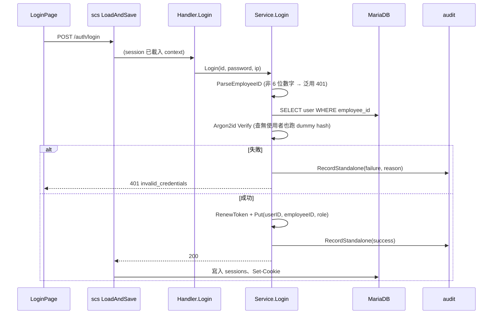

# 登入、登出與 Session 逾時 (AUTH-001/005/006)

## 一句話摘要
以員工編號 + 密碼登入,伺服器端 session(MariaDB + `scs`)閒置 30 分鐘、絕對 8 小時失效,登出即時刪除。

## 背景與目標
對應 PRD AUTH-001(僅 Employee ID 登入,Email 不可)、AUTH-005(30 分閒置 / 8 小時絕對)、AUTH-006(登出立即失效),並順帶遵守 AUTH-003(失敗訊息一律泛用)與 DDL-004(截止後仍可登入)。Cookie 為 `HttpOnly`、`Secure`、`SameSite=Lax`。

成功的定義:登出或逾時後,舊 cookie 立刻打 `/auth/me` 得到 401;任何失敗路徑的回應內容與耗時都不能區分「查無帳號」與「密碼錯」。

**不含**:IP rate limit(AUTH-004)、改密碼後踢掉其他 session(AUTH-007)、Admin 首次改密碼(AUTH-008)、CSRF 後端(AUTH-009)。帳號鎖定(AUTH-002)見「已知落差」。

## 架構與資料流

要點:`Put` 只改 request context 內的 session,真正寫入 `sessions` 表與 `Set-Cookie` 是 `LoadAndSave` 在 handler 結束後做的。所以 service 回錯誤時不會留下 session。

## 程式碼導覽
| 檔案 | 職責 |
|---|---|
| `backend/internal/auth/session.go:31` | `NewSessionManager`:cookie 屬性、IdleTimeout / Lifetime |
| `backend/internal/auth/service.go:185` | `Login`:驗證、建立 session、稽核 |
| `backend/internal/auth/service.go:306` | `Logout`:`Destroy` 後再稽核;無 session 時冪等 |
| `backend/internal/auth/service.go:330` | `CurrentUser`:`/auth/me` 由 session 取 user id,再回 DB 讀最新資料 |
| `backend/internal/auth/handler.go:104` | `Login` handler:`MaxBytesReader` 2 KiB、`no-store` |
| `backend/internal/auth/password.go:58` | `Verify`:超長密碼直接回 false,與 `Hash` 共用 semaphore |
| `backend/internal/platform/config.go:135` | `SESSION_IDLE_TIMEOUT`(30m)、`SESSION_LIFETIME`(8h)與互相檢查 |
| `backend/cmd/server/main.go:71` | 組裝 mysqlstore → SessionManager,`LoadAndSave(router)` 包住整個 router(第 91 行) |
| `frontend/src/features/auth/useSession.ts:14` | 401 視為「訪客」而非錯誤 |

## 設計決策與取捨
- **決策**:所有憑證失敗(格式錯、查無帳號、密碼錯)回同一個 401 `invalid_credentials`,真正原因只寫進 audit 的 `changes.reason`。
  - **替代方案**:依原因回不同訊息(對使用者較友善)。
  - **理由**:AUTH-003,不得洩漏帳號是否存在。Email 因不是 6 位數字,落在「格式錯」同一條路徑,AUTH-001 因此不需額外分支。
  - **代價**:除錯要看 audit,看不到 client 回應。
- **決策**:查無使用者時仍對預先算好的 `dummyHash` 做一次 Argon2id 驗證(`service.go:197`)。
  - **替代方案**:直接回 401。
  - **理由**:否則「查無帳號」比「密碼錯」快上數十毫秒,形成 timing oracle。
  - **代價**:啟動時多算一次 hash;若失敗只記 log 並退回快速路徑(`service.go:73`)。
- **決策**:session 由 `scs` 的 `IdleTimeout` + `Lifetime` 控制(ADR 0007)。
  - **替代方案**:JWT(無法即時撤銷)、Redis(多一個元件)、自寫 session 表。
  - **細節**:`IdleTimeout > 0` 時,每個載入 session 的請求都會重新 commit,到期時間 = `min(絕對期限, now + 閒置)`;絕對期限在建立 / `RenewToken` 時固定,活動不會延長它。因此「一直有操作」的使用者仍在 8 小時整被登出。
  - **代價**:每個請求都寫一次 `sessions`(25,000 人規模可接受)。
- **決策**:cookie 為 browser-session cookie(`Persist=false`),到期由伺服器決定(`session.go:41`)。
  - **理由**:即使 cookie 被保留或竊取,伺服器端過期後也無用。
- **決策**:登入時 `RenewToken`(`service.go:245`),防 session fixation。
- **決策**:登入的稽核寫入失敗 → 銷毀 session 並回 500(fail closed);登出的稽核失敗 → 只記 log。
  - **理由**:AUD-001 要求登入必有紀錄,但登出的首要責任是「立刻失效」,不能因 log 表故障讓使用者仍保持登入。
- **決策**:登出冪等,無 session 也回 204。已過期的使用者按登出不會看到錯誤。
- **決策**:`Service` 依賴的 `Sessions` 是自己定義的窄介面(`*scs.SessionManager` 滿足),store 由 `main.go` 注入;測試用 `memstore`。
  - **代價**:`scs` 用 `time.Now()`,無法注入 `Clock`,逾時測試只能用數百毫秒的真實時間。

## 邊界情況與失敗處理
- 密碼 > 128 bytes:`Verify` 直接回不符,不進 Argon2(`password.go:61`)。
- 請求 body > 2 KiB:`MaxBytesReader` 使 bind 失敗,回 `invalid_request`。
- 資料庫儲存的 hash 格式壞掉 → 500(是我們的 bug,不是使用者的錯),錯誤內容不回給 client。
- 使用者在登入期間被刪除 → `/auth/me` 銷毀該 session 並回 401(`service.go:337`)。
- 偽造或已刪除的 token → `scs` 視為空 session,`/auth/me` 回 401 `unauthenticated`。
- request context 被取消:Argon2 等待 semaphore 時會回 context 錯誤,不會繼續佔用。
- 回應皆帶 `Cache-Control: no-store`。

## 已知落差
- **工作樹有未提交的帳號鎖定(AUTH-002)改動**(`service.go` 的 `recordFailedAttempt`、`repo.go` 的 lock state、`lockout_test.go`),不是本票的 commit 範圍。上面的行號以目前工作樹為準,`Login` 因此比 commit 499a5ed 多出約 40 行。該改動提交前,本文對 `Login` 的描述以「無鎖定」為基準。
- **IP rate limit 未做(AUTH-004)**:登入可被無限次嘗試,Argon2id semaphore 只限制並行量。
- **`main.go` 已用真實 MariaDB 冒煙測試過**(2026-11-05):register → 錯誤密碼 401 → login 200 → me 200 → logout 204 → me 401,`audit_record` 寫入 4 筆,`sessions` 登出後為空。但閒置 30 分 / 絕對 8 小時**沒有**在真實 server 上驗證,只有單元測試。
- **資料表是手動套用 `.up.sql`**,repo 尚無 `cmd/migrate`,所以沒有 `schema_migrations`;`restrict-audit-grants.sh` 也沒跑,應用程式帳號目前仍能改刪 `audit_record`(AUD-003 尚未在 DB 層生效)。
- 沒有通用的「需登入」route group middleware,只有 `/auth/me` 自行判斷。
- 測試用 sqlmock + `memstore`,尚未對真實 `sessions` 表做自動化測試。
- 前端不會在閒置逾時的瞬間主動登出,而是在下一次 `/auth/me` 重新整理時才變為訪客。
- `Secure` cookie 在非 localhost 的純 HTTP 開發環境會被瀏覽器丟棄。

## 面試考題

### 基礎

::: details Q1. 為什麼「一直有操作」的使用者仍會在 8 小時被登出?
**出處**:`backend/internal/auth/session.go:23`

**參考答案**
`scs` 的 `Lifetime` 是絕對期限,在 session 建立或 `RenewToken` 時定下;`IdleTimeout` 只會把 store 到期時間推到 `min(絕對期限, now+閒置)`,所以活動延長不了絕對期限。測試 `TestAUTH_005_AbsoluteLifetimeEndsAnActiveSession` 用短時間驗證這點。

**可能的追問**
- 若 `IdleTimeout` 大於 `Lifetime` 會怎樣?(`config.go:137` 啟動時拒絕)
- 閒置時間是怎麼「滑動」的?(每個載入 session 的請求都重新 commit)

**考察點**:是否理解閒置與絕對逾時的差別與實作語意。
:::

::: details Q2. 登入成功後,session 是在哪裡、什麼時候寫進資料庫的?
**出處**:`backend/internal/auth/service.go:245`、`backend/cmd/server/main.go:91`

**參考答案**
`Service.Login` 只對 request context 內的 session 做 `RenewToken` 與 `Put`。真正寫入 `sessions` 表與 `Set-Cookie` 是 `sessions.LoadAndSave(router)` 這個外層 middleware 在 handler 回傳後完成的,所以 service 中途失敗(例如稽核寫入失敗)時,只要 `Destroy` 就不會有可用 session。

**可能的追問**
- 如果把 `LoadAndSave` 漏接會怎樣?(`Put` 會 panic,因為 context 內沒有 session data)
- 為什麼不在 handler 直接操作 cookie?

**考察點**:middleware 與 request-scoped state 的分工。
:::

### 進階

::: details 🔥 Q3. 登入如何避免洩漏帳號是否存在?只統一訊息夠嗎?
**出處**:`backend/internal/auth/service.go:197`

**參考答案**
不夠。三種失敗用同一個 401 與同一段訊息(內容旁路),查無帳號時另對 `dummyHash` 跑一次 Argon2id(timing 旁路),真正原因只進 audit。`TestAUTH_003_UnknownIDWrongPasswordAndMalformedIDLookIdentical` 比對三者回應 byte 相同。

**可能的追問**
- 格式錯誤(非 6 位數字)沒有跑 Argon2,這算洩漏嗎?(它不依賴帳號是否存在,只洩漏「格式不合」,攻擊者本來就知道自己送了什麼)
- 註冊流程為什麼可以洩漏(REG-009)?
- 帳號鎖定會不會又造成新的旁路?(見 Q8)

**考察點**:回應內容與 timing 兩個 side channel。
:::

::: details Q4. 為什麼登入稽核失敗要 fail closed,登出卻不用?
**出處**:`backend/internal/auth/service.go:252`、`:314`

**參考答案**
登入若沒有紀錄就發出 session,違反 AUD-001 的「100% 被稽核」,所以失敗時銷毀 session 並回 500;登出的安全目標是立即失效,先 `Destroy`,稽核失敗只記 log,避免使用者因 log 故障而無法登出。

**可能的追問**
- 登入「失敗」的稽核寫入失敗呢?(只記 log,維持泛用 401,見 `auditLoginFailure`)
- 為什麼登入用 `RecordStandalone` 而不是 `Record` 進同一個 transaction?(登入沒有業務 transaction,session 寫入也不在 DB transaction 內)

**考察點**:能否依各操作的主要安全目標排序取捨。
:::

::: details Q5. `RenewToken` 做了什麼?少了它會有什麼攻擊?
**出處**:`backend/internal/auth/service.go:244`、`session_test.go:378`

**參考答案**
`RenewToken` 換新的 token 並把絕對期限重設為現在 + 8h,同時刪除舊 token 的 store 記錄。少了它,攻擊者可先取得一個匿名 session token 並想辦法塞給受害者(session fixation),受害者登入後該 token 就升級為已登入。測試 `TestAUTH_005_LoginRenewsTheTokenBeforeStoringIdentity` 檢查順序是先 renew 再 put。

**可能的追問**
- 順序反過來(先 `Put` 再 `RenewToken`)有差嗎?
- 之後的改密碼要不要也 renew?

**考察點**:session fixation 與 token 輪替。
:::

### 設計/情境

::: details 🔥 Q6. 使用者變成 25 萬人且同時在線,`sessions` 表每個請求都寫一次,你會怎麼改?
**出處**:`backend/internal/auth/session.go:26`、`backend/migrations/000003_create_sessions.up.sql`

**參考答案**
先量測再改。每個載入 session 的請求都 commit 是 `IdleTimeout>0` 的後果。選項:(1)換 Redis store,只改 `main.go` 的 store 建構(ADR 0007 已預留),TTL 由 Redis 處理;(2)維持 MariaDB 但自寫 store,讓閒置更新節流(例如超過 1 分鐘才續期),代價是閒置精度降為 1 分鐘;(3)為 AUTH-007 另加有索引的 `user_id` 欄位(ADR 0007 也提到 `Iterate` 會全表掃描)。驗證方式:壓測看 `sessions` 的 write QPS、lock wait、p99 latency。本專案 PRD 明講無效能目標,所以目前不做。

**可能的追問**
- 改 Redis 後「登出即時失效」還成立嗎?(成立,`Destroy` 是 DEL)
- 跨多個 backend instance 有什麼問題?(session 在 DB,無狀態,沒問題;但 in-process rate limiter 是 per instance)

**考察點**:能否把效能問題連回具體程式碼位置與既有 ADR。
:::

::: details Q7. 需求改成「同一帳號最多 1 個登入 session」(新登入踢掉舊的),要改哪裡?
**出處**:`backend/internal/auth/service.go:248`

**參考答案**
ADR 0007 的 `scs` store 把 session 存成不透明 blob,沒有 `user_id` 欄位,只能用 `Iterate` 全表解碼找同一個 user id 的 session 並 `Destroy`,和 AUTH-007 同一個機制。登入時在 `Put` 之後呼叫它。量大時需新增 custom store 與 `user_id` 索引(需要新 ADR)。驗證:兩個 cookie jar 各登入,第一個打 `/auth/me` 應得 401。

**可能的追問**
- 兩個請求同時登入同一帳號會不會兩個都活著?(會有短暫 race,需 row lock 或唯一約束)

**考察點**:對 store 限制的理解與擴充路徑。
:::

### 找問題

::: details Q8. 這段程式碼有什麼潛在問題?
**出處**:`backend/internal/auth/service.go:197` 與 `:223`(後者屬工作樹未提交的鎖定改動)

**問題**:(a) **timing 旁路**:查無帳號只做 Argon2;密碼錯誤在 Argon2 之後還會開 transaction 做 `SELECT … FOR UPDATE` 與 `UPDATE`,多出數毫秒的 DB 往返,理論上可區分「帳號存在」與「不存在」,抵銷了 dummy hash 的目的。(b) **帳號鎖定可被濫用**:任何人送 5 次錯誤密碼就能鎖住別人的帳號 5 分鐘,而 AUTH-004 的 IP rate limit 還沒做,攻擊者可持續鎖定。(c) **登入沒有排隊上限**:`acquire` 會等 semaphore 直到 ctx 取消,大量登入請求會堆積在 goroutine 裡,尚無逾時或 503。

**如何修**:(a) 對查無帳號路徑也執行等價的 DB 往返,或把失敗計數移到背景/非同步;(b) 實作 AUTH-004 並考慮對「鎖定」改為漸進式延遲;(c) 在 `acquire` 加等待上限,超過回 503 + `Retry-After`(Architecture 8.2 對上傳已有類似設計)。

**如何驗證**:(a) 用 benchmark 比較兩條路徑的耗時分佈,統計檢定差異;(b) 整合測試模擬從不同 IP 鎖帳號;(c) 壓測登入 burst,觀察 goroutine 數與記憶體。
:::

::: details Q9. 登出是 POST 且尚無 CSRF token,這安全嗎?
**出處**:`backend/internal/auth/handler.go:121`、`backend/internal/auth/session.go:39`

**問題**:目前只靠 `SameSite=Lax`:跨站 POST 不會帶 cookie,所以惡意網站無法強制登出使用者,實務上安全。但 Lax 在某些情境(舊瀏覽器、同站不同源子網域)不保證,且 AUTH-009 要求所有狀態變更都要 CSRF token,尚未實作。
**如何修**:實作 CSRF middleware(Architecture 9.1:SameSite + per-session token header),登出納入。
**如何驗證**:測試不帶 token 的 POST `/auth/logout` 回 403,帶正確 token 回 204。
:::

## 三分鐘口頭說明稿
這個功能要解決的是員工用工號與密碼登入,並且 session 要能被伺服器隨時撤銷:閒置 30 分鐘、絕對 8 小時、登出立即失效。因為 JWT 沒辦法即時撤銷,我依 ADR 0007 選了 `alexedwards/scs` 配 MariaDB store,cookie 設成 HttpOnly、Secure、SameSite=Lax,瀏覽器只拿到不透明 token。

登入流程是先用 `ParseEmployeeID` 擋掉非 6 位數字的輸入,Email 自然落在這條路徑,所以 AUTH-001 不需要額外分支。接著查使用者、用 Argon2id 驗證密碼。為了不洩漏帳號是否存在,所有失敗都回同一個 401,查無帳號時還會對預先算好的 dummy hash 驗證一次,避免被 timing 區分。成功之後先 `RenewToken` 防 session fixation,再把 user id、員工編號與角色放進 session,並寫一筆稽核;如果稽核寫入失敗,我選擇 fail closed,銷毀 session 並回 500,因為 AUD-001 要求每次登入都有紀錄。登出則相反,先 `Destroy` 再寫稽核,稽核失敗只記 log,因為登出的首要目標是立即失效。

逾時語意是我讀 `scs` 原始碼確認的:`Lifetime` 是絕對期限,`IdleTimeout` 讓每個請求把到期時間推到 `min(絕對期限, now+閒置)`,所以持續操作的人 8 小時一到仍會被登出。代價是每個請求寫一次 `sessions`,在兩萬五千人的規模可接受。

結果是用 sqlmock 加 memstore 跑完 AUTH-001/003/005/006 的測試,並在真實 MariaDB 上做過 register → login → me → logout 的冒煙測試。還沒做的是 IP rate limit、CSRF 與 AUTH-007,以及真實 server 上的逾時驗證;我也已列出一個可能的 timing 旁路與帳號被惡意鎖定的風險。
