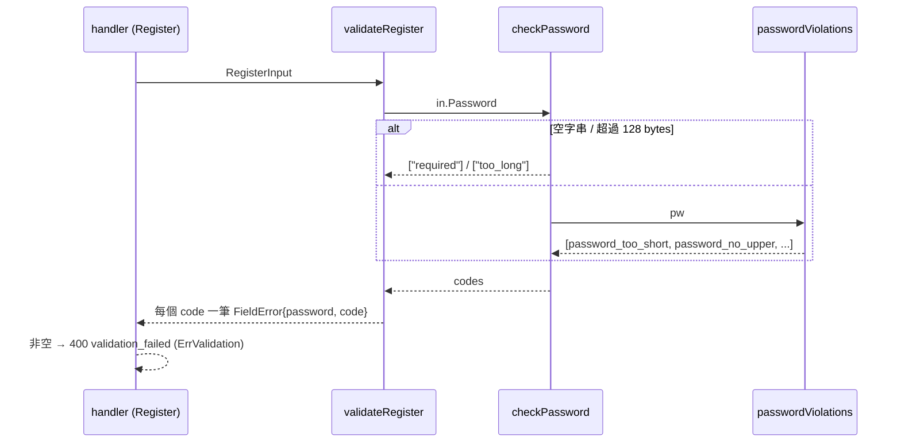

# 密碼政策 Validator (REG-005)

## 一句話摘要
註冊時一次檢查密碼的長度、字元類別、連續序列與重複字元,並把每一條違規各自回報給前端。

## 背景與目標
對應 PRD REG-005:至少 12 字元;大寫、小寫、符號各至少一個;不得有 3 個以上連續字母或數字(`abc`、`cba`、`123`、`321`);不得同一字元連續 3 次以上。驗收條件 AC-REG-005:`Abcdef!Xyz12Q` 必須被拒絕(含 `bcd`、`xyz`)。使用者是註冊流程(REG-001),之後改密碼(REG-007)會重用同一個函式。成功的定義:規則只有一份實作、純函式可表格驅動測試、一次回報所有違規。

Architecture 9.1 規定「Password policy 的 validator 放在 `auth`,註冊與改密碼共用」,這個實作符合。目前沒有專屬 ADR(ADR 0008 只涵蓋 Argon2id,尚未撰寫),API 契約部分見 [ADR 0005](../../docs/adr/0005-spec-first-api-with-oapi-codegen.md)。

## 架構與資料流

## 程式碼導覽
| 檔案 | 職責 |
|---|---|
| `backend/internal/auth/validate.go:86` | `validateRegister` 對 `checkPassword` 的每個 code 加一筆 `FieldError` |
| `backend/internal/auth/validate.go:111` | `checkPassword`:空字串、超長短路(正規化前後各檢查一次 128 bytes);其餘交給 `passwordViolations` |
| `backend/internal/auth/password_policy.go:30` | `normalizePassword`:NFKC;政策判斷、hash、verify 都經過它 |
| `backend/internal/auth/password_policy.go:37` | `passwordViolations`:依固定順序收集所有違規 code |
| `backend/internal/auth/password_policy.go:78` | `hasSequence`:3 個一組的滑動視窗,檢查等差 ±1 |
| `backend/internal/auth/password_policy.go:97` | `seqKey`:把數字與字母映射到不相交的區間,避免跨類別相鄰 |
| `backend/internal/auth/password_policy.go:111` | `hasRepeat`:連續相同 rune 計數 |
| `backend/internal/auth/password_policy_test.go:14` | 表格驅動測試,涵蓋邊界與 AC-REG-005 |
| `backend/api/openapi.yaml` | `RegisterRequest.password` 的規則與 code 清單(description) |

## 設計決策與取捨
- **決策**:一次回傳所有違規,每條規則一個 code,而不是遇到第一個就停。
  - **替代方案**:回傳單一 code(原本 `checkPassword` 的形狀)。
  - **理由**:使用者一次看到全部問題;前端可以逐條對照 i18n 訊息(I18N-003 要求錯誤訊息英文,code 給前端翻譯)。
  - **代價**:`checkPassword` 簽章由 `string` 改為 `[]string`;回應裡 `password` 欄位會出現多筆 `FieldError`。
- **決策**:長度下限以 rune 計(`utf8.RuneCountInString`),上限維持 bytes(`maxPasswordBytes = 128`,`password.go:24`)。
  - **替代方案**:兩邊都用 bytes 或都用 rune。
  - **理由**:下限是「使用者眼中的長度」,中文密碼不該因為 byte 數而被誤判;上限是為了限制 Argon2id 的工作量,必須以 bytes 為準。
  - **代價**:兩個單位並存,讀者要記得它們不同。
- **決策**:符號 = `unicode.IsPunct || unicode.IsSymbol`,空白不算。
  - **替代方案**:只接受 ASCII 標點。
  - **理由**:不排除使用者輸入法產生的符號;空白不算是避免「全是空白湊數」。
  - **代價**:`€`、全形標點也算符號,規則比 ASCII 版本寬。
- **決策**:序列只看 ASCII 字母(不分大小寫)與數字,升降序皆算,不回繞、不跨類別。
  - **替代方案**:支援 `890`、`yza` 回繞;或用鍵盤相鄰(`qwe`)。
  - **理由**:PRD 範例只有 `abc/cba/123/321`;回繞與鍵盤序列 PRD 沒有要求,加了會讓合法密碼被誤擋。
  - **代價**:全形字母數字不會被視為序列(見「找問題」)。
- **決策**:重複字元以 rune 完全相等比較,區分大小寫(`aAa` 不算)。
  - **替代方案**:不分大小寫,與序列一致。
  - **理由**:PRD 寫「同一字元」,取字面意思。這是我選的預設,使用者未明確回覆。
  - **代價**:與序列規則的大小寫處理不一致。
- **決策**:密碼先做 Unicode NFKC 正規化,再套用政策;hash 與 verify 也用正規化後的字串(`password.go`)。
  - **替代方案**:不正規化;或只在 `seqKey` 擴充 `unicode.IsLetter/IsDigit`。
  - **理由**:全形 `ａｂｃ`、`１２３` 否則會繞過序列與重複規則;NFC / NFD 的同一個字在不同裝置產生不同 bytes,會讓日後登入失敗。NFKC 同時解決兩件事。
  - **代價**:NFKC 是有損的(全形與半形視為同一密碼,`fi` 與 `fi` 相同),使用者無法分辨它們;而且正規化結果決定了 hash 輸入,**日後不能更改正規化形式**,否則舊 hash 全部失效。
- **決策**:規則實作為不依賴 DB / context 的純函式,放在 `password_policy.go`,不塞進 `password.go`。
  - **理由**:`password.go` 只負責 hash(NFR-SEC-003),政策可單獨測試,REG-007 可直接重用。

## 邊界情況與失敗處理
- 空字串:`["required"]`,不跑組成規則(`validate.go:111`)。
- 超過 128 bytes:`["too_long"]`,同樣跳過組成規則,避免對超大輸入做工作。先檢查原始輸入再正規化,所以不會對超大字串做 NFKC;正規化後再檢查一次,因為 NFKC 會膨脹(U+FDFA 40 個、120 bytes,正規化後遠超 128 bytes,測試 `expansion past 128 bytes`)。
- 全形 / 分解字元:`ａｂｃ` 視為 `abc` 而被判序列;`e` + U+0301 視為一個 rune `é`。
- 128 bytes 剛好:通過長度上限(測試 `exactly 128 bytes`)。
- 11 個 rune:`password_too_short`;中文 11 字即使超過 11 bytes 仍判短(測試 `CJK 11 runes`)。
- 中文字母:`unicode.IsUpper/IsLower` 皆為 false,所以全中文密碼會同時缺大寫與小寫。
- `890`、`yza`、`ab1`、`c12`、`abd`、`135`:不算序列,可通過。
- `aaa`、`111`、`!!!`:算重複;`aa`、`aAa` 不算。
- 多重違規:依 too_short → no_upper → no_lower → no_symbol → sequence → repeat 的固定順序回傳,前端與測試都能依賴順序。
- 錯誤回應只含 code,不回送密碼內容(AUD-006 精神)。

## 已知落差
- **改密碼尚未使用**:REG-007 / AUTH-007 還沒實作,目前只有註冊呼叫 `checkPassword`。Architecture 9.1 預期兩者共用。
- **無專屬 ADR**:密碼政策與 code 命名沒有 ADR;ADR 0008 尚未撰寫。
- **code 清單只在 description**:`FieldError.code` 在 OpenAPI 裡是自由字串,不是 enum,前端產生的型別無法對 code 做 exhaustive check。
- **正規化形式已固定為 NFKC**:之後若改成 NFC 或其他形式,所有既有 hash 都驗證不過;若要改需要 migration 策略(下次登入時重新 hash)。目前沒有 ADR 記錄此決定。
- **登入尚未實作**:`verifyPassword` 已正規化,但登入流程(AUTH-001)還沒有使用它,屆時要確認走同一條路徑。
- **分支基底**:本分支以 `wip(CUR-56)` commit 為基底,CUR-56 合併後需移除該 commit。

## 面試考題

### 基礎

::: details Q1. `passwordViolations` 為什麼回傳 `[]string` 而不是 `error` 或 `bool`?資料怎麼流到 HTTP 回應?
**出處**:`backend/internal/auth/password_policy.go:37`、`backend/internal/auth/validate.go:86`

**參考答案**
政策檢查的結果不是「發生錯誤」而是「使用者輸入有 0 到 6 種問題」,所以用 code 清單表達。`checkPassword` 把空字串、超長短路後,其餘交給 `passwordViolations`;`validateRegister` 對每個 code 呼叫 `bad("password", code)`,最後 `ErrValidation(fields)`(`errors.go`)轉成 400 `validation_failed`,`errors[]` 裡每個違規一筆 `{field:"password", code:"password_..."}`。code 是穩定契約,英文訊息與 i18n 由前端對照。

**可能的追問**
- 為什麼不直接回傳英文句子?(I18N-003 錯誤訊息英文,但前端需要穩定識別碼做樣式與翻譯。)
- 為什麼要固定順序?(前端顯示與測試斷言都需要確定性。)

**考察點**:API 錯誤模型設計、validation 與 error 的區別
:::

::: details Q2. `hasSequence` 怎麼判斷 `abc`、`cba`、`123`?為什麼要 `seqKey` 這個映射?
**出處**:`backend/internal/auth/password_policy.go:78`、`:97`

**參考答案**
用 3 個 rune 的滑動視窗。每個 rune 先經 `seqKey` 轉成數值:數字 `0..9`、字母(不分大小寫)`100..125`,非 ASCII 字母數字則不參與。若 `b-a` 為 ±1 且 `c-b` 與之相同,就是序列。把數字與字母放在不相交區間,是為了讓 `9` 與 `a` 之類的相鄰字元不可能差 1,因此 `c12` 這種混合不會被誤判;同時天然不回繞(`9→0` 差 -9,`z→a` 差 -25)。

**可能的追問**
- 時間複雜度?(O(n),n ≤ 128 bytes。)
- 如果要支援回繞或鍵盤序列要怎麼改?(改 `seqKey`/比較函式,或加一組規則並新增 code。)

**考察點**:演算法拆解、用資料表示取代條件分支
:::

### 進階

::: details 🔥 Q3. 長度下限用 rune、上限用 bytes,為什麼?這兩個單位混用會出什麼問題?
**出處**:`backend/internal/auth/password_policy.go:40`、`backend/internal/auth/password.go:24`、`backend/internal/auth/validate.go:115`

**參考答案**
下限是使用者體驗:12 個中文字應該被視為 12 字元,所以用 `utf8.RuneCountInString`。上限是資源保護:Argon2id 的輸入長度影響工作量,而且未驗證的使用者可以送任意大小,所以用 `len(pw)`(bytes)並在 `checkPassword` 先短路。混用的結果是:最多 128 bytes 的中文密碼只有約 42 個 rune,仍遠高於 12;但需要明確寫在文件(openapi description 已寫)。另外,`RuneCountInString` 把每個無效 UTF-8 byte 當作一個 rune(U+FFFD),所以無效 bytes 可以湊長度;實測 `Ab!` 加 9 個無效 byte 只被 `password_repeat` 擋下,因為它們都映射為同一個 U+FFFD,不是被長度規則擋下。

**可能的追問**
- JSON 解碼後無效 UTF-8 會怎樣?(標準 `encoding/json` 會替換成 U+FFFD,所以實際到不了這裡,但函式本身沒有依賴這點。)
- 為什麼先做長度上限再跑組成規則?(避免對超大輸入做不必要的工作。)

**考察點**:Unicode 與 bytes 的差異、DoS 面向的輸入限制
:::

::: details Q4. 為什麼回傳所有違規而不是第一個?這對安全或 UX 有什麼影響?
**出處**:`backend/internal/auth/password_policy.go:37`

**參考答案**
UX:一次看到全部問題,減少來回。安全:回應只描述密碼自身的規則違反,不涉及帳號是否存在,所以不構成帳號列舉(帳號存在與否的揭露在 REG-009 另有決定,且只在註冊階段)。要注意的是政策規則本身是公開資訊(PRD 與 openapi 都寫明),回報哪條違規不會洩漏秘密。

**可能的追問**
- 若要加入「不得包含工號」規則,會洩漏什麼?(只洩漏使用者自己輸入的工號與密碼的關係,可接受。)

**考察點**:validation 回應設計、資訊揭露
:::

::: details Q5. 表格驅動測試怎麼涵蓋邊界?哪些案例是為了防止誤判(false positive)?
**出處**:`backend/internal/auth/password_policy_test.go:14`

**參考答案**
測試以 `{name, pw, want}` 組成,測試名稱帶 `REG_005`(NFR-QA-003)。除了每條規則的正例,特別放了「不應該被擋」的反例:`890`、`yza`(不回繞)、`abd`、`ab`(差距不為 1 或只有兩個)、`c12`(跨類別)、`aa`、`aAa`、`135`、全是空白當符號。另有恰好 12 與 11 個 rune、CJK 以 rune 計。AC-REG-005 另有獨立測試 `TestAC_REG_005_...`。測試用 `reflect.DeepEqual` 比對完整 code 清單,所以順序也被鎖定。

**可能的追問**
- 為什麼測試密碼要小心避免意外含序列?(我寫測試時 `Ab!dEf@hIj#l` 其實含 `dEf`,被不分大小寫的序列規則抓到,所以改成 `Ab!dEg@hIk#l`。)

**考察點**:測試設計、邊界值分析
:::

### 設計/情境

::: details 🔥 Q6. 新增規則「不得與常見密碼清單相符」或「不得包含工號」,要改哪裡?怎麼維持 API 契約?
**出處**:`backend/internal/auth/password_policy.go:37`、`backend/internal/auth/validate.go:111`、`backend/api/openapi.yaml`

**參考答案**
`passwordViolations` 只收 `pw`,「包含工號」需要額外輸入,所以要把簽章改成接受 context(例如 `passwordViolations(pw, employeeID)`),或在 `validateRegister` 另加一步。常見密碼清單可用嵌入式 `map[string]struct{}`(`embed`),不需要外部元件(符合 Architecture 1.3 的「少動件」)。每條新規則要新增一個 `pwXxx` code、在 openapi description 補上、並在表格測試加案例。因為 `FieldError.code` 是自由字串,後端新增 code 不會讓前端編譯失敗,所以需要同步改 i18n 並在 CI 檢查(或把 code 改成 enum,讓 `openapi-typescript` 產生型別,見「已知落差」)。

**可能的追問**
- 規則多了之後順序如何維持?(維持在單一函式內的固定順序,測試鎖定。)
- 改密碼時要比對「新舊密碼不同」放哪?(需要現有 hash,屬於 service 層,不屬於純函式。)

**考察點**:擴充性、spec-first 契約維護
:::

::: details Q7. 如果註冊流量放大 10 倍,這個 validator 會是瓶頸嗎?該先看哪裡?
**出處**:`backend/internal/auth/password_policy.go:37`、`backend/internal/auth/password.go:19`

**參考答案**
不會。validator 是 O(n),n 最多 128 bytes,沒有 I/O,並在 hash 之前執行,所以不合規的請求會在昂貴的 Argon2id 之前被擋下。真正的瓶頸是 `maxConcurrentHashes = 4` 的 semaphore 與每次 hash 19 MiB 記憶體(`password.go:19`、`:27`),以及 DB 唯一索引的競爭。驗證方式:用 `go test -bench` 量 `passwordViolations`,並用壓測看 hash 等待時間與 503/timeout 比例。

**可能的追問**
- 驗證放在 hash 之前有什麼安全上的好處?(弱密碼請求不消耗 Argon2id 記憶體。)

**考察點**:效能估算、判斷瓶頸而不是優化錯地方
:::

### 找問題

::: details 🔥 Q8. 這段程式碼有什麼潛在問題?(原版有三個,第 1、2 項已修)
**出處**:`backend/internal/auth/password_policy.go:30`、`backend/internal/auth/password.go`

**原本的問題(已修)**:
1. 全形 `ａｂｃ`、`１２３` 繞過序列規則(實測原版回傳空清單)。
2. 沒有 Unicode 正規化:NFC 與 NFD 的 `é` 都通過驗證,但 Argon2id 產生不同 hash,同一使用者在不同裝置可能無法登入。

**修法**:`normalizePassword`(NFKC)同時用在 `passwordViolations`、`checkPassword`、`Argon2idHasher.Hash`、`verifyPassword`。128 bytes 上限在正規化前後各檢查一次,避免 NFKC 膨脹放大 hash 工作量。

**目前仍存在的問題**:
- 重複規則區分大小寫、序列規則不分大小寫(`aAa` 通過),需向 Product Owner 確認意圖。
- NFKC 有損:全形與半形密碼被視為同一個;而且正規化形式一旦上線就不能改,否則舊 hash 全部失效,目前沒有 ADR 記錄。
- 登入尚未實作,必須確認它呼叫的是會正規化的 `verifyPassword`;若有人在登入另寫一條比對路徑,會重現原問題。

**如何驗證**:`TestREG_005_hashIsNormalizationInsensitive`(NFC 與 NFD 都能驗證同一個 hash)、`TestREG_005_normalizePassword`、表格測試中的全形案例與 `expansion past 128 bytes`。
:::

## 三分鐘口頭說明稿
這個功能實作註冊時的密碼政策 REG-005。需求是至少 12 字元、要有大寫、小寫與符號,不能有三個連續的字母或數字,也不能同一個字元連續出現三次,驗收條件是 `Abcdef!Xyz12Q` 要被擋下。

我把規則寫成不依賴資料庫的純函式 `passwordViolations`,放在 `auth` 套件,註冊與之後的改密碼都能共用。它一次回傳所有違規的 code,而不是第一個,所以前端能一次顯示全部問題;`validateRegister` 再把每個 code 轉成一筆 `FieldError`,由 error middleware 輸出成 RFC 9457 的 400 回應。

幾個取捨:長度下限用 rune 計算,避免中文密碼被誤判太短;上限維持 128 bytes,因為它是在限制 Argon2id 的工作量。序列只處理 ASCII 字母與數字,升降序都算,不處理回繞,因為 PRD 沒要求,多做反而會擋掉合法密碼。符號用 `IsPunct || IsSymbol`,空白不算。

測試是表格驅動,名稱帶需求編號,重點放在「不該被擋」的邊界,像 `890`、`yza`、`c12`、`aAa`。API 契約部分,我先改 `openapi.yaml` 再重新產生程式碼,規則與 code 清單寫在 description。

我自己審視時發現兩個問題:全形的 `ａｂｃ`、`１２３` 會繞過序列規則,而且沒有做 Unicode 正規化,NFC 與 NFD 的同一個密碼會產生不同 hash。我的修法是在驗證、hash 與 verify 之前統一做 NFKC 正規化,並在正規化前後各檢查一次 128 bytes 上限,避免膨脹放大 Argon2id 的工作量。代價是 NFKC 有損,而且正規化形式上線後就不能改,這點記錄在已知落差中。
