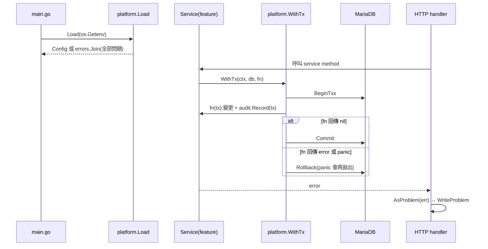

# Platform 基礎設施(設定、交易、日誌、錯誤、時鐘、值型別)

## 一句話摘要
提供所有 feature package 共用的底層零件,且不含任何業務規則、不 import 任何 feature。

## 背景與目標
- 對應 Architecture 5.1(platform 職責)、5.3(`WithTx` 與 audit 同交易)、`docs/adr` ADR 0003(依賴方向)、`docs/adr` ADR 0014(event year / deadline 來自設定、注入 clock)、PRD REG-002(Employee ID 6 位數字)、REG-004(Department)。
- 使用者是後續的 `auth`、`event`、`team`、`idea`、`upload`、`audit` 等 package。
- 成功定義:設定錯誤在啟動時一次列完;業務變更與 audit row 同生共死;測試可以控制「現在」;錯誤回應符合 RFC 9457 且不洩漏內部訊息。

## 架構與資料流

註:`main.go` 目前仍是空殼,圖中的 `main`、handler、`audit.Record` 都是尚未存在的呼叫端;目前只有 platform 本身存在。

## 程式碼導覽
| 檔案 | 職責 |
|---|---|
| `backend/internal/platform/config.go:58` | `Load(getenv)` 讀環境變數、收集全部錯誤 |
| `backend/internal/platform/config.go:129` | `parseDeadline`:RFC 3339 且不接受字面 `Z` |
| `backend/internal/platform/config.go:42` | `DBConfig.DSN()`(含密碼);`String()`(48)遮蔽密碼 |
| `backend/internal/platform/tx.go:15` | `WithTx`:commit / rollback / panic 處理 |
| `backend/internal/platform/problem.go:14` | `Problem` 型別;`AsProblem`(54)、`WriteProblem`(64) |
| `backend/internal/platform/clock.go:10` | `Clock` 介面、`SystemClock`(16)、`ManualClock`(21) |
| `backend/internal/platform/values.go:11` | `EmployeeID`、`Department`、`Track`、`AwardCategory` 的 Parse 函式 |
| `backend/internal/platform/logger.go:11` | JSON slog logger;`ParseLogLevel`(16) |

## 設計決策與取捨
- **決策**:設定用環境變數,`Load` 接收 `getenv` 函式而不是直接呼叫 `os.Getenv`。
  - **替代方案**:viper 之類的設定函式庫;直接讀 `os.Getenv`。
  - **理由**:測試傳 map 即可,不用改全域環境;依賴最少(Architecture 4 的 "Not used" 風格)。
  - **代價**:沒有設定檔、熱更新;但 ADR 0014 本來就要求重啟生效。
- **決策**:`EVENT_DEADLINE` 拒絕字面 `Z`,內部轉 UTC。
  - **替代方案**:缺 offset 時預設 Asia/Taipei。
  - **理由**:ADR 0014 要求明確 offset 且 fail fast,避免靜默用錯時區。
  - **代價**:維運人員必須寫 `+08:00`;`+00:00` 仍可通過(見已知落差)。
- **決策**:`WithTx` 傳入 `*sqlx.DB`,以 defer + recover + re-panic 處理 panic。
  - **替代方案**:不處理 panic,依賴 driver 在連線關閉時 rollback。
  - **理由**:明確 rollback 避免連線帶著未結束 transaction 回到 pool;re-panic 保留原始錯誤給上層 recover middleware。
  - **代價**:沒有 retry、沒有指定 isolation level(`BeginTxx(ctx, nil)`)。
- **決策**:`Problem` 實作 `error`,`AsProblem` 把非 `*Problem` 的錯誤統一變 500。
  - **替代方案**:每個 feature 自訂 error 型別再由 middleware 對映。
  - **理由**:一個型別串起 service → HTTP,`code` 欄位給前端 i18n(I18N-003)。
  - **代價**:service 層因此知道 HTTP status,platform 與 HTTP 語意耦合。
- **決策**:`Clock` 回傳 UTC,`ManualClock` 用 mutex 保護。
  - **理由**:ADR 0014 規定內部 UTC、顯示才轉 Asia/Taipei;測試無需 sleep。
  - **代價**:`ManualClock` 放在非 `_test.go` 檔,會進到正式 binary。

## 邊界情況與失敗處理
- 設定缺漏或格式錯:`Load` 回傳 `errors.Join` 的全部錯誤,呼叫端應啟動失敗。過去的 deadline 允許(唯讀系統)。
- `BeginTxx` 失敗:回傳 `begin tx: ...`,`fn` 不會執行(`platform_test.go:91` 起的子測試)。
- `fn` 回錯且 rollback 也失敗:兩個錯誤 `errors.Join` 一起回傳,原始錯誤仍可 `errors.Is`。
- `Commit` 失敗:回傳 `commit tx: ...`;變更未生效,呼叫端應視為失敗。
- `fn` panic:先 rollback 再用同一個值 re-panic。
- 未知錯誤進 `AsProblem`:回通用 500,不含原始訊息。
- Employee ID:全形數字、空白、長度不對一律拒絕。

## 已知落差
- `main.go` 尚未呼叫 `Load`、`NewLogger`,`audit.Record` 也還不存在,所以「audit 與變更同交易」目前只有 `WithTx` 這半邊。
- `DBConfig` 尚未提供開啟連線(`sqlx.Open`、pool 設定)的函式。
- Track / AwardCategory 的穩定代碼(`smart_innovation` 等)是自行命名,待與 OpenAPI 與 migration 對齊(待確認)。
- 尚無 Gin error middleware;`WriteProblem` 只依賴 `net/http`。
- 字面 `Z` 被擋,但 `+00:00` 通過:是否符合 ADR 0014 「明確 offset」的意圖待確認。

## 面試考題

### 基礎

::: details Q1. `WithTx` 在什麼情況下 commit、什麼情況下 rollback?
**出處**:`backend/internal/platform/tx.go:15`

**參考答案**
`fn` 回傳 nil 才 `Commit`(`tx.go:32`)。`fn` 回傳 error 時 `Rollback` 並把原 error 回傳(`tx.go:27`);若 rollback 本身也失敗,用 `errors.Join` 兩者都保留。`fn` panic 時 defer 內 `recover`,先 rollback 再 `panic(p)` 重拋(`tx.go:20-23`)。

**可能的追問**
- 為什麼 panic 時要 re-panic 而不是吞掉?
- `BeginTxx` 傳入的 `ctx` 被 cancel 時會怎樣?

**考察點**:transaction 生命週期、error wrapping
:::

::: details Q2. `Load` 怎麼處理設定錯誤?為什麼不是遇到第一個錯就回傳?
**出處**:`backend/internal/platform/config.go:58`、`:123`

**參考答案**
每個欄位的問題 append 到 `errs`,最後 `errors.Join(errs...)` 一次回傳(`config.go:123`)。部署時一次看到全部缺漏,不用改一個、重啟一次。`TestLoad_ReportsAllProblems`(`platform_test.go:40`)用空環境驗證訊息包含所有必填鍵。

**可能的追問**
- `errors.Join` 回傳的 error 怎麼用 `errors.Is` 檢查?
- 為什麼 `Load` 接收 `getenv` 函式?

**考察點**:fail fast、可測試性
:::

::: details Q3. 為什麼 `Config` 被 `%+v` 印出時不會洩漏密碼?
**出處**:`backend/internal/platform/config.go:48`

**參考答案**
`DBConfig` 與 `MinIOConfig` 實作 `String()` 與 `GoString()`,輸出不含密碼與 secret key。`fmt` 列印巢狀 struct 欄位時會呼叫欄位的 Stringer,所以 `%v`、`%+v`、`%#v` 都被覆蓋;`TestConfig_DoesNotLeakSecrets`(`platform_test.go:67`)驗證。只有 `DSN()` 含密碼,而它不會被自動呼叫。

**可能的追問**
- 若用 `slog` 的 JSON handler 記錄 `cfg`,會不會洩漏?(JSON handler 走 `encoding/json`,不走 `String()`;我沒有實際測試,待確認)

**考察點**:secret 管理、`fmt` 行為
:::

### 進階

::: details 🔥 Q4. `AsProblem` 為什麼把未知錯誤全部轉成通用 500?代價是什麼?
**出處**:`backend/internal/platform/problem.go:54`

**參考答案**
資料庫或網路錯誤訊息可能含主機位址、SQL 片段,直接回給 client 是資訊洩漏。`AsProblem` 用 `errors.As` 找 `*Problem`,找不到就回固定的 `internal_error`(`problem.go:56-59`)。代價:原始錯誤被丟掉,呼叫端必須在轉換前自己 log,否則出事時沒有線索(見 Q9)。

**可能的追問**
- 為什麼用 `errors.As` 而不是型別斷言?
- 如何把 request ID 放進 log 與 `Problem` 以便對照?

**考察點**:error handling、資訊洩漏
:::

::: details 🔥 Q5. deadline 為什麼要額外拒絕 `Z`?`time.Parse(time.RFC3339, ...)` 本身不是已經要求 offset 嗎?
**出處**:`backend/internal/platform/config.go:129-141`

**參考答案**
RFC3339 layout 本身要求 `Z` 或 `±hh:mm`,所以「完全沒 offset」在 `time.Parse`(`config.go:134`)就失敗。額外的 `HasSuffix "Z"` 檢查(`config.go:138`)是 ADR 0014 的政策:要求維運人員明確寫 `+08:00`,避免把 UTC 當成台北時間。注意 `+00:00` 仍會通過,這是政策與實作之間的細縫。

**可能的追問**
- 內部為什麼 `.UTC()`?顯示時怎麼轉 Asia/Taipei?
- deadline 已過去為什麼允許?

**考察點**:time zone、需求到實作的對應
:::

::: details Q6. 為什麼 `Clock` 是介面?`ManualClock` 為什麼需要 mutex?
**出處**:`backend/internal/platform/clock.go:10`、`:21`

**參考答案**
ADR 0014 要求 `event.Policy` 用注入的 clock,測試能固定「現在」而不用 sleep。`ManualClock` 的 `Now/Set/Advance` 都鎖同一個 mutex(`clock.go:28-42`),避免測試中一個 goroutine 讀時間、另一個 `Advance` 時發生 data race。

**可能的追問**
- 為什麼 `SystemClock` 回 `UTC()`?
- `ManualClock` 放在正式程式碼有什麼風險?

**考察點**:可測試性、concurrency
:::

### 設計/情境

::: details 🔥 Q7. 兩個使用者同時組隊搶同一個 Employee ID,`WithTx` 要怎麼配合才能保證只有一個成功?
**出處**:`backend/internal/platform/tx.go:16`

**參考答案**
Architecture 的做法是 `team_member (event_year, user_id)` 的 unique index:第二個 INSERT 失敗、`fn` 回 error、`WithTx` rollback。`WithTx` 只負責原子性,不負責併發控制。`BeginTxx(ctx, nil)` 用 driver 預設 isolation,所以「先 SELECT 檢查再 INSERT」的檢查本身不可靠,必須靠 unique index 或 `SELECT ... FOR UPDATE`(Architecture 8.x 也寫了 lock member user rows)。

**可能的追問**
- 遇到 deadlock(MySQL error 1213)要不要在 `WithTx` 內 retry?哪些 `fn` 可以安全 retry?
- 流量放大 10 倍,連線池與 transaction 時間怎麼控制?

**考察點**:isolation、idempotency、併發控制
:::

::: details Q8. 要加「每個請求一個 request ID」並讓 `Problem` 與 log 對得上,你會怎麼改?
**出處**:`backend/internal/platform/problem.go:64`、`backend/internal/platform/logger.go:11`

**參考答案**
middleware 產生 ID 放入 `context`;logger 用 `logger.With("request_id", id)`;`Problem` 加一個擴充 member(RFC 9457 允許擴充欄位,不破壞相容性),`WriteProblem` 的 `instance` 目前傳 request path,也可改為 `urn:uuid:<id>`。驗證:handler 測試比對回應中的 ID 與 log buffer 中的 ID。

**可能的追問**
- `instance` 該放 path 還是 ID?
- 如何避免 log 內出現 PII(Employee ID、email)?

**考察點**:observability、API 設計
:::

### 找問題

::: details Q9. 這段程式碼有什麼潛在問題?
**出處**:`backend/internal/platform/config.go:43`、`:61`、`backend/internal/platform/problem.go:54`

**問題**(都是在程式碼裡實際看到的):
1. `DSN()` 用 `fmt.Sprintf` 直接拼密碼(`config.go:43`)。含 `/`、`@` 等特殊字元的密碼可能被 driver 錯誤切分;我沒有對真實 MariaDB 驗證,待確認。
2. `get` 與 `require` 對所有值做 `TrimSpace`(`config.go:61`、`:67`),密碼或 secret key 若有前後空白會被悄悄改掉。
3. `AsProblem` 丟棄原始錯誤(`problem.go:59`),呼叫端若沒先 log,500 無從追查。
4. `ErrInternal` 是回傳新 `*Problem` 的 func 變數(`problem.go:47`),命名像 sentinel error 但不能用 `errors.Is` 比較,容易誤用。
5. `EVENT_YEAR` 範圍 2000–2999 是魔術數字(`config.go:112`)。

**如何修**:`DSN()` 改用 `mysql.Config{...}.FormatDSN()`;secret 欄位不做 `TrimSpace`;在 error middleware 內先 log 再 `AsProblem`;`ErrInternal` 改名或改成明確的建構函式;年份範圍抽成常數。

**如何驗證**:新增含 `@ / : %` 的密碼測試,並用 testcontainers 對真實 MariaDB 連線;測試 secret 前後空白原樣保留;handler 測試確認 500 時 log 有原始錯誤。
:::

## 三分鐘口頭說明稿
這個專案的 platform package 是所有 feature 共用的底層,規則是不放業務邏輯、不 import 任何 feature,這由 golangci-lint 的 depguard 強制。

我做了六件事。第一,設定從環境變數讀,`Load` 接收 getenv 函式所以好測,而且一次回報全部錯誤;ADR 0014 規定的活動年度與截止時間必須帶明確的 `+08:00` offset,內部轉成 UTC。第二,`WithTx` 把「變更加 audit」包成同一個 transaction:成功 commit,錯誤或 panic 就 rollback,panic 會重拋讓上層 recover middleware 處理。第三,錯誤採 RFC 9457,`Problem` 本身實作 error,附穩定的 `code` 給前端 i18n;未知錯誤一律轉通用 500,避免洩漏內部訊息。第四,`Clock` 介面讓 deadline 判斷可以在測試中固定時間,不用 sleep。第五,值型別如 EmployeeID 在邊界就驗證,必須是 6 位半形數字。第六,slog 輸出 JSON。

取捨上,我選擇最少依賴:不用 viper、不用 ORM。代價是 `WithTx` 沒有 retry 也沒指定 isolation,併發正確性要靠資料庫的 unique index。自己 review 時我也找到幾個要改的地方:DSN 應改用 driver 的 FormatDSN 處理特殊字元、secret 不該被 TrimSpace、轉成 500 之前必須先 log 原始錯誤。測試涵蓋率約 87%,用 sqlmock 驗證 commit、rollback 與 panic 路徑。
