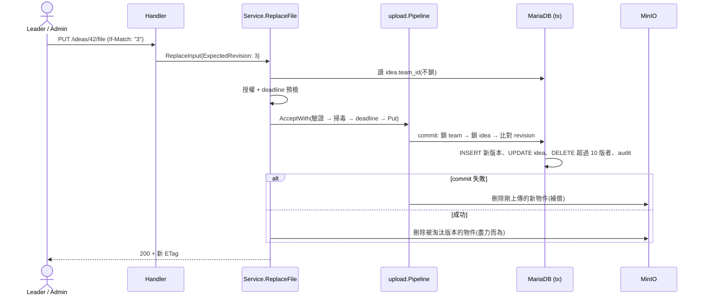

# 替換檔案與 10 版保留 (IDEA-021、023、024)

## 一句話摘要
`PUT /ideas/{ideaId}/file` 每次替換都新增一個版本並成為正式版本;超過 10 版時,同一個 transaction 刪掉最舊版本的 DB 列,commit 後再刪 MinIO 物件。

## 背景與目標
- PRD:**IDEA-020** 每次上傳建立新版本、**IDEA-021** 最多保留 10 版,第 11 版產生時永久移除最舊的、**IDEA-023** 沒有人能刪單一版本、**IDEA-024** 最新版本為正式版本、**IDEA-030** 併發編輯不得靜默覆蓋、**IDEA-006** 失敗不留痕跡、**DDL-003/005/006**。
- 成功的定義:替換成功後 `currentVersion` 是新版本、ETag 前進;剩下的版本最多 10 個;被淘汰的版本在 DB 與物件儲存都消失;API 上找不到任何刪除單一版本的操作(IDEA-023 靠「不提供」達成)。
- 範圍外:改標題/摘要、版本列表、下載(各自是別的票)。

## 架構與資料流

## 程式碼導覽
| 檔案 | 職責 |
|---|---|
| `backend/internal/idea/replace.go:30` | `ReplaceFile`:預檢 → AcceptWith → 交易 → 刪舊物件 |
| `backend/internal/idea/replace.go:113` | `replaceInTx`:鎖 team → 鎖 idea → 比對 revision → 新版本 → 淘汰 → audit |
| `backend/internal/idea/replace.go:181` | `removeObjects`:commit 後刪 MinIO 物件,失敗只記 log |
| `backend/internal/idea/repo.go:118` | `lockIdea`:`SELECT … FOR UPDATE` 讀目前版本號與 revision |
| `backend/internal/idea/repo.go:133` | `advanceIdea`:`UPDATE … WHERE version = ?`,0 列即 412 |
| `backend/internal/idea/repo.go:159` | `trimVersions`:`version_no <= 最新 - 10` 的列選出後刪除 |
| `backend/internal/idea/handler.go:56` | `ReplaceIdeaFile`:要求 `If-Match`,缺少回 428 |
| `backend/internal/idea/service.go` | 新增 `ObjectRemover` 介面;`main.go` 傳入 MinIO |

## 設計決策與取捨
- **決策**:新版本號用 `idea.current_version_no + 1`,不是「現有列數 + 1」。
  - **理由**:欄位在 migration 000006 就註明「不重用,即使舊版本被淘汰」。淘汰後列數永遠是 10,用列數會產生重複號碼(撞 unique key)。
- **決策**:淘汰條件是 `version_no <= 新版本號 - 10`。
  - **理由**:版本號單調遞增,所以這剛好是「保留最新 10 個」;第 10 版時 cutoff 為 0,不會刪任何東西。
- **決策**:DB 列在交易內刪,MinIO 物件在 commit **之後**才刪。
  - **替代方案**:交易內先刪物件。
  - **理由**:若先刪物件而交易 rollback,DB 會指向不存在的檔案,使用者資料損毀;反過來最壞只是留下孤兒物件(Architecture 8.2 已接受)。
  - **代價**:刪除失敗只寫 log,孤兒要靠日後的對帳工具處理。
- **決策**:`If-Match` 在 OpenAPI 宣告為非必填,由 service 回 428。
  - **理由**:codegen 對必填 header 缺少時只會回籠統的 400,拿不到 `precondition_required` 這個穩定 code。
- **決策**:鎖順序 team → idea,與建立、解散一致。避免與 `SoftDeleteByTeam` 互鎖。
- **決策**:外人與已解散團隊的 Idea 都回 404 `idea_not_found`,隊員回 403,與建立時的規則一致。
- **決策**:`auditFailure` 加上 action 與 targetID 參數,讓上傳與替換共用。失敗 audit 也記 `idea.replace` 與 Idea id。

## 邊界情況與失敗處理
- **revision 過期**:鎖住 idea 列後比對,不符回 412 `idea_changed`,rollback,新物件被補償刪除,另記 failure audit。
- **缺少或格式錯誤的 If-Match**:428 / 400,連檔案都不讀。
- **Idea 不存在或已軟刪除**:404 `idea_not_found`;若在掃毒期間被刪,交易內 `lockIdea` 找不到,同樣 404 並補償。
- **截止後**:Participant 403 `deadline_passed`(預檢、存檔前、交易內共三次檢查);Admin 不受限。
- **檔案被拒(格式、大小、毒)**:與首次上傳同一條管線,不寫入任何東西。
- **MinIO 刪舊物件失敗**:替換仍成功,錯誤記 log(含 key 與版本號),留下孤兒。
- **並發兩個替換**:第二個在 `FOR UPDATE` 等待,拿到鎖後 revision 已變 → 412,不會產生重複版本號。

## 已知落差
- **沒有真實 DB 的測試**:全部是 `sqlmock`,沒有驗證 `FOR UPDATE` 與 unique key 的實際行為。
- **孤兒物件無對帳工具**:刪除失敗的物件只在 log 裡。
- **412 沒有回傳最新狀態**:IDEA-030 要求「顯示最新狀態」,目前沒有 GET Idea 端點,前端要等該票。
- **前端未實作**:替換 UI、上傳進度、衝突提示都還沒有。
- `scripts/api-check.sh` 在變更尚未 commit 時會顯示 out of date;commit 後應該通過。

## 面試考題

### 基礎

::: details Q1. 為什麼新版本號不能用「目前版本數 + 1」?
**出處**:`backend/internal/idea/replace.go:113`

**參考答案**
超過 10 版後舊列被刪,列數固定為 10,下一個號碼會與現存版本重複而違反 `uq_idea_version_no`。所以用 `idea.current_version_no` 這個「最新版本號」計數器,它只增不減。

**考察點**:單調計數器與計數的差別。
:::

::: details Q2. IDEA-023「不能刪單一版本」是怎麼保證的?
**出處**:`backend/api/openapi.yaml`(`/ideas/{ideaId}/file`)

**參考答案**
API 只有「新增版本」,沒有任何接受版本號的刪除操作;服務內唯一的 `DELETE idea_version` 在 `trimVersions`,條件由最新版本號推導,不受呼叫者輸入影響。

**考察點**:用「不提供」取代「檢查權限」。
:::

### 進階

::: details 🔥 Q3. 為什麼先刪 DB 列、commit 後才刪 MinIO 物件?
**出處**:`backend/internal/idea/replace.go:181`

**參考答案**
DB 與物件儲存不能在同一個交易。若先刪物件、交易卻失敗,DB 仍引用已消失的檔案,資料真的壞了;反過來,commit 後刪物件失敗只是多一個沒人引用的檔案。兩害相權取其輕。

**可能的追問**
- 如何處理孤兒?(對帳工具:列出物件,比對 `idea_version.object_key`。)
- 為什麼刪除用 `context.WithoutCancel`?(請求可能已結束,但列已經刪了。)

**考察點**:跨系統一致性、補償策略。
:::

::: details Q4. 兩個人同時替換,結果會如何?
**出處**:`backend/internal/idea/repo.go:118`、`backend/internal/idea/repo.go:133`

**參考答案**
兩者都通過預檢並各自上傳物件,進交易後第二個在 `lockIdea` 的 `FOR UPDATE` 等待。第一個 commit 後 revision 已加一,第二個比對失敗回 412,交易 rollback,管線刪掉它剛上傳的物件。`UPDATE … WHERE version = ?` 是第二道保險。

**考察點**:悲觀鎖加樂觀鎖的組合。
:::

### 設計/情境

::: details Q5. 若改成保留 20 版,要動哪裡?
**出處**:`backend/internal/idea/model.go`(`MaxVersions`)

**參考答案**
改常數與 PRD(IDEA-021)、OpenAPI 描述。已經超過新上限的 Idea 不會需要遷移,因為只會變少淘汰。若改成「保留 5 版」,下一次替換會一次淘汰多個版本,`trimVersions` 與 audit 的 `removedVersions` 已能處理多筆。

**考察點**:規則參數化、向後相容。
:::

### 找問題

::: details 🔥 Q6. 這個功能有哪些潛在問題?
**出處**:`backend/internal/idea/replace.go:30`

**問題**:
1. 孤兒物件只留在 log,沒有對帳工具。
2. 預檢的 `teamOfIdea` 沒有鎖,掃毒期間 Idea 被刪除要到交易內才發現,白做了一次掃毒與上傳(有補償,資料安全)。
3. 全部測試都是 sqlmock。
4. 412 沒帶最新狀態。

**如何修**:補對帳指令(`cmd/` 底下);加 GET Idea 端點並在 412 帶 `Location`;補 testcontainers 整合測試。
:::

## 三分鐘口頭說明稿
這張票做的是替換檔案與保留 10 版。我新增 `PUT /ideas/{id}/file`,必須帶 `If-Match`,缺少回 428,過期回 412,所以不會靜默覆蓋別人的修改。流程沿用首次上傳的管線:先授權和檢查截止,再驗證、掃毒,最後才寫入 MinIO,所以被拒絕的檔案不會留下任何東西。

進交易後先鎖 team、再鎖 idea,與建立和解散的鎖順序一致,比對 revision,用 `current_version_no + 1` 當新版本號,更新 idea,然後把版本號小於等於「最新減 10」的列刪掉,最後寫入含被淘汰版本的 audit。版本號不重用,所以不能用列數計算。

DB 列在交易內刪,MinIO 物件在 commit 之後才刪,因為先刪物件再 rollback 會讓資料壞掉,而孤兒物件只是浪費空間。取捨是目前沒有對帳工具、測試只有 sqlmock、412 還不能回最新狀態,這些我列在已知落差。IDEA-023 靠 API 不提供刪除單一版本來保證。
