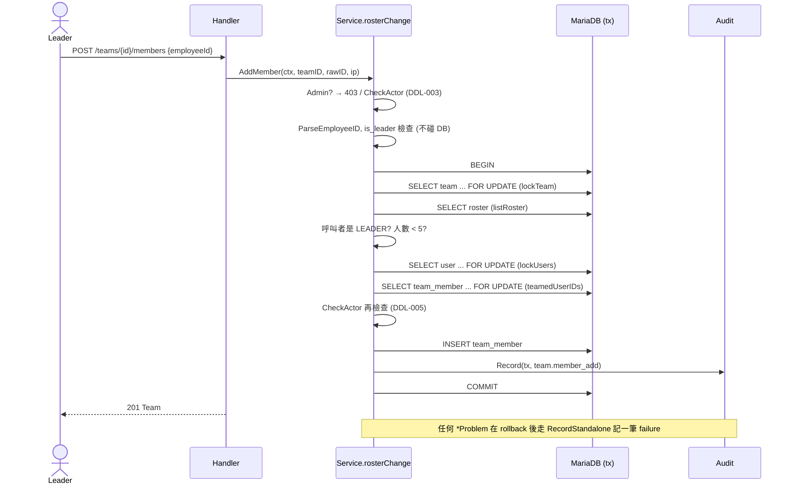

# 組長加入與移除成員 (TEAM-010、011)

## 一句話摘要
組長在活動開放期間以 Employee ID 加人或移人,人數上限與驗證規則在 transaction 內保證。

## 背景與目標
- PRD:**TEAM-010** 加入(套用 TEAM-007 驗證與 TEAM-006 人數上限)、**TEAM-011** 移除(UI 二次確認,NFR-UX-003)、**TEAM-013** 組長不能被移除、**DDL-003/005** 截止後不可改、**AUD-001** 每個 team action 都要稽核、**R-02 / ADM-005** Admin 不碰名單。
- 使用者:Team Leader。成功的定義:任何併發下,團隊不超過 5 人、一人一隊、每次成功的變更都有同一 transaction 的 audit record。
- 二次確認屬於前端。API 不接受 confirm 欄位(`openapi.yaml` 的 description 有寫明),前端 dialog 尚未實作。

## 架構與資料流

移除流程相同,差在 `DELETE ... role='MEMBER'` 且不鎖 user。

## 程式碼導覽
| 檔案 | 職責 |
|---|---|
| `backend/internal/team/members.go:24` | `AddMember`:解析 ID、開 tx |
| `backend/internal/team/members.go:52` | `RemoveMember` |
| `backend/internal/team/members.go:71` | `rosterChange`:Admin 擋、deadline、錯誤翻譯、failure audit(add/remove 共用) |
| `backend/internal/team/members.go:98` | `leaderOf`:鎖 team、讀 roster、判斷 leader / member / 陌生人 |
| `backend/internal/team/members.go:118` | `addInTx`:人數上限、TEAM-007、insert、audit |
| `backend/internal/team/members.go:172` | `removeInTx`:TEAM-013、delete、audit |
| `backend/internal/team/repo.go:121` | `lockTeam`:`FOR UPDATE`,只取當年且未軟刪除的 team |
| `backend/internal/team/repo.go:145` | `listRoster`:leader 排第一,其餘依加入順序 |
| `backend/internal/team/repo.go:157` | `deleteMember`:`role='MEMBER'`,回傳是否真的刪到一列 |
| `backend/internal/team/service.go:229` | `auditFailure` 泛化為接收 action / targetID |
| `backend/internal/team/handler.go:51` / `:68` | 兩個 Gin handler,body 上限 1 KiB |

## 設計決策與取捨
- **決策**:所有名單變更先 `SELECT ... FOR UPDATE` 鎖 team 列,再鎖 user。
  - **替代方案**:只靠 `COUNT(*)` 後 insert;或加 DB trigger / CHECK 限制 5 人。
  - **理由**:人數上限無法用 unique index 表達(Architecture 7.2 明列 "Team row locked while adding members")。鎖 team 把同一隊的變更序列化,count 才精確。
  - **代價**:同一隊的操作排隊;且完全依賴 application 遵守 lock 順序。
- **決策**:鎖順序固定為 team → user。
  - **替代方案**:先鎖 user(`Create` 的做法)。
  - **理由**:`Create` 時 team 還不存在,所以只鎖 user;add/remove 一開始就需要 team 列,順序固定可避免互等。
  - **代價**:正確性靠人工推理,目前沒有對真實 DB 的測試驗證。
- **決策**:非成員拿 404 `team_not_found`,成員但非組長拿 403 `forbidden`。
  - **替代方案**:一律 403。
  - **理由**:不讓陌生人探測 team id 是否存在。
  - **代價**:隊員可以知道自己在那隊(本來就知道)。
- **決策**:Admin 在任何 DB 查詢之前就被 403(`members.go:71` 起)。
  - **理由**:R-02、ADM-005;Admin 不是任何 team 的成員,查了也只會是 404。
- **決策**:add/remove 共用 `rosterChange`,以 closure 傳入 body。
  - **替代方案**:各寫一份(`Create` 的 `reject` closure 風格)。
  - **理由**:Admin、deadline、錯誤翻譯、failure audit 只寫一次,不會漏掉一條路徑。
  - **代價**:多一層 closure,閱讀稍繞。
- **決策**:deadline 檢查兩次(進 tx 前、insert / delete 前)。理由見 DDL-005 與 ADR 0014。

## 邊界情況與失敗處理
- **ID 格式錯誤 / 加自己**:不開 tx,直接 400 `validation_failed`,欄位 `employeeId`,code 為 `invalid_format` / `is_leader`。`invalid_format` 的 value 用 `echo` 截到 20 字。
- **Admin ID 或不存在的 ID**:都回 `not_registered`(R-04,不洩漏誰是 Admin)。
- **部門不同 / 已在其他隊**:`department_mismatch` / `already_in_team`。比較對象是 `team.department`(= 創建時組長的部門)。
- **隊伍已滿**:409 `team_full`,在鎖 user 之前就回。
- **兩個組長同時搶同一個人**:`lockUsers` 讓第二個等待,`teamedUserIDs` 是 locking read 看得到第一個的結果;最後的防線是 `uq_team_member_year_user`,違反時翻成 409 `already_in_team`(`errMemberRaced`)。
- **移除時 row 已被刪**:`deleteMember` 影響 0 列 → 404 `member_not_found`,不寫成功 audit。
- **移除組長**:409 `leader_cannot_be_removed`;`deleteMember` 的 SQL 也只刪 `MEMBER`,是第二道保險。
- **已軟刪除的 team / 往年的 team**:`lockTeam` 查不到 → 404。
- **未預期的 DB 錯誤**:不是 `*Problem`,不寫 failure audit,handler 回 500 並隱藏細節(有測試)。
- **截止後**:403 `deadline_passed`,且不碰 DB。

## 已知落差
- **沒有真實 DB 的測試**:全部是 `sqlmock`,只驗證 SQL 序列,沒驗證 `FOR UPDATE` 的實際鎖行為與 deadlock。(待確認:`testcontainers-go` 是 Architecture 列出的測試手段,但目前專案還沒有用。)
- **前端未實作**:NFR-UX-003 的二次確認 dialog 還沒有。
- `scripts/api-check.sh` 在變更尚未 commit 時會顯示 out of date(因為它拿 working tree 對 index 比);commit 後應該通過。

## 面試考題

### 基礎

::: details Q1. 加入成員時,一個請求依序做了哪些檢查?為什麼是這個順序?
**出處**:`backend/internal/team/members.go:24`、`:118`

**參考答案**
先做不需要 DB 的檢查:Admin(`rosterChange`)、deadline、ID 格式、是否是自己。然後才開 tx:鎖 team → 讀 roster 確認呼叫者是 LEADER → 人數 < 5 → 鎖 target user → 驗證 Participant / 同部門 / 不在其他隊 → 再檢查一次 deadline → insert → 寫 audit → commit。便宜且不需鎖的檢查放前面,避免無謂地持有鎖;需要精確 count 的檢查必須在持有 team 鎖之後。

**可能的追問**
- 人數檢查為什麼要在鎖 user 之前?(滿了就不用鎖 user,縮短持鎖時間。)
- 為什麼 deadline 要檢查兩次?

**考察點**:資料流理解、fail-fast、鎖的持有範圍。
:::

::: details Q2. 非組長的三種呼叫者(隊員、陌生人、Admin)分別得到什麼回應?為什麼不一樣?
**出處**:`backend/internal/team/members.go:71`、`:98`

**參考答案**
Admin:403 `forbidden`,在 DB 之前就回。隊員(roster 裡但 role 是 MEMBER):403 `forbidden`。陌生人(不在 roster):404 `team_not_found`。陌生人拿 404 是為了不讓人用 403/404 的差異探測 team id 存在與否;隊員本來就知道隊伍存在,所以 403 沒有洩漏。

**可能的追問**
- 這個差異本身會不會成為 side channel?(對陌生人來說,不存在與不屬於我是同一個 404,沒有。)

**考察點**:authZ 設計、資訊洩漏。
:::

::: details Q3. 移除成員的 audit 記錄了什麼?失敗時呢?
**出處**:`backend/internal/team/members.go:172`、`backend/internal/team/service.go:229`

**參考答案**
成功:在同一個 tx 內 `Record`,`changes` 有 `before.members` 與 `after.members`(Employee ID 清單),所以 commit 與 audit 同生同死(Architecture 5.3)。失敗:tx 已 rollback,所以用 `RecordStandalone` 另開短 tx,記 `reason` 與 `errors`(只有欄位、code、ID,不含任意文字),AUD-001/002。寫 audit 失敗只會被 log,不會改變回給使用者的結果。

**可能的追問**
- 為什麼失敗 audit 不能放在原本的 tx?

**考察點**:audit 與 transaction 的關係。
:::

### 進階

::: details 🔥 Q4. 兩個請求同時往同一隊加第 5 人和第 6 人,如何保證不超過 5?如果沒鎖會怎樣?
**出處**:`backend/internal/team/repo.go:121`、`backend/internal/team/members.go:123`

**參考答案**
`lockTeam` 用 `SELECT ... FOR UPDATE` 鎖 team 列,兩個請求在這裡序列化。第二個拿到鎖時,`listRoster` 讀到的是第一個已 commit 的結果(snapshot 在這之後的第一個 plain read 才建立),`len(roster) >= 5` 就會回 `team_full`。沒鎖的話,兩邊都讀到 4 人、都 insert,變成 6 人;`team_member` 上沒有任何 unique index 能擋住這件事,所以只能靠鎖。

**可能的追問**
- 如果 `listRoster` 放在 `lockTeam` 之前會怎樣?(snapshot 可能過舊,count 不準。)
- 為什麼不是 CHECK constraint 或 trigger?
- 隔離級別是 REPEATABLE READ 時,`FOR UPDATE` 與 plain read 的差異?

**考察點**:locking read、MVCC snapshot、為什麼 DB 約束表達不了。
:::

::: details Q5. 這裡的 lock 順序是 team → user,而 `Create` 是 user → (新 team)。會 deadlock 嗎?
**出處**:`backend/internal/team/members.go:98`、`backend/internal/team/service.go`(`createInTx`)

**參考答案**
我推理的結果是不會:Create 持有 user 鎖後,是 insert 一個全新的 team,不會等待任何 Add/Remove 持有的 team 鎖;Remove 只持有 team 鎖與 team_member 列鎖,不等 user 鎖;兩個 Add 都是 team → user 的同序。但這是紙上推演,專案目前只有 sqlmock 測試,沒有對真實 MariaDB 驗證。(待確認)

**可能的追問**
- 要怎麼驗證?(testcontainers 起 MariaDB,開兩條連線交錯執行,用 `SHOW ENGINE INNODB STATUS` 看 deadlock。)
- 發生 deadlock 時 MariaDB 怎麼辦?(殺掉一個 tx,應用層目前會回 500,沒有 retry。)

**考察點**:deadlock 推理、誠實面對沒驗證的部分。
:::

::: details Q6. 為什麼 `deleteMember` 的 SQL 要加 `AND role = 'MEMBER'`,service 不是已經擋過組長了?
**出處**:`backend/internal/team/repo.go:157`、`backend/internal/team/members.go:186`

**參考答案**
defense in depth:service 層用 roster 判斷 `ErrLeaderCannotBeRemoved`,但如果未來有人改壞了判斷,SQL 仍然不會刪掉 leader(影響 0 列 → `member_not_found`)。同時回傳 `RowsAffected == 1` 讓「讀到的 roster」與「實際刪到」不一致時不會默默成功。

**可能的追問**
- 影響 0 列時回 404,會不會掩蓋 bug?

**考察點**:防禦式設計、affected rows 的使用。
:::

### 設計/情境

::: details Q7. 需求變成「成員要先同意才能加入」,要改哪裡?
**出處**:`backend/internal/team/members.go:118`、`backend/internal/team/model.go`

**參考答案**
`team_member` 需要 `status`(PENDING/ACCEPTED);一人一隊的 unique index `uq_team_member_year_user` 要決定 PENDING 是否算佔位(算的話一人只能被邀請一隊,不算的話要在接受時重新驗證 TEAM-007 與人數)。`addInTx` 變成「建立邀請」,新增 accept/decline API,`listRoster` 與 5 人上限只計 ACCEPTED。PRD A-05 目前明確接受「不經同意」,所以要先改 PRD,再寫 ADR。

**可能的追問**
- 邀請過期怎麼處理?(專案沒有 scheduler,Architecture 1.3。)

**考察點**:需求變更影響面、不變量(invariant)與 schema 的關係。
:::

::: details Q8. 流量放大 10 倍(例如截止前夕的尖峰),這個設計的瓶頸在哪?怎麼驗證?
**出處**:`backend/internal/team/repo.go:121`

**參考答案**
鎖的粒度是單一 team,不同隊互不阻塞,所以瓶頸不在 team 鎖。熱點是 `user` 表的 `FOR UPDATE`(搶同一個人)與 audit 的 insert。規模是 ~5,000 隊 × 最多 5 人,10 倍仍然很小。驗證:用 k6 或 Go 壓測對同一隊與不同隊分別打,觀察 InnoDB lock wait(`innodb_lock_wait_timeout`)與 p99。注意 PRD NFR-PF-001 明確沒有效能目標,所以這是自我驗證而不是驗收。

**可能的追問**
- 同一隊的操作要排隊,可以接受嗎?(組長一個人操作,實際上幾乎不會併發。)

**考察點**:找瓶頸、對規模的務實判斷。
:::

### 找問題

::: details 🔥 Q9. 這段程式碼有什麼潛在問題?
**出處**:`backend/internal/team/members.go:71`

**問題**:
1. **audit 可被任意灌入**:`rosterChange` 對所有 `*Problem` 都寫 `RecordStandalone`,包含「陌生人對任意 teamID 的 404」「Admin 的 403」。登入的使用者可以用迴圈打任意 team id,每次都產生一筆 audit(append-only、至少保留一年,AUD-003/004),沒有任何限流(AUTH-004 的 limiter 只掛在 `/auth/*`)。這是我在程式碼裡實際看到的,不是推測。
2. **授權前先回 deadline**:`CheckActor` 在檢查呼叫者身分之前,所以截止後陌生人與隊員都得到 `deadline_passed` 而不是 404/403。影響很小,但與「陌生人一律 404」的設計意圖不完全一致。
3. **沒有對真實 DB 的測試**(見 Q5),`FOR UPDATE` 的行為只靠推理。
4. 成功回應的 `members` 順序是「roster + 新成員」,之後 `listRoster` 的順序是 `created_at, user_id`,毫秒內同時加入時兩者可能不同。

**如何修**:(1) 對未授權的失敗(404/403)只記 log 或做 rate limit,或對 audit 做取樣/去重;至少要把這類失敗與業務失敗分開評估。(2) 先確認身分再檢查 deadline,或接受現狀並在文件註明。(3) 補 testcontainers 整合測試。(4) 回應前重新 `listRoster`。

**如何驗證**:(1) 寫測試迴圈打 N 次不存在的 team,斷言 audit 筆數;(3) 起兩條連線,同時加第 5、第 6 人,斷言恰一個成功。
:::

## 三分鐘口頭說明稿
這個功能是讓組長在活動開放期間用 Employee ID 加人或移人,對應 TEAM-010、011。最難的是併發:團隊最多 5 人,但資料庫沒辦法用 unique index 表達這種上限,所以我在每個名單變更的 transaction 一開始就對 team 那一列 `SELECT ... FOR UPDATE`,同一隊的變更因此序列化,再讀 roster 數人頭;接著鎖 target user,套用跟建立團隊相同的 TEAM-007 驗證。鎖順序固定是 team 再 user。一人一隊則由 `team_member (event_year, user_id)` 的 unique index 兜底,撞到就翻成 409。

授權上,只有組長可以改名單:隊員得到 403,陌生人與不存在的 team 都得到 404,避免被拿來探測 team id;Admin 在查 DB 之前就被擋。截止時間檢查兩次,一次在進 tx 前、一次在寫入前,符合「以動作完成時的時間為準」。每次成功的變更在同一個 tx 內寫 audit,含 before/after roster;失敗則在 rollback 後用獨立的 tx 記一筆。

取捨是:鎖的正確性目前只靠推理與 sqlmock 測試,沒有真實 DB 的整合測試;另外我發現任何登入者都能對任意 team id 製造 404 的 failure audit,這個我會列為待修的問題。二次確認屬於前端,API 不收 confirm 欄位。
