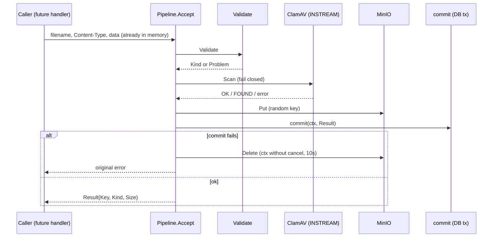

# 上傳管線 Spike (驗證、ClamAV、MinIO)

## 一句話摘要
接收 PPTX/PDF,驗證內容真偽、掃毒、存入物件儲存,且 DB 失敗時不留孤兒檔。

## 背景與目標
對應 PRD IDEA-002 ~ IDEA-006:只收 PPTX/PDF(IDEA-002)、≤ 5 MB(IDEA-003)、副檔名/宣告型別/實際內容三者一致(IDEA-004)、先掃毒才可見(IDEA-005)、中斷的上傳不得留下版本(IDEA-006)。這是風險最高的一塊,所以先做 spike,驗證整條路徑可行。

成功的定義:範例檔中合法的通過、不合法的被拒,EICAR 被 ClamAV 擋下,commit 失敗後 MinIO 查不到物件。已用本機 docker-compose 的真實 ClamAV 與 MinIO 驗證(整合測試)。

## 架構與資料流

## 程式碼導覽
| 檔案 | 職責 |
|---|---|
| `backend/internal/upload/validate.go:57` | `Validate`:大小、副檔名、Content-Type、內容四項一致性檢查 |
| `backend/internal/upload/validate.go:110` | `validatePPTX`:ZIP 魔術數字、必要 part、拒絕 `vbaProject.bin` 與 `macroEnabled` |
| `backend/internal/upload/scan.go:45` | `ClamAV.Scan`:解析 clamd 回覆,FOUND → malware,其他非 OK → unavailable |
| `backend/internal/upload/scan.go:76` | `roundTrip`:INSTREAM 分塊協定(4-byte big-endian 長度,0 結尾)、整體 deadline |
| `backend/internal/upload/store.go:22` | `NewKey`:128-bit 隨機 key,不含使用者檔名 |
| `backend/internal/upload/pipeline.go:31` | `Accept`:validate → scan → put → commit,失敗即補償 |
| `backend/internal/upload/pipeline.go:62` | `compensate`:用 `context.WithoutCancel` 刪除已寫入物件 |
| `backend/internal/upload/testdata/gen.go` | 產生範例檔(EICAR 不落地,測試中即時組出) |

## 設計決策與取捨
- **決策**:整個檔案先讀進記憶體,再驗證、掃描、寫入。
  - **替代方案**:邊收邊串流到 MinIO / 先放 quarantine bucket。
  - **理由**:上限只有 5 MB,記憶體處理讓「中斷的上傳什麼都沒寫」成立(IDEA-006),Architecture 8.2 也這樣規定。
  - **代價**:每個並行上傳佔 ≤ 5 MB;需要 semaphore 限制並行(本 spike 尚未做)。
- **決策**:Scanner 失敗一律 fail closed(回 503 `upload_scan_unavailable`)。
  - **替代方案**:clamd 掛掉時放行並稍後補掃。
  - **理由**:IDEA-005 要求「可見之前必掃」。
  - **代價**:ClamAV 停機期間所有上傳不可用。
- **決策**:不用 minio-go 的 multipart/串流,直接 `PutObject` 一個 `bytes.Reader`。
  - **理由**:檔案小,已知長度,實作簡單。
- **決策**:補償刪除而非兩階段提交。
  - **替代方案**:先 commit DB 再 Put(失敗會有「有版本沒檔案」的可見不一致)。
  - **理由**:先 Put 後 commit 時,最壞情況只是孤兒物件,使用者看不到。
  - **代價**:crash 或刪除失敗會留下孤兒,Architecture 8.2 明確接受。
- **決策**:固定 `go 1.24`,minio-go 鎖 v7.0.95。
  - **理由**:較新版會讓 `go get` 把 `go` 指令升到 1.26,與專案工具鏈不一致。

## 邊界情況與失敗處理
- 空檔 → 422 `upload_file_empty`;> 5 MB → 413;恰好 5 MB 通過(`upload_test.go` 的 size boundary 測試)。
- 雙重副檔名 `a.pdf.exe`、`.pptm` → 只看最後一個副檔名,415。
- Content-Type 缺漏或無法解析 → 視為不一致(415),不是放行(`validate.go:72`)。
- PDF 的 `%PDF-` 必須在 offset 0,不接受前面有雜訊。
- 損壞的 ZIP、純 ZIP(缺 `ppt/presentation.xml`)→ `upload_content_mismatch`。
- clamd 連不上、逾時、回 ERROR → 503,物件不會寫入。
- 病毒簽名名稱只寫進日誌,不回給客戶端(`scan.go:52`)。
- `Put` 失敗也會呼叫補償刪除,因為失敗的 PutObject 可能留下殘骸(`pipeline.go:52`)。
- request context 被取消時,補償刪除仍會執行(獨立的 10 秒 timeout)。
- 補償刪除失敗只記 error log,回傳給呼叫端的仍是原本的錯誤。

## 已知落差
- Architecture 引用 ADR 0009(上傳串流經後端)與 0010(ClamAV INSTREAM),但 `docs/adr/` 目前沒有這兩份檔案,因此本文 `adrs` 欄位為空。
- 尚未實作:HTTP handler、`MaxBytesReader`、並行 semaphore、deadline 二次檢查、`NewMinIO` 與 `platform.Config` 的接線、testcontainers(整合測試目前依賴環境變數指向 docker-compose)。
- `ClamAV` 掃描壓縮檔的深度/大小上限取決於 clamd 設定,程式端沒有額外限制(見「找問題」)。
- 孤兒物件沒有清掃機制。

## 面試考題

### 基礎

::: details Q1. 一個 PPTX 上傳進來,要經過哪幾關才會被存起來?各關擋什麼?
**出處**:`backend/internal/upload/pipeline.go:31`

**參考答案**
`Accept` 依序做:`Validate`(大小、副檔名、宣告型別、內容簽名/OOXML 結構/無巨集)→ `Scanner.Scan`(ClamAV)→ `NewKey` + `Store.Put` → 呼叫端的 `commit`。前兩關任何一個失敗都在寫入 MinIO 之前 return,所以不需要補償。只有 Put 之後的失敗才需要刪除物件。

**可能的追問**
- 為什麼掃毒放在驗證之後?(便宜的檢查先做,避免把明顯不合法的檔案送去掃)
- Validate 通過是否代表安全?(不是,只代表格式合法,所以仍要掃毒)

**考察點**:資料流與 fail-fast 順序。
:::

::: details Q2. INSTREAM 協定怎麼傳資料?怎麼知道結果?
**出處**:`backend/internal/upload/scan.go:76`

**參考答案**
先送 `zINSTREAM\0`,再送多個「4 bytes big-endian 長度 + 資料」的 chunk(每塊 64 KB),最後送長度 0 的 chunk 表示結束。`z` 前綴讓 clamd 以 NUL 結尾回覆,所以讀到 `\0` 為止。回覆如 `stream: OK` 或 `stream: Eicar-Test-Signature FOUND`,用 `HasSuffix` 判斷。

**可能的追問**
- 長度為什麼用 big-endian?(協定規定 network byte order)
- 如果資料超過 clamd 的 StreamMaxLength 會怎樣?(clamd 回 `... ERROR`,這裡視為 unavailable,而不是 clean)

**考察點**:協定細節、對 network 程式的熟悉度。
:::

::: details Q3. 為什麼物件 key 用隨機值,而不是使用者的檔名?
**出處**:`backend/internal/upload/store.go:22`

**參考答案**
`NewKey` 用 `crypto/rand` 產 16 bytes 轉 hex。檔名由使用者控制,放進 key 會有路徑字元、重複覆蓋、猜測他人檔案的風險。隨機 key 也符合 Architecture 9.5「object keys are random」。原始檔名之後存在 DB 的版本紀錄(IDEA-020)。

**可能的追問**
- 為什麼用 `crypto/rand` 而不是 `math/rand`?(key 不可被預測)

**考察點**:安全基本功。
:::

### 進階

::: details 🔥 Q4. 為什麼先 `Put` 再 `commit`?如果反過來會怎樣?
**出處**:`backend/internal/upload/pipeline.go:49`

**參考答案**
先 commit 再 Put:DB 已有版本紀錄,但 Put 失敗,使用者會看到有版本卻下載不到檔案,而且這個不一致是**可見的**,違反 IDEA-006。先 Put 再 commit:最壞情況是 MinIO 裡有沒人引用的物件(使用者看不到),commit 失敗時用補償刪除清掉;真的清不掉(crash、刪除失敗)才留下孤兒,Architecture 8.2 接受這個風險。取捨是用「不可見的垃圾」換「可見的不一致」。

**可能的追問**
- 如何偵測並清掃孤兒?(列出 bucket 物件,與 DB 的 key 做差集,超過一定年齡才刪,避免刪到進行中的上傳)
- 為什麼不用 2PC?(MinIO 不支援,過度複雜)

**考察點**:分散式一致性、補償式交易。
:::

::: details 🔥 Q5. `compensate` 為什麼不直接用請求的 `ctx`?
**出處**:`backend/internal/upload/pipeline.go:62`

**參考答案**
導致進入補償的原因常常就是 ctx 被取消(客戶端斷線)。用已取消的 ctx 呼叫 Delete 會立刻失敗,物件就變孤兒。所以用 `context.WithoutCancel` 另開 context,並加 10 秒 timeout 避免卡死。測試 `compensation survives cancelled request context` 驗證了這點。

**可能的追問**
- `WithoutCancel` 會保留什麼?(ctx 的 values,例如 trace ID,但不保留取消與 deadline)
- 為什麼這裡仍要 timeout?(否則 MinIO 卡住會讓 goroutine 無限期掛住)

**考察點**:`context` 語意。
:::

::: details Q6. 為什麼 scanner 失敗要回 503 而不是放行或回 422?
**出處**:`backend/internal/upload/scan.go:45`

**參考答案**
放行違反 IDEA-005;回 422(像病毒一樣)則會讓使用者誤以為檔案有毒,而且無法重試。503 代表暫時性、可重試,也讓維運能分辨「真的偵測到病毒」與「掃描服務壞了」(不同 code:`upload_malware_detected` vs `upload_scan_unavailable`)。

**可能的追問**
- 要怎麼對這個狀況做監控?(對 `upload_scan_unavailable` 的比率告警)

**考察點**:fail closed 與錯誤分類。
:::

::: details Q7. 副檔名、Content-Type、內容三者為什麼都要驗?各自擋什麼?
**出處**:`backend/internal/upload/validate.go:57`

**參考答案**
副檔名由使用者決定,Content-Type 由瀏覽器/客戶端宣告,兩者都能偽造;只看其中一個,攻擊者可以把 `.exe` 改名。內容檢查(`%PDF-` offset 0、ZIP `PK\x03\x04` 加 OOXML 必要 part)才是實際依據。三者必須一致才通過(IDEA-004)。另外 `.pptm` 偽裝成 `.pptx` 是靠 `macroEnabled` content type 與 `vbaProject.bin` 擋下。

**可能的追問**
- 為什麼不用 `http.DetectContentType`?(它只看前 512 bytes,PPTX 與 docx、xlsx 都會被判成 zip,分不出來)

**考察點**:輸入驗證的縱深防禦。
:::

### 設計/情境

::: details Q8. 同時上傳的人暴增 10 倍,哪裡會先出問題?怎麼改?
**出處**:`backend/internal/upload/pipeline.go:31`

**參考答案**
每個 `Accept` 持有最多 5 MB 的 `[]byte`,ZIP 解析與 clamd 傳輸再各吃一些,所以記憶體隨並行數線性成長;ClamAV 單一 clamd 的掃描吞吐也是瓶頸。對策:Architecture 規劃的 semaphore 限制並行(等待短時間後回 503 + `Retry-After`)、clamd 水平擴充或多個 instance 輪詢、對掃描加 timeout(已有 30 秒預設)。驗證方式:壓測並觀察記憶體(heap)與 503 比例。目前沒有做壓測,數據待確認。

**可能的追問**
- 若檔案上限提高到 100 MB 呢?(就不能整個放記憶體,要改成串流與暫存檔,IDEA-006 的保證要重新設計)

**考察點**:容量規劃與 backpressure。
:::

::: details Q9. 如果要新增允許 DOCX,要改哪裡?怎麼確保不會放寬現有規則?
**出處**:`backend/internal/upload/validate.go:92`

**參考答案**
新增 `Kind`、`kindFromExtension`、`mimeFor` 的分支,以及一個 `validateDOCX`(檢查 `word/document.xml` 與對應 content type,同樣拒絕 `vbaProject.bin`)。`Validate` 的 switch 是以 Kind 分派,既有的 PPTX/PDF 路徑不受影響。用 `upload_test.go` 的 table-driven 測試加案例,並確認既有的 reject 範例檔仍被拒。

**可能的追問**
- 可以把 OOXML 共通部分抽出來嗎?(可以,vbaProject 與 macroEnabled 檢查與格式無關)

**考察點**:擴充性與回歸測試。
:::

### 找問題

::: details 🔥 Q10. 這段程式碼有什麼潛在問題?
**出處**:`backend/internal/upload/scan.go:63`、`backend/internal/upload/validate.go:123`

**問題**:
1. **共用的 `*platform.Problem`**:`errMalware` 是 package 層級的指標,`Scan` 用 `%w` 包裝後回傳。若呼叫端或 error middleware 修改它(例如設定 `Instance`),所有請求都共用同一個物件,有 data race 與資訊串到別的請求的風險。
2. **`[Content_Types].xml` 重複 entry**:迴圈對重複名稱是「最後一個贏」(`validate.go:129-134`),但 Office 等實作可能用第一個,存在解析差異(parser differential),攻擊者可讓檢查看到無害的那一份。
3. **壓縮炸彈**:只限制了壓縮後 5 MB 與 entry 數量(20000),沒有檢查解壓後總大小,完全依賴 clamd 自己的限制。
4. **content type 檢查太鬆**:`bytes.Contains(ct, "presentationml.presentation.main+xml")` 只是子字串比對,不是解析 XML 後確認 `/ppt/presentation.xml` 的 Override。

**如何修**:1. 每次呼叫都建新的 Problem(把 `errMalware` 改成函式)。2. 發現重複名稱(不分大小寫)就直接拒絕。3. 累加 `UncompressedSize64` 並設總上限(例如 100 MB)。4. 用 `encoding/xml` 解析 Override,確認 PartName 與 ContentType。

**如何驗證**:為每項新增反例範例檔(重複 entry 的 zip、聲明巨大解壓量的 zip、content type 只出現在註解的 zip)放進 `testdata/gen.go`,並以 `go test -race` 跑涉及共用錯誤物件的並行測試。以上問題目前尚未修,也尚無對應測試。
:::

## 三分鐘口頭說明稿
這個功能對應需求 IDEA-002 到 006:競賽參加者上傳 PPTX 或 PDF,系統必須確保檔案真的是它宣稱的格式、沒有巨集、沒有病毒,而且上傳失敗不能留下半成品。

我把流程拆成四步,放在 `upload` 套件裡,它只依賴 `platform`,不認識 team 或 idea。第一步 `Validate`:檔案 ≤ 5 MB,副檔名、Content-Type 和實際內容要一致。PDF 看 `%PDF-` 是否在開頭;PPTX 要是 ZIP,有必要的 OOXML part,而且不能有 `vbaProject.bin` 或 macroEnabled 類型,所以改名的 `.pptm` 也擋得住。第二步用自己寫的 ClamAV INSTREAM 用戶端掃描,掃描服務壞掉時一律拒絕上傳(fail closed),並用不同的錯誤碼區分「有毒」與「服務暫時不可用」。第三步用隨機 key 寫入 MinIO。第四步呼叫端的 DB transaction;如果它失敗,就刪掉剛寫入的物件,而且刪除用 `context.WithoutCancel`,因為失敗常常就是客戶端斷線造成的。

取捨方面,我選擇先 Put 再 commit:最壞只是留下不可見的孤兒物件,而不是可見的「有版本沒檔案」。代價是 crash 時會有孤兒,需要之後做清掃。整份檔案放在記憶體處理,因為上限只有 5 MB,換來 IDEA-006 的簡單保證,但需要用 semaphore 限制並行。

結果:我用真實的 ClamAV 與 MinIO 驗證,合法範例通過,各種偽造與巨集範例被拒,EICAR 被擋,commit 失敗後物件確實被刪除。我也自己檢查出幾個待補的缺口,例如共用的錯誤物件、重複的 `[Content_Types].xml` 與壓縮炸彈,還沒修。
