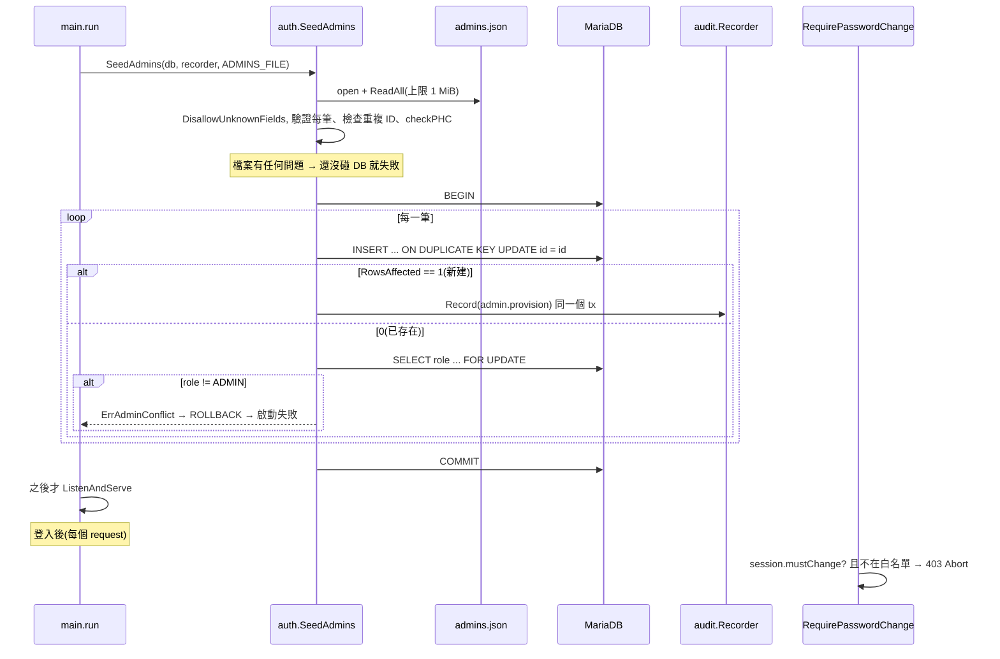

# Admin 由 Vault 檔案 seed 與首次登入強制改密碼 (ADM-004, AUTH-008)

## 一句話摘要
啟動時從 Vault 提供的 JSON 冪等建立 Admin 帳號,並強制這些帳號第一次登入先改密碼。

## 背景與目標
對應 PRD ADM-004、AUTH-008、R-01~R-04。Admin 只能經由 Vault 設定產生(R-03),應用程式沒有任何建立或升級 Admin 的 API。成功的定義:

- 檔案裡的 Admin 啟動後都存在,重啟不會覆蓋已存在帳號(包含 Admin 自己改過的密碼)。
- 檔案裡的 ID 若已是 Participant,啟動失敗並說明原因。
- 新 Admin 改密碼之前,除了 `/auth/me`、`/auth/password`、`/auth/logout`,所有 API 都回 `403 password_change_required`。

**不含**:從檔案移除 Admin、輪替 Admin 密碼(工程師手動處理,ADM-005)。

## 架構與資料流

## 程式碼導覽
| 檔案 | 職責 |
|---|---|
| `backend/internal/auth/seed.go:53` | `SeedAdmins`:先讀檔驗證,再用單一 transaction 逐筆 insert + audit |
| `backend/internal/auth/seed.go:41` | `ErrAdminConflict`:Participant 衝突的 sentinel error |
| `backend/internal/auth/seed.go:97` | `readAdminsFile`:大小上限、`DisallowUnknownFields`、重複 ID 檢查 |
| `backend/internal/auth/seed.go:137` | `validateAdminEntry`:ID、姓名、email、雜湊格式 |
| `backend/internal/auth/seed.go:160` | `insertAdminSQL`:`ON DUPLICATE KEY UPDATE id = id`,`must_change_password = TRUE` |
| `backend/internal/auth/seed.go:167` | `insertAdmin`:用 `RowsAffected()==1` 判斷是否新建 |
| `backend/internal/auth/seed.go:185` | `requireExistingAdmin`:`FOR UPDATE` 讀 role,非 ADMIN 就失敗 |
| `backend/internal/auth/password.go:97` | `parsePHC`:從原本的 `verifyPassword` 抽出,錯誤訊息不回顯輸入 |
| `backend/internal/auth/password.go:132` | `checkPHC`:salt/key 長度與 Argon2 參數上限 |
| `backend/internal/auth/forcechange.go:22` | `RequirePasswordChange` middleware |
| `backend/internal/auth/forcechange.go:34` | `passwordChangeAllowed`:白名單(method + path) |
| `backend/internal/auth/service.go:258` | 登入時把 `must_change_password` 複製進 session(`keyMustChange`) |
| `backend/internal/auth/account.go:97` | 改密碼成功後把 session 的旗標設回 false |
| `backend/cmd/server/main.go:72` | 啟動時呼叫 seed;失敗就 `return err` 讓程序結束 |
| `backend/cmd/server/main.go:98` | `router.Use(auth.RequirePasswordChange(sessions))`,在 CSRF 之後 |

## 設計決策與取捨
- **決策**:`INSERT ... ON DUPLICATE KEY UPDATE id = id`,一個 statement 完成「不存在才建」。
  - **替代方案**:先 `SELECT` 再 `INSERT`;或 `INSERT IGNORE`。
  - **理由**:SELECT-then-INSERT 在多實例同時啟動時有 race(都看到不存在,後者撞唯一索引報錯)。`INSERT IGNORE` 會把其他錯誤(資料過長、CHECK 失敗)也吞成 warning。`id = id` 是 no-op update,真正的錯誤仍會浮出來。
  - **代價**:要靠 `RowsAffected` 區分新建/已存在,這依賴驅動與 server 對 no-op update 回 0 的行為(見「找問題」)。
- **決策**:所有 entry 放同一個 transaction,衝突就整批 rollback。
  - **替代方案**:每筆各自一個 transaction,盡量多 seed。
  - **理由**:啟動失敗時不留下「只 seed 一半」的狀態,行為容易推論;ADM-004 要求衝突時啟動失敗。
  - **代價**:一筆壞資料擋住所有 Admin 的建立(這是刻意的)。
- **決策**:檔案先全部驗證完再開 DB;只收雜湊,未知欄位直接拒絕。
  - **替代方案**:收明文密碼在啟動時雜湊。
  - **理由**:Architecture 8.6 規定明文不進任何設定檔;`DisallowUnknownFields` 讓有人貼了 `"password"` 時立刻失敗,而不是被默默忽略。
  - **代價**:維運要先用 `cmd/hashpw` 產生雜湊。
- **決策**:`checkPHC` 限制 Argon2 參數(記憶體 ≤ 256 MiB、t ≤ 10、p ≤ 8)。
  - **理由**:檔案內容是外部輸入;打錯成很大的 `m` 會讓該帳號每次登入配置 GB 級記憶體(登入路徑上有 semaphore 但單次仍然很大)。
  - **代價**:合法但極端的參數會被拒絕。
- **決策**:強制改密碼的旗標複製進 session,middleware 不查 DB。
  - **替代方案**:每個 request 讀 `user` 表。
  - **理由**:閘門要套在**每個**路由上,不想多一次查詢;白名單(deny by default)讓之後新增的路由自動被擋。
  - **代價**:session 內的旗標可能落後 DB(見「找問題」)。ADR 0013。
- **決策**:seed 的 audit 沒有 actor。
  - **理由**:這是系統動作,沒有 request 也沒有使用者;`audit.Entry` 本來就允許空 actor。

## 邊界情況與失敗處理
- 檔案不存在、不是 JSON 陣列、尾巴有多餘資料、超過 1 MiB:啟動失敗,錯誤訊息只含路徑與結構資訊。
- 空陣列 `[]`:合法,只開關一個空 transaction。
- 同一個 ID 出現兩次:讀檔階段就失敗(否則第二次會被當成「已存在」而過關,掩蓋檔案錯誤)。
- 帳號在 insert 和 `SELECT role` 之間被刪:回錯誤而不是猜測(`seed.go:185` 的 `sql.ErrNoRows` 分支)。
- Audit 寫入失敗:整個 transaction rollback,啟動失敗(帳號與 audit 同生共死,Architecture 5.3)。
- 兩個實例同時啟動:後到的 insert 會在唯一索引的鎖上等到先到的 commit,然後看到 0 rows、驗證 role 為 ADMIN、略過。
- 被閘門擋住的 session 呼叫 `PATCH /auth/me`:`403 password_change_required`。改密碼成功後同一個 session 立刻解鎖,不必重新登入,但 CSRF token 已輪替(ADR 0018)。
- 改密碼後其他 session:由 `credential_version` 失效(ADR 0019),不靠旗標。

## 已知落差
- ADR 0013 狀態是 **Proposed**,還沒有 Architect 確認。
- `openapi.yaml` 還沒記載新的 `403 password_change_required` 回應(尚未重新產生程式碼)。
- 閘門的白名單路徑硬寫 `/api/v1/auth/...`,和 `main.go` 的 `apiBase` 是兩份來源。
- 工程師直接在 DB 把某人設成 `must_change_password` 時,對已登入的 session 不會生效,要等下次登入。
- 旗標只存在 session 與 DB 兩處,沒有 API 可讓 Admin 以外的人查詢;前端是否根據 `mustChangePassword` 導向改密碼頁,不在這次範圍(待確認)。

## 面試考題

### 基礎

::: details Q1. 啟動時 Admin 是怎麼被建立的?如果重啟一次會發生什麼?
**出處**:`backend/internal/auth/seed.go:53`、`seed.go:160`

**參考答案**
`main.run` 在 DB ping 之後、開始 listen 之前呼叫 `SeedAdmins`。它先讀 `ADMINS_FILE` 並完整驗證,再開一個 transaction,每筆執行 `INSERT ... ON DUPLICATE KEY UPDATE id = id`。新建的帳號 `must_change_password = TRUE`、`department = NULL`、role 為 ADMIN,並在同一個 transaction 寫 `admin.provision` audit。重啟時所有 ID 都已存在,`RowsAffected` 為 0,不會寫任何東西,也不會覆蓋雜湊,所以 Admin 改過的密碼會保留。

**可能的追問**
- 為什麼不是 `REPLACE INTO`?(會刪掉再插入,改 `id`、洗掉密碼與 `credential_version`。)
- 為什麼是啟動時而不是 migration?(Architecture 7.5:migration 不放帳號資料。)

**考察點**:idempotency、對 SQL upsert 語意的理解
:::

::: details Q2. `RequirePasswordChange` 怎麼決定放行或擋下?
**出處**:`backend/internal/auth/forcechange.go:22`、`forcechange.go:34`

**參考答案**
它從 session 讀 `mustChange`。沒有旗標就 `c.Next()`;有旗標則只有 `GET /auth/me`、`POST /auth/password`、`POST /auth/logout` 放行,其餘寫 `403 password_change_required` 並 `c.Abort()`。旗標在 `Login` 時由 DB 的 `must_change_password` 複製進 session(`service.go:258`),`ChangePassword` 成功後設為 false(`account.go:97`)。

**可能的追問**
- 為什麼白名單包含 `/auth/me`?(SPA 要靠它知道 `mustChangePassword`。)
- middleware 為什麼要放在 CSRF 之後?

**考察點**:middleware 順序、deny by default
:::

### 進階

::: details 🔥 Q3. 兩個實例同時啟動、檔案相同,為什麼不會出錯?什麼情況會出問題?
**出處**:`backend/internal/auth/seed.go:60`、`seed.go:160`

**參考答案**
`user.employee_id` 有唯一索引。實例 A 的 insert 先拿到索引鍵的鎖,實例 B 的同一筆 insert 會等待到 A commit 或 rollback。A commit 後,B 的 `ON DUPLICATE KEY UPDATE id = id` 走 update 分支且沒有實際變更,回 0 rows;B 再用 `SELECT role ... FOR UPDATE` 確認它是 ADMIN 然後略過。因為兩邊用檔案的同一個順序鎖,不會形成環。若不同實例拿到**不同順序**的檔案(滾動更新中檔案內容不同),理論上可能 deadlock,InnoDB 會殺掉其中一個,該實例啟動失敗,重試即可。

**可能的追問**
- 這個設計能防止兩個實例各自 seed 不同檔案的結果不一致嗎?(不能,也不該;Vault 是單一來源。)
- deadlock 時 `WithTx` 會重試嗎?(不會,直接回錯誤。)

**考察點**:transaction、lock、race condition
:::

::: details Q4. 為什麼用 `RowsAffected()==1` 判斷新建,而且為什麼要再查一次 role?
**出處**:`backend/internal/auth/seed.go:167`、`seed.go:185`

**參考答案**
MySQL/MariaDB 對 upsert 的回傳值:新建是 1、真的更新是 2、no-op update 是 0(預設沒有 `clientFoundRows`)。因為 update 分支是 `id = id`,已存在就是 0,可以當「已存在」訊號。但「已存在」不等於「已是 Admin」:同一個 ID 可能是 Participant(R-04),所以要 `SELECT role ... FOR UPDATE` 驗證,是 Participant 就回 `ErrAdminConflict` 讓啟動失敗。`FOR UPDATE` 是為了在 transaction 結束前鎖住該列,答案不會再變。

**可能的追問**
- 如果 DSN 加了 `clientFoundRows=true` 會怎樣?(見 Q7。)
- 為什麼 role 不直接放進 upsert 的 update 分支檢查?

**考察點**:對資料庫語意的細節掌握、防禦性檢查
:::

::: details Q5. 為什麼讀檔階段要 `DisallowUnknownFields`,又為什麼要 `checkPHC`?
**出處**:`backend/internal/auth/seed.go:112`、`backend/internal/auth/password.go:132`

**參考答案**
兩者都是對「外部輸入」的防線。`DisallowUnknownFields` 讓誤貼的 `"password": "..."` 讓整個檔案失敗,而不是被忽略後帳號帶著無法使用的雜湊上線。`checkPHC` 要求格式是 Argon2id、salt ≥ 8 bytes、key ≥ 16 bytes、參數在界線內;否則錯誤的雜湊(例如把明文貼進 `passwordHash`)會變成永遠登不進去的帳號,而過大的 `m` 會讓每次登入配置巨量記憶體。錯誤訊息不回顯值,避免把祕密寫進 log。

**考察點**:輸入驗證、secrets 處理、資源耗盡
:::

### 設計/情境

::: details Q6. 需求變成「可以從檔案停用/移除 Admin」,要改哪裡?怎麼確保安全?
**出處**:`backend/internal/auth/seed.go:53`、PRD ADM-005

**參考答案**
目前 seed 只增不減,是刻意的(ADM-005 不提供管理功能,ADR 0013 的 Consequences)。若要支援,需要:新增 `disabled_at`(或刪除)欄位及 migration;seed 對檔案中不存在的 Admin 設 disabled,並同時 bump `credential_version` 讓既有 session 失效(ADR 0019);登入與 `sessionUser` 要檢查 disabled。風險是「檔案打錯或 Vault 暫時給空檔」會把所有 Admin 停用,所以要加護欄:空檔視為錯誤、一次最多停用幾個、並且先 audit。驗證:對應的 sqlmock/整合測試加上「空檔不會停用」與「session 在下一次 request 被拒」。

**可能的追問**
- 流量放大 10 倍影響嗎?(不影響,seed 只在啟動時跑一次。)

**考察點**:需求變更的影響分析、fail-safe 設計
:::

::: details Q7. 如何驗證強制改密碼真的擋得住,而不是只有前端導頁?
**出處**:`backend/internal/auth/seed_test.go:165`、`seed_test.go:183`

**參考答案**
閘門在後端 middleware,測試用整個 router(含 scs、CSRF)走完整流程:以 Admin 登入拿到 session,對 `PATCH /auth/me` 預期 `403 password_change_required`,`GET /auth/me` 仍回 `mustChangePassword:true`,`logout` 回 204。另一個測試改密碼成功後,用**同一個** session 與輪替後的 CSRF token 呼叫 `PATCH /auth/me` 預期 200。再加一個「沒有旗標的 session 完全不受影響」的對照測試。尚缺的是對 `main.go` 組裝順序的測試(middleware 有沒有真的掛上),可以用一個啟動 router 的整合測試補上。

**考察點**:可測試性、黑箱與白箱測試取捨
:::

### 找問題

::: details 🔥 Q8. 這段程式碼有什麼潛在問題?
**出處**:`backend/internal/auth/seed.go:167`、`backend/internal/platform/config.go:56`、`backend/internal/auth/service.go:258`

**問題**:
1. **`RowsAffected()==1` 依賴 DSN 沒有 `clientFoundRows=true`**。如果有人之後在 DSN 加上它,no-op update 也會回 1,「已存在」會被誤判為「新建」,Participant 衝突檢查被跳過,同時還會重複寫 audit。目前 DSN(`config.go:56`)沒有設定,所以不是現存的 bug,但是個沒有被測試鎖住的隱性耦合。
2. **session 內旗標可能落後 DB**。工程師在 DB 設 `must_change_password` 對已登入的 session 不生效;反方向,若 DB 的旗標被清掉,舊 session 仍被擋到登出(只有改密碼會清)。
3. **滾動更新時的 deadlock**(Q3):不同順序的檔案下 InnoDB 可能殺掉其中一個 transaction,而 `SeedAdmins` 不重試,該實例啟動失敗。
4. **白名單硬寫 `/api/v1`**:`apiBase` 改了,閘門會變成全部擋住(fail closed,安全但會讓 Admin 無法登出/改密碼)。

**如何修**:(1) 不要依賴 affected rows:改成先 `SELECT ... FOR UPDATE` 或在 insert 後用 `SELECT role` 比對,或在 DSN 的測試中加斷言;(2) 需要時改成每個 request 讀旗標,或在工程師程序中同時 bump `credential_version`;(3) 對 deadlock 錯誤(1213)做有限次重試;(4) 把 `apiBase` 傳進 middleware。

**如何驗證**:(1) 單元測試斷言 `DBConfig.DSN()` 不含 `clientFoundRows`,或在實際 MariaDB(testcontainers)測試重啟為 no-op;(2) 整合測試模擬 DB 旗標變更;(3) 並行啟動兩個 `SeedAdmins` 的整合測試;(4) 路徑常數化後的表驅動測試。
:::

## 三分鐘口頭說明稿
PRD 規定 Admin 只能由 Vault 產生,應用程式不能有建立或升級 Admin 的入口。所以我在啟動時讀 Vault 渲染的 `admins.json`,用 `auth.SeedAdmins` 把裡面的帳號建起來。

做法有幾個重點。第一,檔案先驗證完才碰資料庫:只接受 Argon2id 雜湊、拒絕未知欄位,避免有人貼明文密碼;雜湊參數也設上限,避免打錯變成資源耗盡。第二,寫入用 `INSERT ... ON DUPLICATE KEY UPDATE id = id`,讓多個實例同時啟動也安全,而且已存在的帳號絕對不會被覆蓋,Admin 自己改過的密碼重啟後還在。第三,全部放在同一個 transaction,新建的帳號同時寫 audit;如果某個 ID 已經是 Participant,就整批 rollback 並讓啟動失敗,因為 R-04 規定一個工號不能同時是兩種角色。

強制改密碼這部分,新帳號的 `must_change_password` 是 TRUE,登入時把旗標放進 session,再用一個 middleware 做 deny-by-default 的白名單:只允許看自己、改密碼、登出。這樣之後新增的路由自動被擋,而且不需要每個 request 查 DB。改密碼成功後旗標清掉,其他 session 靠 `credential_version` 失效。

取捨是:用 `RowsAffected` 判斷是否新建,依賴驅動設定,是我最想補測試鎖住的地方;session 內的旗標也可能比 DB 慢一步。結果是 auth 套件覆蓋率約 93%,涵蓋 seed 的建立、冪等、衝突、壞檔案,以及閘門的封鎖與解鎖。
